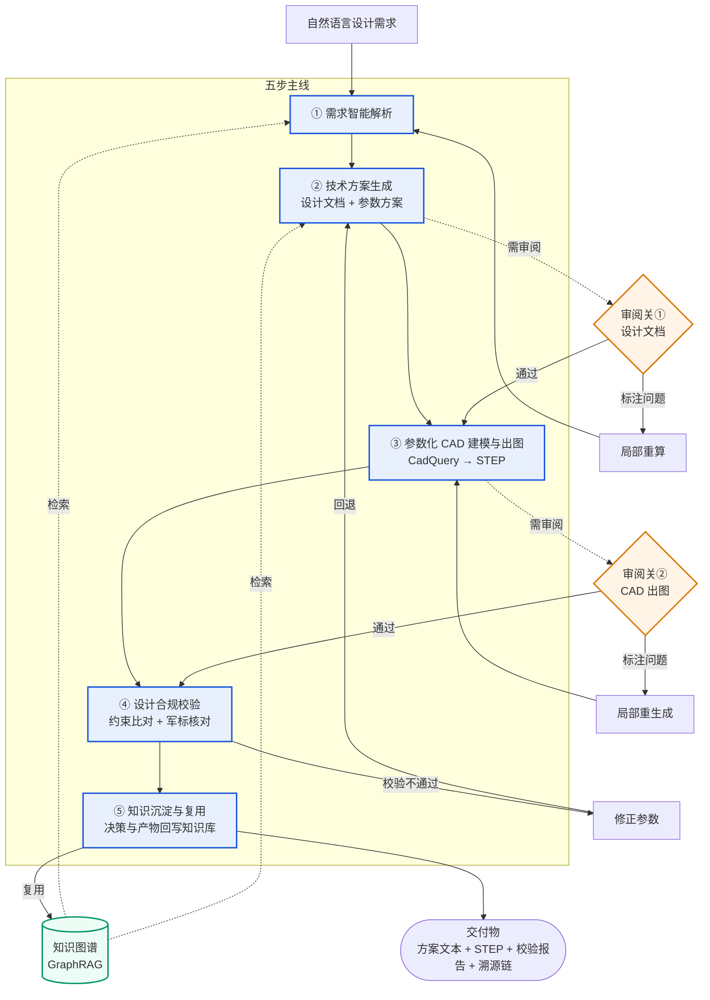
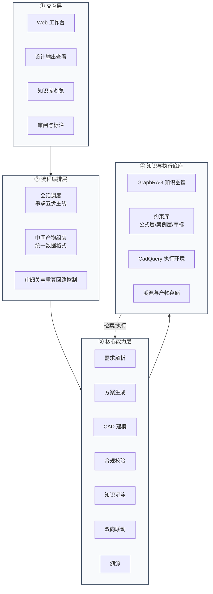
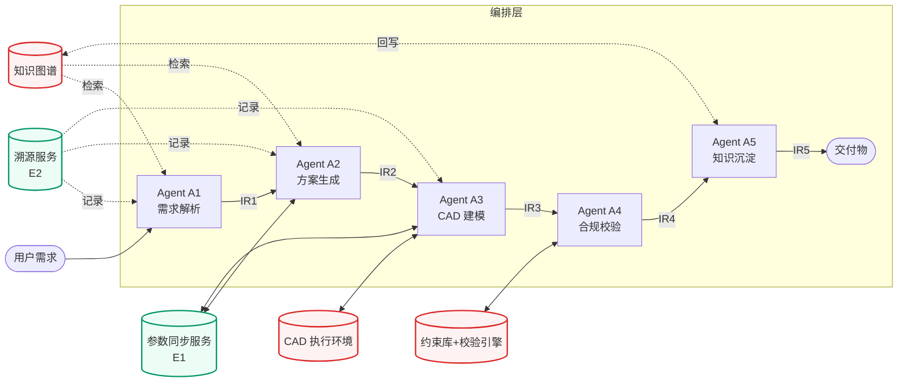
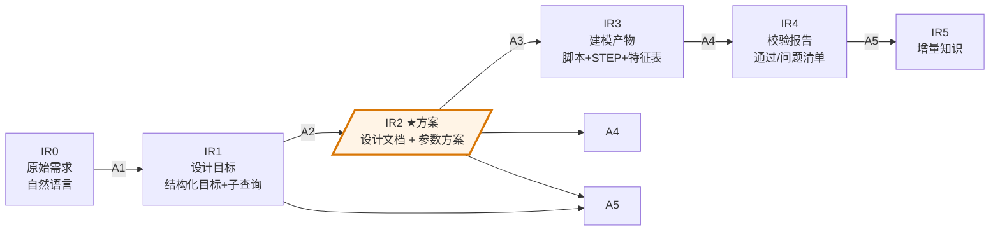
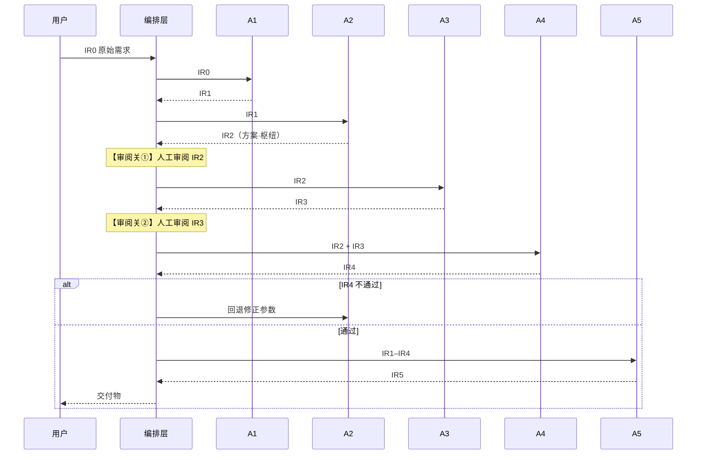

# 声呐装备智能辅助设计系统 · 设计方案


| 文档版本 | v1.2 |
|---|---|
| 文档类型 | 总体设计 + Agent 架构设计 |
| 编制日期 | 2026-06 |
|          |                           |

# 1  系统定位与价值边界

## 1.1  要解决的问题

声呐装备设计是一项长链路工程：从战术使命与探测需求，到总体方案、结构参数、零部件三维建模，再到出图与合规核对。该链路长期存在三方面问题：

| 问题 | 表现 | 后果 |
|---|---|---|
| 链路冗长、人工传递损耗大 | 需求、方案、图纸在不同人员与工具之间手工传递 | 信息失真、返工频繁、周期延长 |
| 知识难以复用 | 成熟设计案例、公式、经验值分散于文档与个人经验 | 新型号需从零起步，重复出现问题 |
| 合规难以落地 | 设计约束（几何、声学、军用标准）依赖人工核对 | 易漏检，问题往往滞后暴露 |

## 1.2  系统能力定位与边界

为避免产生歧义，首先界定系统的能力范围与边界。

本系统是：一套面向声呐装备设计全流程的智能辅助系统，以参数化 CAD 设计为核心，通过知识图谱增强检索为设计提供可计算的依据，自动生成方案文本与标准化 CAD 文件，并实施合规校验、将设计经验沉淀回知识库。

本系统不是：

不是通用 CAD 软件（不替代 Catia/SolidWorks，而是产出可被其打开的 STEP 标准文件）；

不是纯文档检索系统（检索仅为手段，最终输出为可执行的 CAD 模型）；

不是脱离人工决策的自动设计机（关键节点保留人工审阅把关）。

## 1.3  总体目标

以参数化 CAD 设计为核心，深度集成知识图谱增强检索，实现“需求智能解析 → 技术方案生成 → 参数化 CAD 建模出图 → 设计合规校验 → 知识沉淀复用”的全流程闭环，最终同步输出符合军用标准的专业声呐设计方案文本与标准化参数化 CAD 文件，支持设计参数双向联动与全链路溯源。

## 1.4  当前实现基线

当前项目原型已端到端跑通的核心链路为一条**三阶段流水线**（需求理解与检索 → 参数化建模脚本生成 → 执行出图与自动修复）；五 Agent 编排、IR 数据契约、合规校验、知识沉淀及三项增强能力（E1–E3）属于本期及远期的演进目标。

```
设计需求
  → ① 知识检索 + 设计文档生成
  → ② 参数化建模（CadQuery）脚本生成
  → ③ 执行出图 + 自动修复（含失败重试）
  → 交付物：STEP 三维模型 + 设计文档
```

| 原型已验证 | 演进目标（尚未实现） |
|---|---|
| ① 需求要素抽取 + 多路并行检索 | 合规校验（约束引擎、等式 / 区间分流） |
| ② 检索结果整合为设计文档 | 知识沉淀（设计决策回写知识库） |
| ③ 参考范例匹配 + 建模脚本生成 | 参数双向联动 |
| ④ 多层静态校验（语法 / 完整性 / 建模模式 + 自动修复） | 全链路溯源 |
| ⑤ 脚本执行 + STEP 导出 + 失败修复循环 | 人在回路（两道审阅关、局部回算） |
| ⑥ 知识图谱构建（单案例） | 结构化参数方案表（带来源与溯源字段） |
|  | 创新三道关中的"算准 / 算完查"（依赖合规校验引擎） |

# 2  系统总览

## 2.1  端到端流程

下图展示系统的主干流程：五步主线串联起从需求解析到知识沉淀的闭环，并叠加两个人工审阅关与若干回写及重算回路。



图 2-1  系统端到端流程：五步主线 + 两道审阅关 + 知识闭环

图片说明：

主线自上而下呈线性串联，清晰呈现系统所承担的整体职能。

两个审阅关即人在回路机制：分别设于设计文档生成之后与 CAD 出图之后，未通过时进行局部回算，无需重跑整条流程。

知识图谱既支持检索（虚线），也支持回写（实线），二者共同构成闭环。

## 2.2  能力总览（八大能力）

| 编号 | 能力 | 职责概述 |
|---|---|---|
| C1 | 设计需求智能解析 | 将自然语言需求解析为结构化设计目标与子查询 |
| C2 | 技术方案自动生成 | 基于知识检索，生成设计文档与参数方案 |
| C3 | 参数化 CAD 建模与出图 | 由参数方案生成 CadQuery 脚本并产出 STEP |
| C4 | 设计合规校验 | 核对参数是否满足约束、公式与军用标准 |
| C5 | 知识沉淀与复用 | 将设计决策与产物回写知识库 |
| E1 | 参数双向联动 | 文档参数与 CAD 特征双向自动同步 |
| E2 | 全链路溯源 | 任一参数均可追溯至知识来源与计算依据 |
| E3 | 人在回路（关键节点把关） | 两道审阅关与局部重算机制 |

说明：C1–C5 为五步主线能力；E1–E3 为贯穿全流程的增强能力。

## 2.3  三态阶段总览表

| 能力/模块 | 【实现情况】 | 【本期扩展】 | 【远期规划】 |
|---|---|---|---|
| C1 需求解析 | LLM 拆子查询、并行检索 | 同左，强化目标结构化 | 自然语言多轮需求澄清 |
| C2 方案生成 | LLM 整合知识为设计文档 | 参数方案可计算、带出处 | 多方案比选 |
| C3 参数化 CAD | CadQuery 生成 + STEP + 自动修复 | 增加生成前后双校验 | 多型号模板库 |
| C4 合规校验 | 仅校验“代码跑不跑” | 校验“参数合不合理”（约束+军标接入框架） | 全量军标合规 |
| C5 知识沉淀 | 无 | 设计决策/产物回写知识库 | 自动知识蒸馏 |
| E1 双向联动 | 无 | 文档参数 ↔ CAD 双向同步 | 可视化拖拽联动 |
| E2 溯源 | 无 | 参数→知识→依据→特征链 | 设计谱系可视化 |
| E3 人在回路 | 全自动跑通 | 两道审阅关 + 局部重算 | 协同标注平台 |
| 知识库 | 307 实体/371 边（单案例） | 公式可算、约束分层、军标接入 | 多声呐类型覆盖 |
| 创新点 | 无 | 约束网络冲突推理与合规校验引擎 | 修复策略自学习 |

## 2.4  概念落地对照表（目标架构 ↔ 当前 demo）

一表索引全文关键概念在当前原型中的实现状态，供评审快速核对。**本表为单一事实源**，与各章正文若有口径出入，以本表为准。

| 概念 | 实现说明 |
|---|---|
| C1 需求解析·子查询规划 | 按声呐设计要素抽取目标并规划检索查询 |
| C1 多查询并行检索 | 多路查询并发执行，避免单次检索遗漏 |
| C1 充分性判定与定向补查 | 设计目标：检索后结构化判定证据覆盖、缺口处补查一轮；原型期暂以单轮并行检索覆盖 |
| C2 设计文档生成 | 整合检索结果为结构化设计文档（文本形式） |
| C2 结构化参数表（IR2） | 来源 / 可信度 / 溯源字段尚未结构化 |
| C3 参考范例匹配 | 按声呐类型从范例库匹配建模范例 |
| C3 建模脚本生成 | 基于范例与参数生成 CadQuery 脚本 |
| C3 多层静态校验 | 语法 / 完整性 / 建模模式校验 + 自动修复 |
| C3 执行 + STEP 导出 | 运行脚本生成 STEP（含导出补救） |
| C3 失败修复循环 | 执行失败由模型修复并重试，设次数上限 |
| C3 物理约束双校验（"算完查"） | 当前为语法与结构级静态校验，非物理 + 几何约束校验 |
| C4 合规校验 | 演进目标，尚未实现 |
| C5 知识沉淀 | 演进目标，尚未实现 |
| E1 参数双向联动 | 尚未实现 |
| E2 全链路溯源 | 溯源字段尚未落地 |
| E3 人在回路·审阅关 | 当前为全自动流程，无暂停—裁决节点 |
| IR0–IR5 中间表示 | 当前阶段间以非结构化文本传递 |
| 流程编排 | 已实现固定顺序串联；局部回环 / 版本管理待建 |
| 知识图谱 | 基于 GraphRAG 构建，单案例（约 307 实体 / 371 边 / 82 社区） |
| 工程化技术栈（前后端分离、消息队列、专用数据库等） | 当前为单页应用形态，工程化部署为演进目标 |

# 3  全流程设计

本章沿 2.1 的主线，逐一阐述五个步骤。每步统一按四个维度组织：职责 / 输入→输出 / 关键方法 / 阶段标注。

## 3.1  设计需求智能解析 〈C1〉

| 项 | 内容 |
|---|---|
| 职责 | 将自然语言需求（如“设计一套 32 阵元、工作深度 300m 的拖曳线列阵”），解析为结构化的设计目标，并规划若干条向知识库提问的子查询。 |
| 输入→输出 | 自然语言需求 → 结构化设计目标 + 4~8 条子查询 + 检索证据集 |
| 关键方法 | ① LLM 按声呐设计要素（声阵规模、工作深度、频段、拖曳方式等）抽取目标；② LLM 将目标转化为多条精确检索查询；③ 两段式检索：先多查询并发检索（覆盖公式 / 案例 / 标准 / 经验四类来源），再以结构化清单判定各参数维度的证据是否充分，仅对覆盖缺口发起至多一轮定向补查。 |
| 边界 | 仅承担理解与拆解职能，不推导几何参数、不直接生成 CAD。几何与数值交由后续步骤处理。 |

## 3.2  技术方案自动生成 〈C2〉

| 项 | 内容 |
|---|---|
| 职责 | 综合知识库检索结果，生成技术方案。 |
| “方案”的明确定义 | 方案 = 设计文档（总体描述、分段结构、关键指标、材料、配色等）+ 参数方案（一组带出处的设计参数值）。CAD 代码是参数方案的可执行产物，不等于方案本身。 |
| 输入→输出 | 检索证据集 → 设计文档（.md）+ 参数方案 |
| 关键方法 | ① LLM 将多路检索结果整合为结构化设计文档；② 参数方案区分两类来源——公式类参数（如长度=段数×间距）由计算得出、案例类参数（如外径阈值）标注为经验值，每个参数均标注出处。 |

## 3.3  参数化 CAD 建模与出图 〈C3〉

| 项 | 内容 |
|---|---|
| 职责 | 将参数方案转化为可运行的 CadQuery 脚本，执行后产出工业标准 STEP 三维模型。 |
| 输入→输出 | 参数方案 + 设计文档 → CadQuery 脚本（.py）→ STEP 三维模型（.step） |
| 关键方法 | ① 按声呐类型从参考代码库智能匹配范例；② LLM 基于范例与参数方案生成脚本；③ 多层校验（语法→完整性→关键建模模式）+ 自动修复已知问题；④ 执行脚本生成 STEP，失败则由 LLM 修复，最多重试 3 次。 |
| 建模特征 | 采用 z 游标（z-cursor）顺序装配各段，柔性段以样条+扫掠+sin² 轨迹生成，空心管经内外扫掠相减获得——支持整套多段声呐装配，而非单零件。 |

## 3.4  设计合规校验 〈C4〉

| 项 | 内容 |
|---|---|
| 职责 | 校验所求得的参数是否合理，即是否满足知识库中的约束、公式与军用标准。 |
| 输入→输出 | 参数方案 + CAD 特征 → 合规校验报告（通过/不通过 + 问题清单） |
| 关键方法 | 知识图谱中的公式边（COMPUTED_BY）与约束边（CONSTRAINED_BY）共同构成一张**约束网络（Constraint Network）**——参数为节点、公式与约束为边。校验时 ① 按边类型分层求解：等式边（如长度=段数×间距）做等式校验、范围边（如外径≤27mm）做区间校验；② 以**约束传播算法**沿网络正向推断冲突，前置诊断"改 A 是否违反 B"，而非被动逐条核对；③ 军用标准经接入框架核对（见 6.3）；④ 未通过则回退至 3.2 修正参数。 |
| 边界 | 校验仅产出结构化报告、暴露问题，不擅自修改参数——参数修改交回方案生成步骤。 |

## 3.5  知识沉淀与复用 〈C5〉

| 项 | 内容 |
|---|---|
| 职责 | 将一次成功设计中的决策与产物回写至知识库，供后续设计复用，使系统具备持续累积能力。 |
| 输入→输出 | 本次设计过程与产物 → 增量知识（新参数关系、新案例、新约束经验） |
| 关键方法 | ① 记录各参数的取值方式与依据（与 E2 溯源共用链路）；② 经审阅确认后，将稳定、可复用的部分回写至知识图谱；③ 下次同类需求可直接检索复用。 |
| 边界 | 回写需经人工确认，避免将一次性、错误的决策污染知识库。 |

# 4  系统架构与 Agent 设计

第 3 章为流程视角（按时间顺序），本章为结构视角（按职责分层与软件单元）。两章描述同一系统，仅观察角度不同。本章先阐述四层架构与模块边界，再将各能力落地为具体的 Agent，并给出 Agent 之间的数据契约与编排控制流。

## 4.1  四层架构



图 4-1  系统四层架构

各层职责简述：

交互层：提供人机交互入口（输入需求、查看产物、审阅标注）。

流程编排层：按既定方式串联五步主线，管理审阅关与回算，承担调度职责，不承担具体业务实现。

核心能力层：八个能力模块的具体实现所在。

知识与执行底座：知识图谱、约束库、CAD 执行环境、产物与溯源存储，供上层调用。

## 4.2  模块职责边界

本表采用正向四列表述：承担职责 / 不承担职责 / 输入 / 输出，避免否定式表述导致的边界含糊。

| 模块 | 承担职责 | 不承担职责 | 输入 | 输出 |
|---|---|---|---|---|
| 需求解析 C1 | 解析需求、规划子查询 | 不推导几何参数、不生成 CAD | 自然语言需求 | 设计目标+子查询 |
| 方案生成 C2 | 综合知识生成方案 | 不求解复杂隐式方程 | 检索结果 | 设计文档+参数方案 |
| CAD 建模 C3 | 生成脚本、产出 STEP | 不擅自改参数，严格继承参数方案 | 参数方案 | 脚本+STEP |
| 合规校验 C4 | 比对约束、出具报告 | 不直接修改参数 | 参数方案+CAD特征 | 校验报告 |
| 知识沉淀 C5 | 回写可复用知识 | 不回写未经验证的决策 | 设计过程与产物 | 增量知识 |
| 流程编排 | 串联步骤、组装中间产物、管理回算 | 不替代能力模块做业务决策 | 用户请求 | 执行序列 |

## 4.3  Agent 总览

总体设计中的各项“能力”，在本文中分别对应一个“Agent”或一项“横切服务”。能力之间的流程顺序，体现为 Agent 之间的数据契约（IR）与编排控制流。

设计原则：

一能力一 Agent：每个主线能力由一个专职 Agent 承担，职责单一、边界清晰。

固定管线，而非自由协商：五个主线 Agent 按既定顺序串联，由编排层调度。

Agent 之间不直接互调：仅通过中间表示（IR）经编排层传递，可独立开发、测试与替换。

横切能力不单独成 Agent：双向联动、溯源、人在回路以服务方式集成。



图 4-2  Agent 拓扑：五个主线 Agent（固定管线）+ 横切服务 + 底座

| Agent | 对应能力 | 职责概述 | 输入 IR | 输出 IR |
|---|---|---|---|---|
| A1 需求解析 | C1 | 自然语言需求 → 结构化目标 + 检索子查询 | IR0 | IR1 设计目标 |
| A2 方案生成 | C2 | 检索结果 → 设计文档 + 参数方案 | IR1 | IR2 方案（核心） |
| A3 CAD 建模 | C3 | 参数方案 → CadQuery 脚本 + STEP 模型 | IR2 | IR3 建模产物 |
| A4 合规校验 | C4 | 参数 + 特征 → 校验报告 | IR2+IR3 | IR4 校验报告 |
| A5 知识沉淀 | C5 | 设计过程与产物 → 增量知识 | IR1–IR4 | IR5 增量知识 |

## 4.4  Agent 间数据契约（IR）（暂定）

Agent 之间通过“中间表示”（Intermediate Representation，简称 IR）传递数据。每个 Agent 均有明确的输入 IR 与输出 IR，互不越界。



图 4-3  IR 流转：IR0→IR1→IR2（枢纽）→IR3→IR4→IR5

说明：A4（合规校验）同时消费 IR2 与 IR3——其既需校验参数方案是否满足约束，也需校验 CAD 特征是否几何自洽。A5（知识沉淀）则消费前序全部 IR。

### 4.4.1  核心 IR：参数方案（IR2）

参数方案是 A2 的输出，A3/A4/A5 的输入，是全系统最关键的中间表示。其设计直接承载了论文创新点“能算→算准”——每个参数均标注其取值来源。参数方案 = 设计文档 + 参数表，其中参数表各参数的结构如下：

| 字段 | 含义 | 示例 |
|---|---|---|
| id | 参数唯一标识 | P-014 |
| name | 参数名 | 声阵段外径 |
| value + unit | 取值与单位 | 27 mm |
| source_type | 来源类型 | formula / case / standard / estimated |
| source_ref | 来源引用 | 公式编号 / 知识条目 ID / GJB 条目 |
| derivation | 取值依据 | 公式类：计算过程；案例类：引用说明 |
| confidence | 可信度 | high / medium / low |
| trace_id | 溯源链 ID（挂接 E2） | T-0042 |
| dependencies | 该参数依赖的上游参数（挂接 E1） | [P-007, P-009] |
| dependents | 依赖该参数的下游参数（挂接 E1） | [P-021] |

> 字段权威性：本表为参数方案字段的**单一事实源**。其中 `confidence` 枚举（high / medium / low）、《系统实施方案》§2.2 IR2 定义、§3.3 `parameter_schemes` 表、§4.2 前端参数表组件均以本表为准，跨文档口径统一；`dependencies`/`dependents` 为 E1 双向联动构建依赖图的唯一数据来源。

source_type 为关键字段——其将参数划分为四类，并决定下游对该参数的处理方式：

| source_type | 含义 | 下游处理 |
|---|---|---|
| formula | 由物理/数学公式算出（如 长度=段数×间距） | A4 进行等式校验，可信度高 |
| case | 引自工程案例经验值（如 外径≤27mm） | A4 进行区间校验，可信度中 |
| standard | 引自军用标准 | A4 进行强制符合性核对 |
| estimated | 大模型在约束区间内提议 | 须标注依据，A4 予以重点复核 |

> 该表对应 6.2 约束分层：formula/standard 属公式层，case 属案例阈值层，estimated 是允许大模型介入的明确出口——此处将该出口显式化、可审计，消解了旧文档“严禁 LLM 取值”与“LLM 估算”之间的矛盾。

### 4.4.2  其它 IR 简表

| IR | 产出 Agent | 核心字段 |
|---|---|---|
| IR0 原始需求 | （用户） | 原始自然语言文本 |
| IR1 设计目标 | A1 | 结构化目标（声阵规模/深度/频段…）+ 检索子查询列表 + 检索证据集 |
| IR2 方案 | A2 | 设计文档（.md）+ 参数方案表（见 4.4.1） |
| IR3 建模产物 | A3 | CadQuery 脚本 + STEP 文件 + 特征参数表（各段尺寸/位置） |
| IR4 校验报告 | A4 | 总体结论（通过/不通过）+ 逐条问题清单 |
| IR5 增量知识 | A5 | 待回写的知识条目 + 回写状态 |

## 4.5  五个主线 Agent 详解

每个 Agent 按统一契约描述：职责 / 输入 IR / 输出 IR / 内部子步骤 / 边界 / 协作。

### 4.5.1  Agent A1 · 需求解析（C1）

| 项 | 内容 |
|---|---|
| 职责 | 将自然语言需求解析为结构化的设计目标，并规划若干条向知识库提问的子查询。 |
| 输入 / 输出 | IR0（原始需求）→ IR1（设计目标 + 子查询列表 + 检索证据集） |
| 内部子步骤 | ① 要素抽取：按声呐设计要素从需求中抽取显式目标，并标记缺失项；② 子查询规划：将目标转化为 4~8 条精确检索查询；③ 两段式检索：先多查询并发检索知识图谱（覆盖公式 / 案例 / 标准 / 经验四类来源），再以结构化清单判定各参数维度的证据是否充分，仅对覆盖缺口发起至多一轮定向补查——以确定性判定替代自由推理，保证检索路径可复现、上下文与延迟可控。 |
| 边界 | 仅承担理解与拆解职能，不推导几何参数、不赋数值、不生成 CAD。缺失项如实标记，不予臆造。 |
| 协作 | 向知识图谱发起检索；输出 IR1 交付 A2。 |

### 4.5.2  Agent A2 · 方案生成（C2）

| 项 | 内容 |
|---|---|
| 职责 | 综合检索结果，生成设计文档与参数方案。 |
| 输入 / 输出 | IR1（设计目标 + 检索证据集）→ IR2（设计文档 + 参数方案表，每参数带 source_type） |
| 内部子步骤 | ① 文档整合：将多路检索结果组织为结构化设计文档；② 参数定值：逐个参数确定取值——公式类由计算得出并附过程，案例类引用经验值，标准类引用军标，估计类标注依据；③ 挂接溯源：每个参数分配 trace_id，接入 E2。 |
| 边界 | 不求解复杂隐式方程（交由底座校验引擎处理）；不直接编写 CAD 代码（交由 A3）。其产物为“带出处的参数表”，而非图纸。 |
| 协作 | IR2 是 A3、A4、A5 的共同输入；A2 是双向联动（E1）的主要一端。 |

### 4.5.3  Agent A3 · CAD 建模（C3）

| 项 | 内容 |
|---|---|
| 职责 | 将参数方案转化为可运行的 CadQuery 脚本，执行后产出 STEP 三维模型。 |
| 输入 / 输出 | IR2（参数方案 + 设计文档）→ IR3（CadQuery 脚本 + STEP + 特征参数表） |
| 内部子步骤 | ① 范例匹配：按声呐类型从参考代码库匹配建模范例；② 脚本生成：基于范例与参数方案生成脚本；③ 静态校验：语法→完整性→关键建模模式；④ 执行出图：运行脚本生成 STEP，失败则修复并设次数上限。 |
| 边界 | 严格继承 IR2 的参数值，不擅自改数——若发现参数矛盾，抛回 A2，不自行调整。 |
| 协作 | 消费 IR2；产出 IR3 供 A4 校验；为双向联动（E1）的另一端。 |

### 4.5.4  Agent A4 · 合规校验（C4）

| 项 | 内容 |
|---|---|
| 职责 | 校验参数与 CAD 特征是否满足约束、公式与军用标准。 |
| 输入 / 输出 | IR2（参数方案）+ IR3（建模产物/特征表）→ IR4（校验报告） |
| 内部子步骤 | ① 分流校验：按 source_type 分流——formula/standard 进行等式与符合性校验，case 进行区间校验，estimated 予以重点复核；② 几何自洽：检查 CAD 特征层（段长累加=总长、Z 轴连续、无干涉）；③ 军标核对：经接入框架逐条比对；④ 汇总报告：通过/不通过 + 问题清单。 |
| 边界 | 仅出具报告，不修改参数。发现问题抛回 A2 修正，不越权改值。 |
| 协作 | 同时消费 IR2、IR3；未通过则触发回退 A2 的回路。 |

### 4.5.5  Agent A5 · 知识沉淀（C5）

| 项 | 内容 |
|---|---|
| 职责 | 将一次成功设计中的决策与产物沉淀回知识库，供后续复用。 |
| 输入 / 输出 | IR1–IR4（全过程产物，含溯源链）→ IR5（增量知识） |
| 内部子步骤 | ① 筛选：抽取稳定、可复用的部分（新参数关系、新案例、新约束经验）；② 去重比对：与现有知识库比对，避免重复；③ 回写：经人工确认后写入知识图谱。 |
| 边界 | 回写须经人工确认（经审阅关），避免一次性错误决策污染知识库。 IR5 先以 pending 候选形式产出，经知识审阅关确认后才置 completed 并真正写入知识图谱（与 A5 实现一致）。 |
| 协作 | 向知识图谱回写；下次同类需求的 A1/A2 可检索复用。 |

## 4.6  编排与控制流

本节阐述 Agent 之间的串联与回退机制。编排由编排层统一负责，Agent 自身不感知流程顺序。



图 4-4  正向管线时序：A1→A2→A3→A4→A5，含两道审阅关与校验回退

审阅关与局部回环：

| 审阅关 | 位置 | 审阅对象 | 未通过 → 回退至 |
|---|---|---|---|
| ① | A2 之后 | 设计文档 + 参数方案（IR2） | 回退至 A1（需求理解问题）或 A2（参数问题） |
| ② | A3 之后 | STEP 模型（IR3） | 回退至 A3（重新生成脚本） |

另设一条自动回路：A4 校验未通过 → 回退 A2 修正参数。

局部回环是关键设计：编排层记录每个 IR 的版本，回退时仅重跑受影响的 Agent，下游已有产物按需失效重算。由此“修改单个参数”无需“重跑全流程”。

编排层职责（说明）：编排层属调度组件，而非 Agent，仅承担以下三项工作，不做业务决策：① 按固定顺序调用 Agent、传递 IR；② 在审阅关处暂停、等待人工裁决、按裁决执行局部回环；③ 维护 IR 版本，支撑局部重算与溯源。

## 4.7  横切能力与主线 Agent 的集成方式

E1–E3 不单独成 Agent，而是以服务或机制的方式贯穿全链路：

E2 全链路溯源（贯穿每个 IR）：每个参数自 A2 产生起即携带 trace_id，沿途各 Agent 追加记录，形成链路：参数 → source_type/source_ref → 经 A2 定值 → 落到 A3 的 CAD 特征 → 经 A4 校验。

E1 参数双向联动（A2 ↔ A3）：文档→CAD 仅重跑 A3 受影响段；CAD→文档 反向回写参数至 IR2。

E3 人在回路（集成于编排层）：即两道审阅关，为编排层在 A2 后、A3 后设置的两个“暂停—裁决”节点。

## 4.8  与底座的交互

Agent 通过明确接口调用底座，底座不主动介入流程：

| 底座 | 服务对象 | 交互方式 |
|---|---|---|
| 知识图谱（GraphRAG） | A1 检索、A2 检索、A5 回写 | A1/A2 只读检索；A5 经确认后写入 |
| 约束库 + 校验引擎 | A4 | A4 将参数与特征送入引擎，取回结论；公式求解、区间核对在引擎内完成 |
| CAD 执行环境 | A3 | A3 提交 CadQuery 脚本，取回 STEP 与执行结果 |
| 溯源与产物存储 | 全部 Agent | 各 Agent 追加溯源记录；产物集中存储 |

> 职责集中原则：计算密集的逻辑（约束求解、CAD 执行）置于底座，Agent 仅负责“理解、组织、裁决”。由此 Agent 保持轻量、可替换，底座可独立优化与验证——这也是论文创新点（约束推理引擎）能够作为独立模块验证的前提。

# 5  三个增强能力

以下三项能力贯穿五步主线，是系统区别于单纯绘图工具的关键所在。

## 5.1  参数双向联动 〈E1〉

能力定义：设计文档中的参数与 CAD 模型特征互为镜像——修改一侧，另一侧自动同步。

必要性：实际设计中方案需反复迭代。修改某段长度后，无需在 CAD 中手工重复修改；反之，在 CAD 中调整尺寸后，设计文档亦应同步更新。缺乏联动机制，文档与图纸将很快出现不一致。

实现路径（仅述方向，不展开实现细节）：

文档→CAD：修改设计文档某参数 → 仅重跑 3.3 受影响段，无需整链路重跑。

CAD→文档：在 CAD 中调整特征 → 反向回写参数至设计文档。

与 5.3 人在回路配合：联动触发的重算同样须经审阅关。

边界：联动仅同步参数与特征，不改变总体方案结构。

## 5.2  全链路溯源 〈E2〉

能力定义：系统产出的每一个设计参数，均可追溯至其来源——来自哪条知识、依据哪个公式计算，抑或引用了哪个案例。

必要性：军用设计尤为重视“可问责性”。审图时需能回答“该 27mm 外径的来源与依据是什么”。缺乏溯源，AI 给出的数值即为黑箱，无法验收。

实现路径（方向）：每个参数挂接一条溯源链“参数 → 来源知识条目 → 计算公式/案例依据 → CAD 特征”，全程记录。该链路同时供 3.5 知识沉淀与 3.4 合规校验复用。

边界：溯源仅负责记录与查询，不修改取值。

## 5.3  人在回路·关键节点把关式 〈E3〉

形态设计：在关键节点设置审阅关，而非对每个中间产物均打断流程。此举既保证人工对关键决策的把控，又避免设计师陷入频繁确认。

两道审阅关：

| 审阅关 | 位置 | 审阅对象 | 未通过的处理 |
|---|---|---|---|
| 审阅关① | 3.2 方案生成之后 | 设计文档 + 参数方案 | 标注问题 → 局部回退至 3.1 重算 |
| 审阅关② | 3.3 CAD 出图之后 | STEP 三维模型 | 标注问题 → 局部重新生成脚本 |

采用把关式而非全节点介入式的理由：全节点介入（逐产物审阅）能力虽强，但流程被打断过于零碎、设计师负担重、流程图亦趋于复杂。关键节点把关在“可控”与“高效”之间取得平衡。

关键设计：未通过时进行局部重算——仅回退至出问题的步骤，无需自需求解析整条重跑。其与 5.1 双向联动共用同一套局部重算机制。

定位说明：本设计明确将人在回路定位为本期核心能力，经两道审阅关实现。

# 6  数据与知识体系

知识是本系统运行的基础支撑。本章说明知识的现状、组织方式与可信度。

## 6.1  知识图谱现状

系统采用 GraphRAG（知识图谱增强检索）作为知识底座。当前项目原型知识库基于一份拖曳线列阵声呐的公开设计资料构建，已索引：

| 指标 | 现状 |
|---|---|
| 实体数 | 307 |
| 关系数 | 371 |
| 社区报告 | 82 |
| 实体类型 | 声呐系统 / 结构模块 / 零部件 / 设计参数 / 性能指标 / 设计约束 / 算法 / CAD 建模标准 |
| 可计算参数占比 | 待定 |

检索方式：三级降级——图谱检索（local）→ 语义向量检索（basic）→ 文本关键词，保证查询鲁棒。

现状说明：当前知识库源自单一案例文本（AI 基于参考案例整理），覆盖面有限，后续将扩充更多案例与公式。

## 6.2  约束分层：可信度的依据

知识库中的约束并非同等可靠。系统按来源性质分两层组织，这也是 3.4 合规校验判断各约束可信程度的依据：

| 约束层 | 含义 | 示例 | 校验方式 | 可信度 |
|---|---|---|---|---|
| 公式层 | 有明确物理/数学公式、可解析计算 | 长度=段数×阵元间距；指向性指数 DI≈10·lg(N) | 等式校验，可直接计算 | 高（可信） |
| 案例阈值层 | 来自工程案例的经验取值范围 | 声阵段外径≤27mm；工作深度≥300m | 区间校验，核对是否落入范围 | 中（经验值） |

> 现有约束可归入这两层。军用标准作为第三类约束来源，通过 6.3 的接入框架注入，当前以"框架与规则注入机制"为研发重点，标准库数据增量注入后自动激活。实施原则：公式类参数由计算驱动；案例类参数允许大模型在约束区间内提议取值，但须标注来源——既保证关键数值可计算，又承认经验参数的现实。

## 6.3  军用标准接入框架

设计定位：系统核心聚焦于"标准合规校验框架与规则注入机制"的研发。系统采用插拔式、低耦合设计，定义了标准条目的结构化元数据契约（条目编号、约束类型、适用对象、判定表达式、优先级），使军标以配置化规则而非硬编码逻辑接入约束网络。

当前阶段重点：验证"框架调度—规则解析—冲突诊断"的机制闭环，即约束网络能否正确加载标准条目、按元数据分流求解、在冲突时定位参数并回退。

演进路径：后续随标准库数据的增量注入，系统可在不调整任何核心代码的前提下，自动激活全量军标核对功能——这正是插拔式架构的设计意图，将"数据录入"与"系统能力"彻底解耦。

## 6.4  知识沉淀的回写路径

```
本次设计过程（参数怎么取、依据什么）
      ↓ 经人工确认
筛选稳定可复用部分
      ↓
增量写入知识图谱（新参数关系 / 新案例 / 新约束经验）
      ↓
下次同类需求可直接检索复用
```

关键约束：回写须经人工确认（经审阅关），避免将一次性错误决策污染知识库——以此保证系统持续累积有效知识，而非趋于混乱。

---

# 增补说明（2026-09-30）

> **代际定位**：本文档（v1.2，2026-06）为项目 v1 原型期的总体设计，其中 §1.4「当前实现基线」、§2.3「三态阶段总览表」、§2.4「概念落地对照表」描述的是**当时的**三阶段流水线现状。正文一字未改，保留作历史代际记录；阅读时请知悉下述演进。

**后续演进**：本项目于 2026-07 编制《智能辅助声呐装备设计系统_总体设计方案》（Java + Python 双后端完整架构），并按其全量实施。截至 2026-09-30，本文"演进目标（尚未实现）"一列的内容已基本落地：

| 本文档时的"演进目标" | 截至 2026-09-30 的实施现状 |
|---|---|
| 合规校验（约束引擎、等式/区间分流） | 已实现（A4：SymPy 等式 / 区间传播 / 军标框架 / 估算复核四分流，三级风险分类） |
| 知识沉淀（设计决策回写知识库） | 已实现（A5：pending 候选 + 三级去重 + 知识审阅关确认后写 Neo4j） |
| 参数双向联动 | 部分实现（文档→CAD 已实现；CAD→文档反向回写列二期，以 FreeCAD 微调版本化过渡） |
| 全链路溯源 | 已实现（trace_id 全程贯通 + `/api/v1/trace/{id}` 反查） |
| 人在回路（两道审阅关、局部回算） | 已实现（实为三道：gate1 / gate2 / knowledge 知识关，驳回局部回算 + 下游 IR 失效） |
| 结构化参数方案表（带来源与溯源字段） | 已实现（IR2 参数四件套 source_type / source_ref / derivation / trace_id，JSON Schema 契约校验） |
| "算准 / 算完查"（合规校验引擎） | 已实现（A4 纯确定性零 LLM + STEP 实测几何数值复核） |
| 知识图谱（单案例） | 已演进为多库体系（PHASE-006：多库归属、按库过滤、Agent 路由） |
| 工程化技术栈（前后端分离、消息队列、专用数据库） | 已实现（React 19 前端 + Java 五服务 + py-engine + Celery/RabbitMQ/DLQ + PG/Neo4j/Milvus/MinIO/Redis） |

另有本文档未包含的新增能力：**FreeCAD CAD 交互微调**（PHASE-008，ADR-004）。

**权威口径**：设计以《智能辅助声呐装备设计系统_总体设计方案》（docs/reference/ 同目录）为准，开发行为约束以仓库宪法（`docs/00_开发约束与协作规范.md` CONST-001）为准，进度以 `docs/roadmap.md` 为准；实现现状对照与后续优化路线见 `docs/设计实现对照与优化路线.md`。
