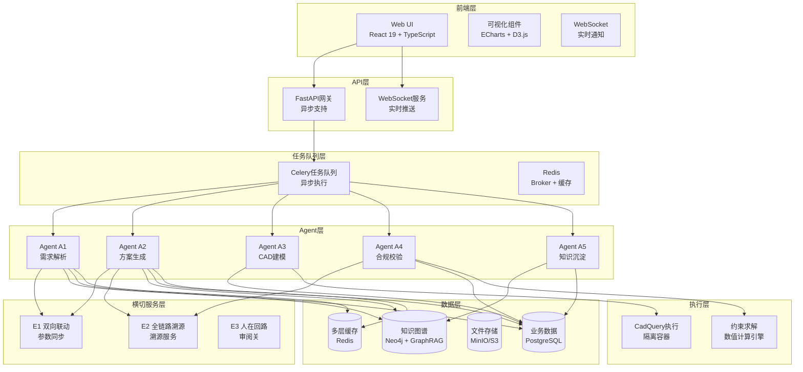
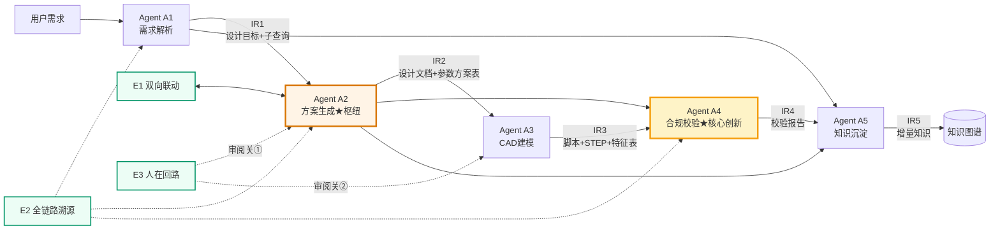
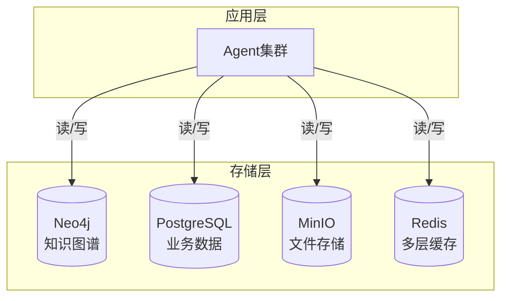
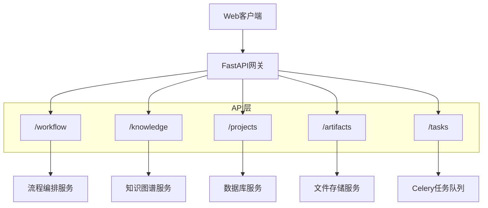
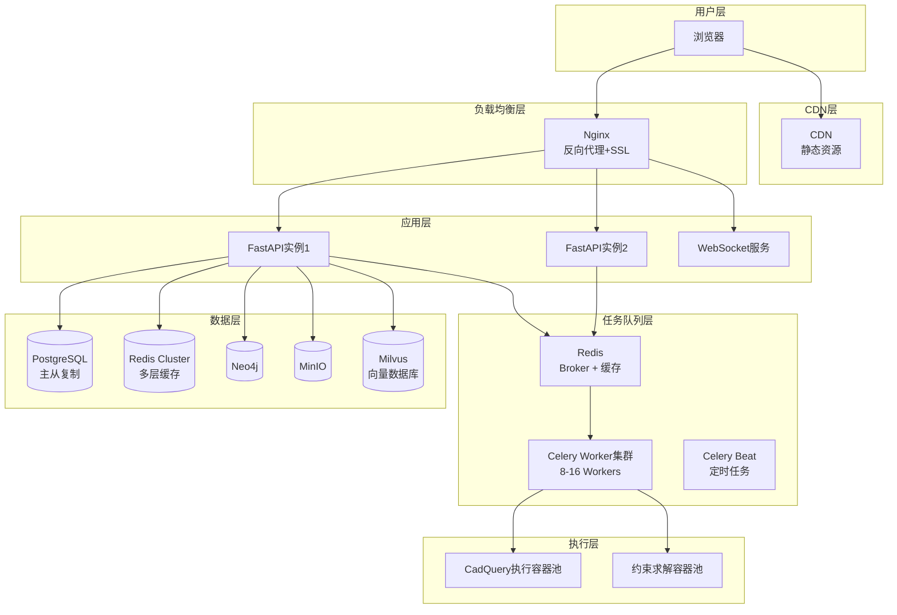

# 声呐装备智能辅助设计系统 · 系统实施方案

---

> **文档定位**：本文档是《[声呐装备智能辅助设计系统_设计方案](./声呐装备智能辅助设计系统_设计方案.docx)》的**实施下沉版**。
> 
> - 总体设计回答"**系统是什么、做什么**"（架构、功能边界、创新点）
>- 本文档回答"**系统怎么做、用什么技术实现**"（技术选型、界面设计、数据库设计、部署架构）
> 
>**与实践计划的关系**：本文档聚焦**技术实施层面**。
>
>**单一事实源（SSOT）权衡申明**：本文档所涉及的数据库拓扑、API 契约及状态机流转图，均作为系统构建的**单一事实源（Single Source of Truth）**。在当前原型验证阶段，部分模块允许采用 Mock 数据或轻量化内存级组件进行功能级替代；后续生产级终态将严格遵循本蓝图定义的契约边界，确保从原型到量产的平滑演进与一致性。


## 目录

1. [技术架构选型](#1-技术架构选型)
2. [完整五Agent架构设计](#2-完整五agent架构设计)
3. [数据存储设计](#3-数据存储设计)
4. [用户界面设计](#4-用户界面设计)
5. [API 设计规范](#5-api-设计规范)
6. [部署架构与性能优化](#6-部署架构与性能优化)
7. [实施路线图](#7-实施路线图)

---

## 1. 技术架构选型

### 1.1 整体技术栈概览



> 数据层连线说明：A1–A5 均连向 PostgreSQL，因各 Agent 在被 Celery 异步调度时，需统一读写 `ir_snapshots` 表以获取入参 IR、提交产物 IR（与 §3.3 集中式快照流转机制一致）；Agent 之间不直接互调，仅经编排层从快照恢复数据。

### 1.2 前端技术栈

| 技术选型 | 用途 | 选择理由 |
|---------|------|---------|
| **React 19 + TypeScript** | UI框架 | 组件化开发、类型安全、生态成熟、三维可视化库选择更多（React 19 的 Actions/use hook 提升表单与数据流体验） |
| **Zustand** | 状态管理 | 比Redux更轻量、API简洁、适合中等规模应用 |
| **React Router v7** | 路由管理 | 官方路由方案、支持嵌套路由与数据加载 |
| **Vite** | 构建工具 | 开发体验好、HMR快速、优化生产构建 |
| **Ant Design / Material-UI** | UI组件库 | 企业级组件、表单/表格能力强、React生态成熟 |
| **React Three Fiber** | 3D模型展示 | Three.js的React绑定、STEP模型预览 |
| **ECharts** | 数据可视化 | 图表丰富、可定制 |
| **D3.js** | 知识图谱可视化 | 灵活度高、适合复杂关系图 |
| **Monaco Editor** | 代码编辑 | 设计文档编辑、CadQuery脚本查看 |
| **Socket.io Client** | WebSocket实时通信 | 接收任务进度、参数变更通知 |

**前端模块划分**：按 `views`（页面）/ `components`（可复用组件）/ `stores`（状态管理）/ `services`（API 调用）/ `hooks`（自定义 Hook）分层。核心页面包括需求输入、任务中心、设计文档审阅（审阅关①）、CAD 预览（审阅关②）、校验报告、知识库浏览；核心组件包括参数表（支持双向联动）、溯源链、知识图谱可视化、STEP 查看器、任务进度。

### 1.3 后端技术栈

| 技术选型 | 用途 | 选择理由 |
|---------|------|---------|
| **Python 3.12+** | 主要语言 | LLM集成、数值计算生态好 |
| **FastAPI** | API框架 | 高性能、异步支持、自动文档 |
| **Celery + Redis** | 异步任务队列 | **核心优化**：长时间运行的Agent任务异步化，支持设计院级高并发 |
| **Pydantic v2** | 数据验证 | 类型安全、与FastAPI深度集成 |
| **LangChain / LlamaIndex** | LLM编排 | Agent任务编排（可选） |
| **Docker** | 容器化 | CadQuery执行环境隔离 |
| **Nginx** | 反向代理 | 静态文件服务、负载均衡 |
| **Gunicorn + Uvicorn** | ASGI服务器 | 生产环境部署（4-8 workers） |

**后端服务划分**：按职责分模块——`api`（FastAPI 路由、Pydantic 数据模型、中间件）、`agents`（A1–A5 + orchestrator 编排器）、`cross_cutting`（E1–E3 横切服务）、`knowledge`（GraphRAG 客户端 + 约束引擎）、`cad`（CadQuery 执行 + STEP 校验）、`tasks`（Celery 异步任务）、`storage`（知识图谱 / 数据库 / 文件存储抽象层）。

### 1.4 基础设施选型

| 组件 | 选型 | 用途 |
|------|------|------|
| **知识图谱存储** | Neo4j 5.x | GraphRAG底层存储 |
| **关系数据库** | PostgreSQL 17 | 业务数据、会话状态、IR版本管理（生产稳健版，长周期支持） |
| **缓存** | Redis 7.2 | **多层缓存**：任务队列Broker、会话缓存、查询缓存、LLM结果缓存（工业级生产稳健版；亦可平替为 Valkey 7.x 开源分支） |
| **文件存储** | MinIO / AWS S3 | STEP文件、脚本、文档 |
| **消息队列** | Redis (Celery) | **核心优化**：异步任务调度，支持设计院级高并发 |
| **LLM服务** | 私有化部署为主（vLLM + Qwen 系列本地推理） | **军用设计数据不出网**；公网 API（DeepSeek/OpenAI）仅作开发期 fallback（见 1.6） |
| **向量数据库** | Milvus / Qdrant | 语义检索（GraphRAG basic 降级层依赖）；若最小部署可关闭 basic 层则可省 |

### 1.5 性能优化技术栈

| 优化层级 | 技术方案 | 效果 |
|---------|---------|------|
| **L1 缓存层** | Redis多层缓存（LLM调用、查询结果、参数计算、代码生成） | 70%请求 <1秒响应 |
| **L2 队列层** | Celery异步任务队列（8-16 Workers） | 支持100+并发，无等待 |
| **L3 并行化层** | Agent内部并行查询、Agent间流水线并行 | 总耗时缩短3倍 |
| **L4 查询优化层** | 查询合并（8个→3个）、知识图谱分区、增量索引 | Stage 1耗时从6.5分钟→45秒 |

### 1.6 数据安全与合规

系统定位为军用声呐装备设计，**设计数据不得出网**。LLM 调用采用以下策略：

| 部署模式 | 选型 | 适用场景 |
|---------|------|---------|
| **私有化部署（主选型）** | vLLM + 开源模型（Qwen / DeepSeek 系列本地推理） | 生产/军用环境，数据不出网 |
| 公网 API（仅开发期） | DeepSeek / OpenAI API | demo 阶段、非敏感数据验证 |

配套措施：
- LLM 调用前置脱敏代理：剥离项目代号、型号、关键性能指标后再送入（即便私有化也作纵深防御）
- 知识图谱、设计文档、STEP 模型全程在内网存储（Neo4j / MinIO 不暴露公网）
- 审计日志独立留存，记录所有 Agent 调用与人工审阅决定（对接 E2 溯源）

---

## 2. 完整五Agent架构设计

### 2.1 Agent协作流程



### 2.2 IR数据契约

各 Agent 间通过中间表示（IR）传递数据。核心 IR 定义如下（字段为设计契约，非现状代码）：

| IR | 产出 Agent | 核心字段 |
|---|---|---|
| IR0 原始需求 | 用户 | 原始自然语言文本、项目 ID、提交信息 |
| IR1 设计目标 | A1 | 结构化目标（声呐类型 / 声阵规模 / 工作深度 / 频段 / 部署方式）+ 检索子查询列表 + 检索证据集 `retrieval_evidence` + 缺失项 |
| IR2 方案 | A2 | 设计文档（Markdown）+ **参数方案表** |
| IR3 建模产物 | A3 | CadQuery 脚本 + STEP 文件路径 + CAD 特征表（各段尺寸 / 位置、关联参数 ID） |
| IR4 校验报告 | A4 | 总体结论（pass / fail）+ 约束满足率 CSR + 问题清单 |
| IR5 增量知识 | A5 | 待回写知识条目 + 回写状态（pending / completed） |

**IR1 检索证据集 `retrieval_evidence`** 由 A1 的两段式检索产出，按 `source_type` 分桶组织，供 A2 消费：

- 结构：`{formula: [...], case: [...], standard: [...], estimated: [...]}`，每条证据携带 `id / summary / source_ref`，A2 主流程只读摘要、不读原文；
- `sufficiency_check`：结构化清单判定各参数维度（声阵规模 / 频段 / 孔径 / 功率…）的证据覆盖情况，逐项标记 `covered` / `gap`；
- `topup_log`：定向补查记录（缺口维度 → 指定源 → 补查结果），硬上限 1 轮，轨迹隔离在子任务内、不进 A2 主上下文。

> 设计要点：检索取证全部归 A1，A2 不发起检索、仅消费 `retrieval_evidence`；两段式（并行地毯式检索 + 有界充分性补查）以结构化判定替代 ReAct 式自由推理，保证检索路径可复现、上下文与延迟可控。

**IR2 参数方案表**是全系统枢纽，每个参数携带：`id / name / value / unit`，以及四个关键设计字段——

- `source_type`：`formula` 公式 / `case` 案例 / `standard` 军标 / `estimated` 估算，决定下游校验与可信度处理；
- `source_ref`：公式编号 / 标准条目 / 案例 ID；
- `derivation`：取值依据（公式计算过程或案例引用说明）；
- `trace_id`：溯源链 ID（接 E2）；
- `dependencies / dependents`：依赖与被依赖参数（接 E1 双向联动）。

> 说明：`confidence` 枚举（high / medium / low）以《设计方案》§4.4.1 为准，跨文档口径统一。

### 2.3 五个Agent详细设计

各 Agent 的职责与边界（接口为设计契约，非现状代码）：

#### Agent A1: 需求解析

- **输入 → 输出**：IR0 → IR1（含检索证据集 `retrieval_evidence`）
- **步骤**：① 要素抽取（LLM 按声呐设计要素）② 子查询规划 ③ 多路并行检索（公式 / 案例 / 标准 / 经验四类来源并发查询）④ 充分性判定（结构化清单核对各参数维度是否有证据覆盖）⑤ 定向补查（仅对覆盖缺口发起至多一轮补查，硬上限 1 轮）
- **检索策略**：两段式——并行地毯式检索 + 有界充分性补查，以结构化判定替代 ReAct 式自由推理，保证路径可复现、上下文与延迟可控；补查轨迹隔离在子任务内，仅向主流程返回结构化增量
- **边界**：承担理解、拆解与检索取证；不推导几何参数、不赋数值

#### Agent A2: 方案生成

- **输入 → 输出**：IR1（含 `retrieval_evidence`） → IR2（系统枢纽）
- **步骤**：① 整合 `retrieval_evidence` 为设计文档 ② 逐参数定值——按来源分类（公式计算 / 案例引用 / 军标引用 / 估算标注）并挂接溯源
- **边界**：不解复杂隐式方程、不写 CAD 代码；不发起检索（检索取证归 A1），仅消费 IR1 证据集

#### Agent A3: CAD建模

- **输入 → 输出**：IR2 → IR3
- **步骤**：① 按声呐类型匹配参考范例 ② LLM 生成 CadQuery 脚本 ③ 静态校验 ④ 执行生成 STEP（失败则修复重试）
- **边界**：严格继承 IR2 参数，发现矛盾抛回 A2，不自行调整

#### Agent A4: 合规校验（★核心创新）

- **输入 → 输出**：IR2 + IR3 → IR4（核心创新点）
- **步骤**：① 按 `source_type` 分流校验（formula / standard 走等式与符合性、case 走区间、estimated 重点复核）② CAD 特征几何自洽 ③ 约束冲突检测（约束传播）④ 汇总报告与约束满足率 CSR
- **约束传播**：冲突规则来源于知识图谱的设计约束与公式边（COMPUTED_BY），由 A4 启动时从 KG 加载并逐条核对，保证可扩展、可审计——对应论文创新点"约束推理引擎作为独立可验证模块"；KG 未覆盖时以"外径 ≥ 2×壁厚"等几何常识兜底，不作主路径
- **边界**：仅出具报告，不修改参数；发现问题抛回 A2

#### Agent A5: 知识沉淀

- **输入 → 输出**：IR1–IR4 → IR5
- **步骤**：① 提取新参数关系 ② 提取校验经验 ③ 落库为 pending 候选
- **回写约束**：A5 只产出 IR5 候选并置 `pending`，须经一道"知识审阅关"人工确认后，才将获批条目写入知识图谱，避免一次性错误决策污染知识库

### 2.4 横切能力实现

#### E1: 双向联动服务

- 以 IR2 的 `dependencies`/`dependents` 字段为唯一事实源构建依赖图（避免双源不一致）
- 参数变更按依赖项 `source_type` 分流传播：`formula` 类重跑公式（如改"阵元间距"则重算"总长 = 段数 × 间距"）；`case`/`standard` 类核对是否仍落入区间，越界则回退主参数并抛回 A2；`estimated` 类标注重算待审、不直接改值
- **防环形震荡死循环**：双向联动服务引入变更发起方原子锁（Origin Lock）与最大传播深度限制（Max Depth = 3）。由文档发起的变更在同步至 CAD 过程中，CAD 生成的特征反向事件将被回写拦截器挂起，从架构上彻底避免"文档↔CAD"互触发的环形震荡死循环；超出传播深度时降级为"标注待人工确认"，不再继续传播
- 完成后经 WebSocket 通知前端，并记录溯源（E2）

#### E2: 全链路溯源服务

- 溯源信息持久化于业务库 `traceability_chain` 表（事实来源）；内存图仅作查询加速缓存、启动时从库重建——纯内存实现会在进程重启时丢失全部溯源记录，违背"可验收"核心卖点
- 记录参数的创建 / 修改 / 校验事件，支持溯源链查询、影响范围（依赖后代）查询、变更历史查询

#### E3: 人在回路服务

- 编排层在 A2 后设审阅关①、A3 后设审阅关②，均为"暂停—裁决"节点
- 审阅关①：approved → 触发 A3；needs_revision → 回退 A1（需求理解问题）或 A2（参数问题，默认）
- 审阅关②：approved → 触发 A4；needs_revision → 回退 A3 重新生成脚本
- A4 校验未通过：自动回退 A2 修正参数（不回到审阅关①）

---

## 3. 数据存储设计

### 3.1 存储分层架构



### 3.2 知识图谱存储（Neo4j）

**实体类型**（对应总体设计本体）：声呐系统 / 结构模块 / 零部件 / 设计参数 / 性能指标 / 设计约束 / 公式 / 军标条款。

**关键关系**：模块—含零部件、零部件—含参数、参数—受约束于（CONSTRAINED_BY）、参数—由公式计算（COMPUTED_BY）、参数—受军标治理（GOVERNED_BY）、公式—使用变量（USES_VARIABLE）。

**公式节点**（承载可计算化，对应创新点"能算"）：每个公式记录表达式、变量列表、输出量、单位类型（几何 / 声学 / 结构）、求解方式（解析 / 区间 / 迭代），如 `L_total = N_segments × d_spacing`（analytic）。

### 3.3 业务数据存储（PostgreSQL）

**核心数据表**：

| 表 | 用途 | 关键字段 |
|---|---|---|
| projects | 项目 | 名称、声呐类型、负责人 |
| design_sessions | 设计会话 | 关联项目、状态（running/paused/completed/failed）、当前步骤、起止时间 |
| ir_snapshots | IR 不可变版本快照（支持溯源 / 回退，每次变更追加新版本） | 会话 ID、IR 类型、版本号、内容 JSONB、产生 Agent |
| parameter_schemes | IR2 可编辑工作副本（E1 双向联动在此就地更新；字段以《设计方案》§4.4.1 为权威源） | 参数 ID、name、值、单位、source_type、source_ref、derivation、confidence、trace_id、dependencies、dependents |
| review_records | 人在回路审阅记录 | 审阅关（1/2）、裁决、意见、标注 |
| artifacts | 产物（设计文档 / 脚本 / STEP） | 类型、文件路径、元数据 |
| traceability_chain | 溯源链（E2） | 参数 ID、事件类型、前后值、来源 Agent、来源引用 |

设计要点：`ir_snapshots`（不可变历史版本）与 `parameter_schemes`（当前可编辑状态）职责分离、互不覆盖；对会话状态、参数 source_type、溯源参数 ID 等高频查询字段建索引。

### 3.4 文件存储（MinIO）

**存储桶结构**：
```
sonar-cad/
├── step-models/          # STEP三维模型
│   └── {session_id}/{artifact_id}.step
├── cad-scripts/          # CadQuery脚本
│   └── {session_id}/{artifact_id}.py
├── design-docs/          # 设计文档
│   └── {session_id}/{artifact_id}.md
├── validation-reports/   # 校验报告
│   └── {session_id}/{artifact_id}.json
└── knowledge-dumps/      # 知识图谱备份
    └── graph_backup_{date}.graphml
```

### 3.5 多层缓存策略（Redis）

**缓存用途与 TTL 设置**（接口为设计契约，非现状代码）：

| 缓存键 | 用途 | TTL |
|---|---|---|
| `cache:llm:call:{prompt_hash}` | LLM 调用结果（减少 API 调用成本） | 7d |
| `cache:kb:query:{query_hash}` | 知识检索结果（减少图谱查询，核心优化） | 24h |
| `cache:param:calc:{formula_id}:{values}` | 公式计算结果 | 7d |
| `cache:codegen:{scheme_hash}` | 相同参数方案的 CadQuery 脚本 | 30d |
| `session:{session_id}:status / current_step` | 会话热数据（状态、当前步骤） | 会话级 |
| `celery-task:{task_id}:status / progress` | 异步任务状态与进度 | 任务级 |
| `pubsub:progress:{session_id}` | WebSocket 实时进度推送（订阅频道） | — |
| `pubsub:param_update:{scheme_id}` | E1 双向联动参数变更通知（订阅频道） | — |

---

## 4. 用户界面设计

### 4.1 主要页面流程

```mermaid
flowchart LR
    HOME[首页<br/>项目列表] --> NEW[新建设计]
    HOME --> EXISTING[查看项目]

    NEW --> INPUT[需求输入页]
    INPUT --> SUBMIT[提交任务]
    SUBMIT --> TASKCENTER[任务中心]

    TASKCENTER -->|A1执行中| P1[解析中...]
    P1 -->|A1完成| REVIEW1[审阅关①<br/>设计文档]

    TASKCENTER -->|A2执行中| P2[方案生成中...]
    P2 -->|A2完成| REVIEW1

    REVIEW1 -->|通过| CADTASK[CAD生成任务]
    REVIEW1 -->|修改| INPUT

    CADTASK -->|A3执行中| P3[CAD建模中...]
    P3 -->|A3完成| REVIEW2[审阅关②<br/>CAD预览]

    REVIEW2 -->|通过| VALIDATING[合规校验任务]
    REVIEW2 -->|修改| CADTASK

    VALIDATING -->|A4执行中| P4[校验中...]
    P4 --> REPORT[校验报告]

    REPORT -->|通过| KNOWLEDGE[知识沉淀]
    REPORT -->|不通过| A2FIX[A2修正参数<br/>校验失败回退]

    KNOWLEDGE -->|A5执行中| P5[沉淀中...]
    P5 --> COMPLETE[完成]

    COMPLETE --> DOWNLOAD[下载交付物]
```



### 4.2 关键页面设计

> 以下页面与组件为目标交互设计（设计契约，非现状代码；当前 demo 前端为 Streamlit 单页原型）。

| 页面 / 组件 | 作用 | 关键交互 |
|---|---|---|
| **需求输入页** | 用户提交设计需求 | 自然语言描述（必填）+ 可选结构化参数（声呐类型 / 声阵规模 / 工作深度）；支持快速引用历史案例模板；提交后跳转任务中心 |
| **任务中心** | 设计任务列表与进度跟踪 | 列出全部任务及状态（运行中 / 已完成 / 失败），WebSocket 实时显示当前阶段、进度条、预计剩余时间；完成后可查看结果或日志 |
| **审阅关①·设计文档审阅** | 人工裁决 IR2（设计文档 + 参数方案） | 左侧只读设计文档，右侧参数表（可编辑触发 E1）+ 审阅意见；裁决：通过→触发 A3 / 修改需求→回退；点参数可弹窗查看溯源链 |
| **审阅关②·CAD 预览** | 人工裁决 IR3（脚本 + STEP） | 三维预览 STEP 模型，查看 CAD 特征表；裁决：通过→触发 A4 / 修改→回退 A3 |
| **校验报告页** | 展示 IR4 | 约束满足率 CSR、问题清单、不通过项定位到参数，触发 A2 修正 |
| **知识库浏览页** | 知识图谱可视化 | D3.js 关系图、检索、查看公式 / 案例 / 军标条目 |

**核心可复用组件**：

- **参数表（ParameterTable）**：列出 `id / name / value / unit / source_type / confidence`；`source_type` 用色标区分（公式=蓝 / 案例=绿 / 军标=红 / 估算=橙）；每行带"溯源"按钮；编辑模式下改值即调用 E1 双向联动。
- **溯源链（TraceabilityChain）**：按参数 ID 展示来源类型、来源引用、取值依据、变更历史、影响范围（依赖后代）。
- **STEP 查看器**：基于 React Three Fiber 的三维模型预览。
- **任务进度条**：订阅 WebSocket 频道，实时渲染当前 Agent 与百分比。

---

## 5. API 设计规范

### 5.1 API 架构



### 5.2 核心 API 端点设计

> 以下端点为接口设计契约，非现状代码（当前 demo 为命令行 / Streamlit 直接驱动）。

#### 5.2.1 设计流程 API

| 方法 | 路径 | 作用 | 关键字段 / 响应 |
|---|---|---|---|
| POST | `/api/v1/workflow/sessions` | 创建设计会话（异步任务） | 请求：`project_id` + 需求（自然语言 / 结构化参数）；响应：`task_id`、`session_id`、`status=pending`、预估时长 |
| GET | `/api/v1/tasks/{task_id}` | 查询任务状态（轮询或 WS 推送） | `status`、`progress`、`current_step`、`message` |
| GET | `/api/v1/workflow/sessions/{session_id}/irs/{ir_type}` | 获取中间产物（IR） | IR 类型、版本号、内容 JSON |
| POST | `/api/v1/workflow/sessions/{session_id}/reviews/gate1` | 提交审阅关① 决定 | `decision`（approved / needs_revision）+ 审阅意见 + 参数修改清单；触发下游 A3 任务 |

#### 5.2.2 参数双向联动 API（E1 / E2）

| 方法 | 路径 | 作用 | 关键字段 / 响应 |
|---|---|---|---|
| POST | `/api/v1/parameters/{param_id}/update` | 更新参数（触发 E1） | 请求：`new_value` + 原因；响应：前后值、受影响参数清单、`trace_id` |
| GET | `/api/v1/parameters/{param_id}/trace` | 获取参数溯源链（E2） | 当前值、`source_type` / `source_ref` / `derivation`、变更历史、`impact_chain`（影响后代） |

#### 5.2.3 WebSocket 实时推送

客户端连接 `WS /api/v1/ws/tasks/{task_id}`，服务端推送两类消息：

- `step_progress`：Agent 执行进度（agent_id、step_name、progress、message）。
- `parameter_updated`：E1 双向联动引起的参数变更（源参数、受影响参数前后值）。

---

## 6. 部署架构与性能优化

### 6.1 生产环境部署图



### 6.2 性能瓶颈分析与优化

**基于demo项目的性能数据**：
```
总耗时: 597.4s ≈ 10分钟
├─ Stage 1: 392.7s ≈ 6.5分钟  ← 最大瓶颈（知识检索）
├─ Stage 2: 180.6s ≈ 3分钟   ← 第二瓶颈（代码生成）
└─ Stage 3: 24.2s  ≈ 24秒    ← 执行（已很快）
```

#### 6.2.1 多层优化方案

| 优化层级 | 优化措施 | 效果 |
|---------|---------|------|
| **L1 缓存层** | LLM调用缓存、查询缓存、参数计算缓存、代码生成缓存 | 70%请求 <1秒响应 |
| **L2 队列层** | Celery异步任务队列（8-16 Workers） | 支持100+并发，无等待 |
| **L3 并行化层** | Agent内部并行查询、Agent间流水线并行 | 总耗时缩短3倍 |
| **L4 查询优化层** | 查询合并（8个→3个）、知识图谱分区、增量索引 | Stage 1耗时从6.5分钟→45秒 |

#### 6.2.2 优化效果预测


**场景1：设计院级部署**

```
小型设计院（20-50设计师）:
  服务器: 8核 / 16GB
  Celery Workers: 4个
  并发能力: 20个设计师同时使用

中型设计院（50-100设计师）:
  服务器: 16核 / 32GB
  Celery Workers: 8个
  并发能力: 50个设计师同时使用

大型设计院（100+设计师）:
  分布式部署
  - API服务器: 16核 × 2台
  - Celery集群: 8核 × 4台
  并发能力: 100+个设计师同时使用
```

#### 6.2.3 异步网络与抗压降级设计

针对大模型推理（vLLM）及 CadQuery 三维渲染等高耗时、高并发场景，系统在网关层（FastAPI / Nginx）引入基于**令牌桶算法**的动态限流与熔断机制。当并发请求超出算力集群负载时，系统不再向下游抛出未捕获异常，而是由网关拦截并向前端返回标准的结构化降级报文（如 429 状态码）。前端基于 React 异步机制，建立基于**指数退避算法（Exponential Backoff）**的自动重试与状态防抖拦截器，彻底隔绝因网络抖动、异步上下文错位引发的前端 TypeError 异常（如 503 / `Cannot read properties of undefined` 类报错），确保工业级生产环境下百人并发系统的鲁棒性。

| 防御层级 | 机制 | 作用 |
|---|---|---|
| 网关限流 | 令牌桶算法 + 动态阈值 | 削峰填谷，超载请求结构化降级（429），保护下游算力 |
| 熔断降级 | 连续失败率触发的断路器 | 故障隔离，防止级联雪崩 |
| 前端重试 | 指数退避 + 抖动（jitter） | 自动恢复瞬时抖动，避免重试风暴 |
| 状态防抖 | 异步请求拦截 + 上下文校验 | 拦截过期响应、空值引用，杜绝 TypeError |

### 6.3 容器化部署

采用 Docker Compose 编排，各服务镜像与职责如下：

| 服务 | 镜像 | 说明 |
|---|---|---|
| frontend | sonar-cad-frontend | React 前端（Nginx 托管静态资源） |
| api | sonar-cad-backend | FastAPI 后端，Gunicorn + Uvicorn 多 worker |
| celery-worker | sonar-cad-backend（同镜像） | Celery Worker，`--concurrency=8`，副本数 ×2（共 16 并发进程），挂载 CadQuery 执行目录 |
| celery-beat | sonar-cad-backend（同镜像） | 定时任务调度 |
| pg | postgres:17 | 业务数据库 |
| redis | redis:7.2-alpine | 多层缓存 + Celery Broker（单实例按 db 分离：db0=缓存 / db1=Broker；大型设计院可升级 Redis Cluster，与 6.1 对齐） |
| neo4j | neo4j:5 | 知识图谱存储 |
| minio | minio/minio | STEP / 脚本 / 文档对象存储 |
| nginx | nginx:alpine | 反向代理 + SSL，对接前端与 api |

后端服务通过环境变量注入连接信息（`DATABASE_URL`、`REDIS_URL`、`NEO4J_URI`、`MINIO_ENDPOINT`、`LLM_API_KEY`）；数据卷独立挂载（pg-data / redis-data / neo4j-data / minio-data）以持久化。

### 6.4 监控与日志

**监控指标**：应用性能（API 响应时间、Agent 执行时间、错误率）、资源使用（CPU / 内存 / 磁盘 / 网络）、业务指标（设计会话成功率、平均完成时长、约束满足率分布）、各层缓存命中率。

**日志分流**：应用日志 → ELK Stack；审计日志（人工操作、审阅决定）→ 独立审计库；Agent 轨迹 → 专用溯源表（支持 E2）；Celery 任务日志 → 独立文件。

**告警规则**：系统建立了一套环境自适应配置矩阵，将关键工程参数（建模超时、任务软/硬超时、并发 Worker 数）抽离至物理隔离的环境变量文件中，支持在不重启服务的情况下根据压测反馈动态调优。超时层级由内到外逐级放大、各级职责分离：内层 `CADQUERY_TIMEOUT`（单次 CadQuery 建模，120s~600s 弹性区间）→ 中层 Celery `task_soft_time_limit`（单次 Agent 任务软超时，基线 **15 分钟**，相对端到端基准 ~10 分钟留约 1.5 倍冗余以容纳修复重试）→ 外层 `task_time_limit`（硬强杀兜底，基线 **20 分钟**，约为 soft 的 1.3 倍）。该比例既避免单次建模抖动误杀长任务，又确保 LLM 幻觉导致的死循环被快速回收，不致长期占用 Worker 算力：

- Agent 执行超时（soft_time_limit 触发，> 15 分钟）
- CadQuery 执行失败率 > 10%
- 知识图谱查询延迟 > 5 秒
- 缓存命中率 < 60%（缓存配置不当）
- Celery 队列长度 > 100（Workers 不足）

---

## 7. 实施路线图

### 7.1 分阶段实施计划

系统演进按"里程碑 / 版本代际（Phase / Release）"推进，不绑定绝对日历，以能力闭环达成为阶段验收口径：

| 版本代际 | 定位 | 核心目标与主要任务 |
|---|---|---|
| **Phase 1 · Base Line（机制验证期）** | 最小可行性产品 MVP | 聚焦核心五 Agent 状态机流转打通、文档到 CAD 单向生成的最小闭环。任务：前后端框架与基础设施搭建（数据库 / 缓存层）、A1–A5 Agent 与 IR 数据契约落地、任务队列集成、横切能力 E1–E3 串联、前端核心页面。验收：能跑通"需求→方案→CAD→校验→沉淀"完整五步异步任务。 |
| **Phase 2 · Advanced（闭环演进期）** | 闭环强化与精度优化 | 攻关双向联动中的变更抑制（Origin Lock / Max Depth）、约束网络冲突推理引擎的精度优化（约束传播分层求解、生成前后物理+几何双校验）、多层缓存与查询性能调优、压力测试。验收：通过 50 并发压力测试、约束满足率 CSR 达标、参数双向联动无环形震荡。 |
| **Phase 3 · Extensible（业务泛化期）** | 规模化与生产上线 | 军标知识库的规模化录入与全自动合规报告生成、生产部署与监控告警体系完善、用户培训与正式上线。验收：系统稳定运行、全量军标合规核对激活、用户可用。 |

### 7.2 技术里程碑

| 里程碑 | 交付物 | 验收标准 |
|-------|-------|---------|
| **M1: 基础架构** | React前端、FastAPI后端、多层缓存 | 能创建项目、能查询知识图谱 |
| **M2: 核心流程** | A1-A2 Agent、IR数据契约、Celery集成 | 能跑通"需求→方案"异步任务 |
| **M3: 完整闭环** | A3-A5 Agent、横切能力E1-E3 | 能跑通完整五步流程 |
| **M4: 生产就绪** | 性能优化、监控告警 | 通过压力测试（50并发）、文档齐全 |
| **M5: 正式上线** | 生产部署、用户培训 | 系统稳定运行、用户可用 |

### 7.3 关键风险与应对

| 风险 | 应对措施 |
|------|---------|
| **Celery任务执行超时** | 任务超时控制 + 失败重试 + 死锁检测 |
| **知识图谱查询性能瓶颈** | Redis多层缓存 + 查询优化 + 知识图谱分区 |
| **LLM API成本超预算** | 提示词优化 + LLM结果缓存 + 批量调用 |
| **前后端联调复杂度高** | API文档先行（OpenAPI）+ Mock测试 + TypeScript类型检查 |
| **并发支持不足** | Celery Workers动态扩展 + Redis Cluster + 负载均衡 |

### 7.4 风险控制与应急预案

为应对工程实施中的不确定性，系统建立"架构冗余 + 机制降级 + 应急预案"三层防御体系：

| 风险等级 | 触发场景 | 应急预案 |
|---|---|---|
| **P0 级阻断**（核心服务宕机） | FastAPI 网关、PostgreSQL、Neo4j 不可用 | 双活部署 + 健康探针自动切换；PostgreSQL 流复制热备接管；Neo4j 定期 GraphML 快照回滚 |
| **P1 级降级**（算力过载） | 大模型推理队列堆积、CadQuery 容器池饱和 | 网关令牌桶限流 + 自动熔断，超载请求返回 429 结构化降级报文；前端指数退避重试，避免雪崩 |
| **P2 级容错**（单任务失败） | 某次 CAD 生成 / 约束求解失败 | 三阶段流水线内置修复循环（重试上限可配置）；失败任务隔离至死信队列，不阻塞主队列 |
| **数据安全级** | 知识图谱误写、知识沉淀污染 | A5 知识回写一律经"知识审阅关"人工确认，候选条目置 pending 不直接生效；ir_snapshots 不可变版本支持任意时点回退 |

**应急回退路径**：任一 Agent 输出异常，编排层依据 IR 版本快照回退至最近合规状态，局部重算受影响步骤，无需重跑全流程——与 §2.4 / §4.6 的局部回环机制共用同一套基础设施。

---

# 增补说明（2026-09-30）

> **代际定位**：本文档（2026-07-02）为单后端（FastAPI 网关单体 + Celery）架构口径的实施下沉版。随后《智能辅助声呐装备设计系统_总体设计方案》（2026-07-07）确立 **Java + Python 双后端**架构，项目按后者实施。正文一字未改，保留作历史代际记录；阅读时以下表对照实际实现。

**关键偏差对照（正文口径 → 实际实现）**：

| 正文位置 | 正文口径 | 实际实现（截至 2026-09-30） |
|---|---|---|
| §1.1 整体架构图 | FastAPI 网关单体（API 层直连 Celery/Agent） | Spring Cloud Gateway（8080）+ Java 五服务（auth 8081 / workflow 8082 / biz 8083 / notify 8084）+ py-engine（FastAPI 8090 内部算力 API + Celery worker）；Java 经 RabbitMQ 以 Celery protocol v2 投递任务 |
| §5.2 API 端点 | `/api/v1/workflow/sessions`、`/api/v1/parameters/{pid}/update` 等 | 分组为 `/api/v1/workflow|kb|cad-agent|trace|cad|logs/**` 经网关路由；独立参数更新入口未按原样实现（E1 联动经审阅关①驳回回环完成）；新增 `/api/v1/cad-agent/**` 十端点（FreeCAD 微调） |
| §5.2.3 WebSocket 契约 | `WS /api/v1/ws/tasks/{task_id}`，2 类消息 | JWT 握手 + 会话级订阅，5 类消息（task_progress / log / review_request / ir_updated / cad_tune_updated），契约文件 `contracts/ws/ws-message.schema.json`；前端断线指数退避重连 + HTTP 对账轮询兜底 |
| §3.3 业务表 | `parameter_schemes` 为 IR2 可编辑工作副本 | 表已建（Flyway V1）但预留未用；参数展示与编辑经 IR2 快照（`ir_snapshots` jsonb）承载；另有 V6–V11 增补表（kb_* / cad_tune_* / session_logs / kb_bases） |
| §3.4 MinIO 桶 | 5 桶（step-models / cad-scripts / design-docs / validation-reports / knowledge-dumps） | 实际 4 桶：step-models / cad-scripts / **kb-docs** / **cad-tunes**（后两桶为新增；设计文档与校验报告实际以 IR 快照承载，未建对象存储桶） |
| §6.2 性能数据 | 总耗时 597.4s（三阶段 demo 实测拆解） | 为旧原型基线，对新架构无参考性；**v0.3 已重新基线化**（2026-09-30，容器化全栈 4 轮真 LLM 中位 554.5s≈9.2min、检索 P95 1.3s，见 `docs/reviews/性能基线_v0.3.md`） |
| §6.3 容器化 | frontend / api / celery-worker 均入 compose | 过渡态：数据底座十容器 compose 一键起；应用为宿主机进程（`scripts/start-all` 一键启动）；应用容器化列 v0.2 待办 |
| §4.2 页面清单 | 任务中心独立页等 | 任务中心并入仪表盘（会话列表 + WS 实时进度）；新增项目管理页、知识库五页签（含多库）、系统管理页（服务探测真实、日志/备份/用户管理如实标注"待接"）、FreeCAD 微调时间线 |
| §6.4 监控告警 | ELK、审计库、告警规则 | 监控告警零实现；会话日志落库（session_logs）+ 前端回看导出已有；审计语义由不可变 IR 快照 / 审阅记录 / 溯源链承担 |

**另有两项本文档未包含的新增能力**：FreeCAD CAD 交互微调（PHASE-008，ADR-004）、知识库多库与会话选库（PHASE-006）。

**权威口径**：架构与设计以《智能辅助声呐装备设计系统_总体设计方案》为准，开发行为约束以仓库宪法（`docs/00_开发约束与协作规范.md` CONST-001）为准，进度以 `docs/roadmap.md` 为准；实现现状对照与后续优化路线见 `docs/设计实现对照与优化路线.md`。
