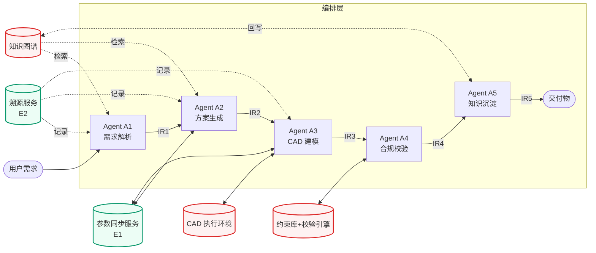
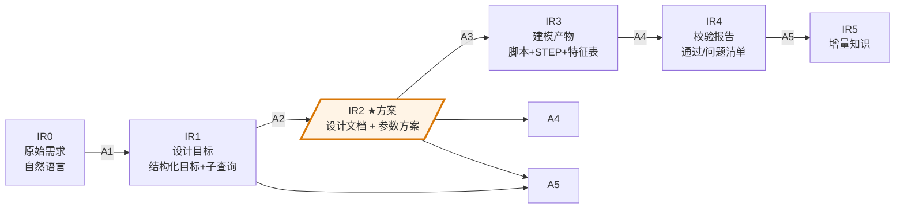
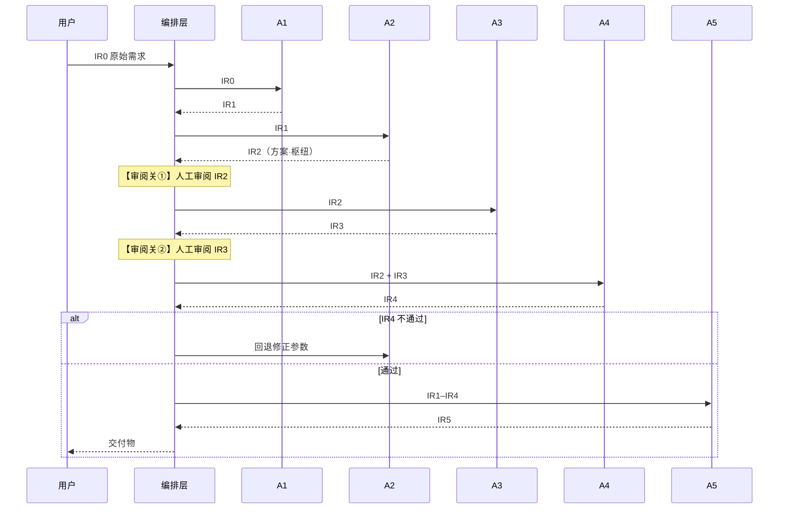

# 声呐装备智能辅助设计系统 · Agent 架构设计（核心版）

> **文档定位**：本文是《[项目总体设计_Sonar-CAD](项目总体设计_Sonar-CAD.md)》的**技术下沉版**。
> 总体设计回答"系统**做什么**"（五步主线、八大能力、价值边界）；
> 本文回答"系统**怎么做**"——由哪些 Agent 承担、Agent 之间如何协作、数据如何在它们之间传递、流程如何被编排。
>
> **与总体设计共用同一套能力编号**：C1–C5（五步主线）、E1–E3（横切增强）。本文把这些能力**落地为具体的 Agent**。
>
> **读者**：系统设计与实现人员。本文是技术契约，不是面向甲方的宣传材料，因此可以使用 IR、管线、契约等正常工程术语；但同样**不使用自造术语**（旧版中的"异构双轨制""量纲感知""前向几何守卫"等已全部弃用，见总体设计附录术语对照表）。

---

## 目录

1. [与总体设计的关系](#1-与总体设计的关系)
2. [Agent 总览](#2-agent-总览)
3. [Agent 间数据契约（IR）](#3-agent-间数据契约ir)
4. [五个主线 Agent 详解](#4-五个主线-agent-详解)
5. [编排与控制流](#5-编排与控制流)
6. [横切能力如何织入 Agent 链](#6-横切能力如何织入-agent-链)
7. [与底座的交互](#7-与底座的交互)
- [附录：IR Schema 汇总](#附录ir-schema-汇总)

---

## 1. 与总体设计的关系

总体设计给出的是**能力视图**（系统具备哪些能力）。本文给出的是**结构视图**（这些能力由哪些软件单元实现、它们如何衔接）。两者描述同一个系统：

| 总体设计（能力视图） | 本文（Agent 视图） |
|---------------------|-------------------|
| C1 设计需求智能解析 | → Agent A1：需求解析 |
| C2 技术方案自动生成 | → Agent A2：方案生成 |
| C3 参数化 CAD 建模与出图 | → Agent A3：CAD 建模 |
| C4 设计合规校验 | → Agent A4：合规校验 |
| C5 知识沉淀与复用 | → Agent A5：知识沉淀 |
| E1 参数双向联动 | → 横切服务（参数同步） |
| E2 全链路溯源 | → 横切服务（贯穿每个 IR） |
| E3 人在回路 | → 编排层嵌入的审阅关 |

**一句话**：总体设计里的每个"能力"，在本文里都对应一个"Agent"或一个"横切服务"。能力之间的流程顺序，在本文里体现为 Agent 之间的**数据契约（IR）** 与**编排控制流**。

---

## 2. Agent 总览

### 2.1 设计原则

- **一能力一 Agent**：每个主线能力由一个专职 Agent 承担，职责单一、边界清晰。不把多个能力塞进一个 Agent，也不把一个能力拆给多个 Agent 抢着做。
- **固定管线，而非自由协商**：五个主线 Agent 按既定顺序串联，由编排层调度，而非由大模型自主决定"下一步调用谁"。这样行为可预期、可复现、可调试。（理由见总体设计 4 章）
- **Agent 不直接互调**：Agent 之间不彼此发消息，只通过**中间表示（IR）** 经编排层传递。这使每个 Agent 可独立开发、独立测试、独立替换。
- **横切能力不做成 Agent**：双向联动、溯源、人在回路是贯穿全链路的机制，不单独成 Agent，而是作为服务织入（见 [第 6 节](#6-横切能力如何织入-agent-链)）。

### 2.2 Agent 拓扑



**图例**：蓝色为五个主线 Agent（固定管线）；绿色为横切服务（E1/E2，贯穿全程）；红色为底座（被调用）。

### 2.3 Agent 一览表

| Agent | 对应能力 | 一句话职责 | 输入 IR | 输出 IR |
|-------|---------|-----------|---------|---------|
| **A1 需求解析** | C1 | 自然语言需求 → 结构化目标 + 检索子查询 | IR0 原始需求 | IR1 设计目标 |
| **A2 方案生成** | C2 | 检索结果 → 设计文档 + 参数方案 | IR1 | IR2 方案（核心） |
| **A3 CAD 建模** | C3 | 参数方案 → CadQuery 脚本 + STEP 模型 | IR2 | IR3 建模产物 |
| **A4 合规校验** | C4 | 参数 + 特征 → 校验报告 | IR2 + IR3 | IR4 校验报告 |
| **A5 知识沉淀** | C5 | 设计过程与产物 → 增量知识 | IR1–IR4 | IR5 增量知识 |

> **关键设计**：A2 输出的**参数方案（IR2）是整个系统的枢纽**——它向上承接需求，向下驱动 CAD 建模，还是合规校验与溯源的依据。本文 [第 3 节](#3-agent-间数据契约ir) 重点讲它。

---

## 3. Agent 间数据契约（IR）

Agent 之间靠"中间表示"（Intermediate Representation，简称 **IR**）传递数据。每个 Agent 有明确的输入 IR 与输出 IR，互不越界。这一节定义这些 IR 的结构——它是 Agent 协作的技术契约。

### 3.1 IR 流转总览



注意：**A4（合规校验）同时消费 IR2 和 IR3**——它既要校验参数方案（IR2）是否满足约束，也要校验 CAD 特征（IR3）是否几何自洽。A5（知识沉淀）则消费前面所有 IR，把全过程沉淀下来。

### 3.2 核心 IR：参数方案（IR2）

参数方案是 A2 的输出、A3/A4/A5 的输入，是全系统最关键的中间表示。它的设计直接承载了论文创新点"能算 → 算准"——**每个参数都标注它是怎么来的**。

**参数方案 = 设计文档 + 参数表**。其中参数表的每一条参数（Parameter）结构如下：

| 字段 | 含义 | 示例 |
|------|------|------|
| `id` | 参数唯一标识 | P-014 |
| `name` | 参数名 | 声阵段外径 |
| `value` + `unit` | 取值与单位 | 27 mm |
| **`source_type`** | **来源类型**（核心字段） | `formula` / `case` / `standard` / `estimated` |
| `source_ref` | 来源引用 | 公式编号 / 知识条目 ID / GJB 条目 |
| `derivation` | 取值依据 | 公式类：计算过程；案例类：引用说明 |
| `confidence` | 可信度 | high / medium |
| `trace_id` | 溯源链 ID（挂接 E2） | T-0042 |

**`source_type` 是关键**——它把参数分成四类，决定了下游怎么对待这个数：

| source_type | 含义 | 下游处理 |
|-------------|------|----------|
| `formula` | 由物理/数学公式算出（如 长度=段数×间距） | A4 做等式校验，可信度高 |
| `case` | 引自工程案例经验值（如 外径≤27mm） | A4 做区间校验，可信度中 |
| `standard` |引自军用标准 | A4 做强制符合性核对 |
| `estimated` | 大模型在约束区间内提议 | 必须标注依据，A4 重点复核 |

> 这张表对应总体设计 [6.2 约束分层](项目总体设计_Sonar-CAD.md)：`formula`/`standard` 属公式层，`case` 属案例阈值层，`estimated` 是允许大模型介入的明确出口（消解旧文档"严禁 LLM 取值"与"LLM 估算"的矛盾——这里把出口**显式化、可审计**）。

### 3.3 其它 IR 简表

| IR | 产出 Agent | 核心字段 |
|----|-----------|----------|
| **IR0** 原始需求 | （用户） | 原始自然语言文本 |
| **IR1** 设计目标 | A1 | 结构化目标（声阵规模/深度/频段…）+ 检索子查询列表 |
| **IR2** 方案 | A2 | 设计文档（.md）+ 参数方案表（见 3.2） |
| **IR3** 建模产物 | A3 | CadQuery 脚本 + STEP 文件 + 特征参数表（各段尺寸/位置） |
| **IR4** 校验报告 | A4 | 总体结论（通过/不通过）+ 逐条问题清单（违反的约束 + 涉及参数 + 建议动作） |
| **IR5** 增量知识 | A5 | 待回写的知识条目（新参数关系/新案例/新约束经验）+ 回写状态 |

完整字段定义见[附录](#附录ir-schema-汇总)。

---

## 4. 五个主线 Agent 详解

每个 Agent 按统一契约描述：**职责 / 输入 IR / 输出 IR / 内部子步骤 / 边界（不做什么）/ 协作**。

### 4.1 Agent A1 · 需求解析（C1）

| 项 | 内容 |
|----|------|
| **职责** | 把一句自然语言需求，拆成结构化的设计目标，并规划出若干条向知识库提问的子查询。 |
| **输入** | IR0（原始需求） |
| **输出** | IR1（设计目标 + 子查询列表） |
| **内部子步骤** | ① 要素抽取：按声呐设计要素（声阵规模、工作深度、频段、拖曳方式等）从需求中抽出显式目标，并标记缺失项；② 子查询规划：把目标转成 4~8 条精确检索查询；③ 并行检索：多查询并发查知识图谱，避免单次遗漏。 |
| **边界** | 只做"理解与拆解"。**不推导几何参数、不赋数值、不生成 CAD**。缺失的需求项要如实标记，不自己编。 |
| **协作** | 向知识图谱发起检索；输出 IR1 交给 A2。 |

### 4.2 Agent A2 · 方案生成（C2）★ 系统枢纽

| 项 | 内容 |
|----|------|
| **职责** | 综合检索结果，产出**设计文档 + 参数方案**。 |
| **输入** | IR1（设计目标 + 子查询结果） |
| **输出** | IR2（设计文档 + 参数方案表，每参数带 source_type） |
| **内部子步骤** | ① 文档整合：把多路检索结果组织成结构化设计文档（总体描述、分段结构、关键指标、材料、配色）；② 参数定值：逐个参数确定取值——公式类用计算得出并附过程，案例类引用经验值，标准类引用军标，估计类标注依据；③ 挂溯源：每个参数分配 trace_id，接入 E2。 |
| **边界** | **不求解复杂隐式方程**（交给底座校验引擎）；**不直接写 CAD 代码**（交给 A3）。它的产物是"带出处的参数表"，不是图纸。 |
| **协作** | IR2 是 A3、A4、A5 的共同输入；A2 是双向联动（E1）的主要一端。 |

> ⚠️ A2 输出的设计文档会进入**审阅关①**（见 [5.2](#52-审阅关与局部回环)）。

### 4.3 Agent A3 · CAD 建模（C3）

| 项 | 内容 |
|----|------|
| **职责** | 把参数方案变成可运行的 CadQuery 脚本，执行后产出 STEP 三维模型。 |
| **输入** | IR2（参数方案 + 设计文档） |
| **输出** | IR3（CadQuery 脚本 + STEP + 特征参数表） |
| **内部子步骤** | ① 范例匹配：按声呐类型从参考代码库匹配建模范例；② 脚本生成：基于范例 + 参数方案生成 CadQuery 脚本；③ 静态校验：语法→完整性→关键建模模式（如柔性段是否用样条扫掠）；④ 执行出图：在 CAD 执行环境跑脚本生成 STEP，失败则修复、设次数上限。 |
| **边界** | **严格继承 IR2 的参数值，不擅自改数**——若发现参数矛盾，抛回 A2，不自己调。 |
| **协作** | 消费 IR2；产出 IR3 供 A4 校验；是双向联动（E1）的另一端。 |

> ⚠️ STEP 出图后进入**审阅关②**（见 [5.2](#52-审阅关与局部回环)）。

### 4.4 Agent A4 · 合规校验（C4）

| 项 | 内容 |
|----|------|
| **职责** | 检查参数与 CAD 特征是否满足约束、公式与军用标准。 |
| **输入** | IR2（参数方案）+ IR3（建模产物/特征表） |
| **输出** | IR4（校验报告） |
| **内部子步骤** | ① 分流校验：按 source_type 分流——`formula`/`standard` 走等式与符合性校验，`case` 走区间校验，`estimated` 重点复核；② 几何自洽：检查 CAD 特征层（段长累加=总长、Z 轴连续、无干涉）；③ 军标核对：经军标接入框架逐条比对（当前 GJB 0 条，未建全前如实标"待补"）；④ 汇总报告：通过/不通过 + 问题清单。 |
| **边界** | **只出报告，不改参数**。发现问题抛回 A2 修正，不越权改值。 |
| **协作** | 同时消费 IR2、IR3；不通过则触发回 A2 的回路。 |

### 4.5 Agent A5 · 知识沉淀（C5）

| 项 | 内容 |
|----|------|
| **职责** | 把一次成功设计中的决策与产物，沉淀回知识库，供后续复用。 |
| **输入** | IR1–IR4（全过程产物，含溯源链） |
| **输出** | IR5（增量知识） |
| **内部子步骤** | ① 筛选：从全过程抽取稳定、可复用的部分（新参数关系、新案例、新约束经验）；② 去重比对：与现有知识库比对，避免重复；③ 回写：经人工确认后写入知识图谱，标记回写状态。 |
| **边界** | **回写必须经人工确认**（走审阅关），不把一次性错误决策污染知识库。 |
| **协作** | 向知识图谱回写；下次同类需求的 A1/A2 可检索复用。 |

---

## 5. 编排与控制流

[第 4 节](#4-五个主线-agent-详解) 讲了每个 Agent 内部"做什么"；本节讲它们之间"怎么串、怎么回"。编排由**编排层**统一负责，Agent 自身不感知流程顺序。

### 5.1 正向管线

正常路径是一条直线：A1 → A2 → A3 → A4 → A5，IR 沿线传递。



### 5.2 审阅关与局部回环

人在回路（E3）以**两道审阅关**嵌入管线，不通过时**局部回算**，不整链路重来：

| 审阅关 | 位置 | 审阅对象 | 不通过 → 回退到 |
|--------|------|----------|----------------|
| ① | A2 之后 | 设计文档 + 参数方案（IR2） | 回 A1（需求理解问题）或 A2（参数问题） |
| ② | A3 之后 | STEP 模型（IR3） | 回 A3（重新生成脚本） |

另外一条自动回路：**A4 校验不通过 → 回 A2 修正参数**（见时序图 alt 分支）。

> **局部回环是关键设计**：编排层记住每个 IR 的版本，回退时只重跑受影响的 Agent，下游已有产物按需失效重算。这让"改一个参数"不必"重跑全流程"。

### 5.3 编排层职责（澄清）

编排层是**调度组件，不是 Agent**（消解旧文档"IR 组装中间件算不算 Agent"的矛盾）。它只做三件事，不做业务决策：
1. 按固定顺序调用 Agent，传递 IR；
2. 在审阅关处暂停、等待人工裁决、按裁决走局部回环；
3. 维护 IR 版本，支撑局部重算与溯源。

---

## 6. 横切能力如何织入 Agent 链

E1–E3 不单独成 Agent，而是作为**服务/机制**贯穿全链路。

### 6.1 E2 全链路溯源（贯穿每个 IR）

每个参数从 A2 产生起就带 `trace_id`，沿途每个 Agent 处理时追加记录，形成链：

```
参数 P-014「声阵段外径 = 27mm」
  ├─ source_type: case（案例阈值）
  ├─ source_ref: 知识条目 K-118（拖曳阵设计案例）
  ├─ 经 A2 定值 → A3 落到 CAD 特征 F-07 → A4 通过校验
  └─ trace_id: T-0042（可反查全过程）
```

溯源服务由 A2 起头、各 Agent 追加、A5 沉淀时归档。任一参数都可回答"这个数哪来的、谁用过、过没过校验"。

### 6.2 E1 参数双向联动（A2 ↔ A3）

参数方案（IR2）与 CAD 特征（IR3）互为镜像：
- **文档 → CAD**：修改 IR2 某参数 → 仅重跑 A3 受影响段（走局部回环，不回 A1/A2）。
- **CAD → 文档**：在 CAD 调整特征 → 反向回写参数到 IR2。

联动复用 [5.2](#52-审阅关与局部回环) 的局部重算机制，触发的重算同样过审阅关。

### 6.3 E3 人在回路（编排层嵌入）

即 [5.2](#52-审阅关与局部回环) 的两道审阅关。人在回路不是独立 Agent，而是编排层在 A2 后、A3 后设的两个"暂停-裁决"节点。

---

## 7. 与底座的交互

Agent 通过明确接口调用底座，底座不主动介入流程：

| 底座 | 服务对象 | 交互方式 |
|------|----------|----------|
| **知识图谱**（GraphRAG） | A1 检索、A2 检索、A5 回写 | A1/A2 只读检索；A5 经确认后写入 |
| **约束库 + 校验引擎** | A4 | A4 把参数与特征送入引擎，取回校验结论；公式求解、区间核对在引擎内完成（论文创新点的"算"在底座实现，不散落在 Agent 里） |
| **CAD 执行环境** | A3 | A3 提交 CadQuery 脚本，取回 STEP 与执行结果 |
| **溯源与产物存储** | 全部 Agent | 各 Agent 追加溯源记录；产物集中存储 |

> **职责集中原则**：计算密集的逻辑（约束求解、CAD 执行）放在底座，Agent 只负责"理解、组织、裁决"。这样 Agent 保持轻量、可替换，底座可独立优化与验证——这也是论文创新点（约束推理引擎）能作为独立模块验证的前提。

---

## 附录：IR Schema 汇总

```yaml
# IR0 原始需求
IR0:
  raw_text: string              # 用户原始自然语言

# IR1 设计目标（A1 输出）
IR1:
  objectives:                   # 结构化设计目标
    - dimension: string         # 如 声阵规模/工作深度/频段
      value: any
      explicit: bool            # 是否需求中显式给出
  missing_items: [string]       # 缺失项（如实标记，不编造）
  sub_queries: [string]         # 向知识库的检索子查询
  retrieved_context: [ref]      # 检索回的知识条目引用

# IR2 方案（A2 输出 · 系统枢纽）
IR2:
  design_document: string       # 结构化设计文档（md）
  parameters:                   # 参数方案表（核心）
    - id: string
      name: string
      value: any
      unit: string
      source_type: enum         # formula | case | standard | estimated
      source_ref: string        # 公式号 / 知识条目ID / GJB条目
      derivation: string        # 计算过程 或 引用说明
      confidence: enum          # high | medium
      trace_id: string

# IR3 建模产物（A3 输出）
IR3:
  cadquery_script: string       # CadQuery 脚本
  step_file: ref                # STEP 文件
  features:                     # 特征参数表
    - feature_id: string
      segment: string           # 所属段
      geometry: object          # 尺寸/位置/方向
      linked_param_id: string   # 对应 IR2 的参数 id（双向联动用）

# IR4 校验报告（A4 输出）
IR4:
  overall: enum                 # pass | fail
  issues:
    - constraint_id: string
      severity: enum            # error | warning
      related_params: [string]  # 涉及的参数 id
      related_features: [string]
      suggestion: enum          # 回退建议：back_to_A2 | back_to_A3 | ...

# IR5 增量知识（A5 输出）
IR5:
  candidates:                   # 待回写知识
    - type: enum                # relation | case | constraint
      payload: object
      dedup_status: enum        # new | duplicate
  writeback_status: enum        # pending | confirmed | written
```

---

