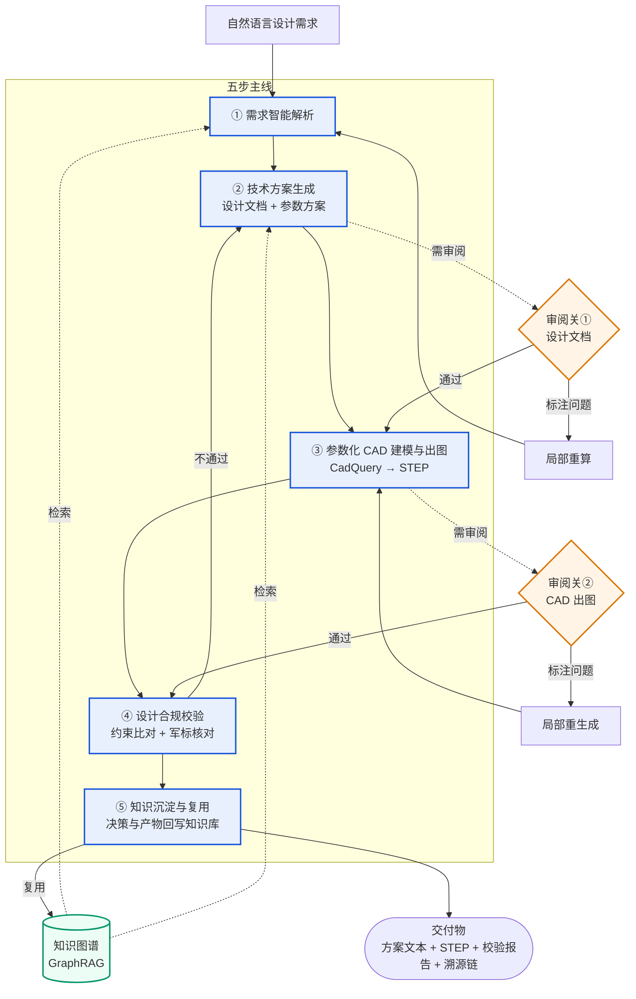
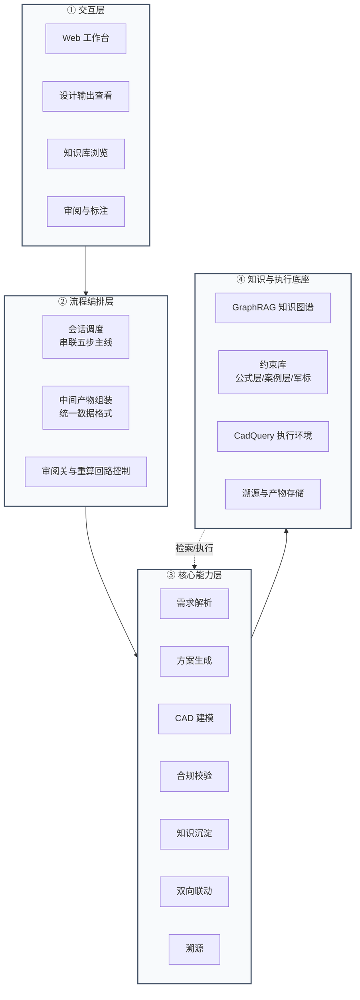
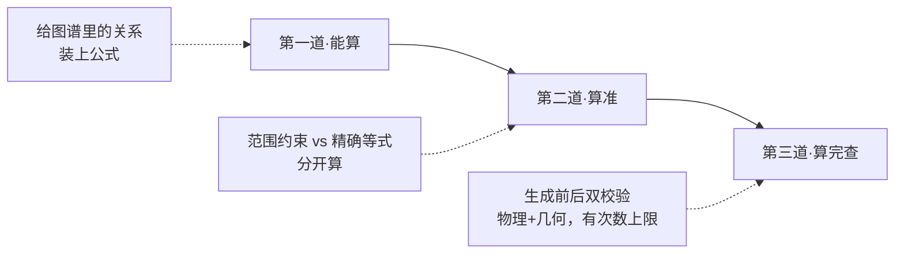

# 声呐装备智能辅助设计系统 · 项目总体设计

---

## 目录

1. [系统定位与价值边界](#1-系统定位与价值边界)
2. [系统总览](#2-系统总览)
3. [全流程设计（五步主线）](#3-全流程设计五步主线)
4. [系统架构与模块边界](#4-系统架构与模块边界)
5. [三个增强能力](#5-三个增强能力)
6. [数据与知识体系](#6-数据与知识体系)
7. [技术创新点（论文方向）](#7-技术创新点论文方向)
- [附录 术语对照表](#附录-术语对照表)

---

## 1. 系统定位与价值边界

### 1.1 要解决的问题

声呐装备设计是一条长链路：从战术使命与探测需求，到总体方案、结构参数、零部件三维建模，再到出图与合规核对。这条链路上有三个长期痛点：

| 痛点 | 表现 | 后果 |
|------|------|------|
| **链路长、人工传递损耗大** | 需求→方案→图纸在不同人、不同工具间手工传递 | 信息失真、返工多、周期长 |
| **知识难复用** | 成熟设计案例、公式、经验值散落在文档与个人经验里 | 新型号从零起步，重复犯错 |
| **合规难落地** | 设计约束（几何、声学、军用标准）靠人脑核对 | 容易漏检、事后才暴露问题 |

### 1.2 系统是什么 / 不是什么

为了不产生误读，先把边界说清楚：

**本系统是**：一套面向声呐装备**设计全流程**的智能辅助系统，以**参数化 CAD 设计为核心**，用知识图谱增强检索为设计提供可计算的依据，自动生成方案文本与标准化 CAD 文件，并对其做合规校验、把设计经验沉淀回知识库。

**本系统不是**：
- ❌ 不是通用 CAD 软件（不替代 Catia/SolidWorks，而是**产出**可被它们打开的 STEP 标准文件）；
- ❌ 不是纯文档检索系统（检索只是手段，终点是**可执行的 CAD 模型**）；
- ❌ 不是脱离人决策的自动设计机（关键节点保留人工审阅把关）。

### 1.3 总目标（一句话）

> 以参数化 CAD 设计为核心，深度集成知识图谱增强检索，实现"需求智能解析 → 技术方案生成 → 参数化 CAD 建模出图 → 设计合规校验 → 知识沉淀复用"的全流程闭环，最终同步输出**符合军用标准的专业声呐设计方案文本**与**标准化参数化 CAD 文件**，支持设计参数双向联动与全链路溯源。

---

## 2. 系统总览

### 2.1 端到端流程图

下图是系统的主干：五步主线（蓝色）串起从需求到知识沉淀的闭环，叠加两个**人工审阅关**（橙色）与若干**回写/重算回路**（虚线）。



**阅读说明**：
- 主线从左到右是一条直线，任何不熟悉项目的人都能看清"系统干什么"。
- 两个橙色审阅关 = 人在回路（详见 [5.3](#53-人在回路关键节点把关式)）：设计文档生成后、CAD 出图后各设一关，不通过则局部回算，**不必整条流程重来**。
- 知识图谱既被检索（向左虚线），也被回写（向右实线）——这就是"闭环"。

### 2.2 能力地图：八大能力一览

| 编号 | 能力 | 一句话职责 | 阶段 |
|------|------|-----------|------|
| C1 | 设计需求智能解析 | 把自然语言需求拆成结构化设计目标与子查询 | 【已实现·demo】 |
| C2 | 技术方案自动生成 | 基于知识检索，产出设计文档 + 参数方案 | 【已实现·demo】 |
| C3 | 参数化 CAD 建模与出图 | 由参数方案生成 CadQuery 脚本并产出 STEP | 【已实现·demo】 |
| C4 | 设计合规校验 | 核对参数是否满足约束/公式/军标 | 【本期扩展】 |
| C5 | 知识沉淀与复用 | 设计决策与产物回写知识库 | 【本期扩展】 |
| E1 | 参数双向联动 | 改文档参数↔CAD 特征自动同步 | 【本期扩展】 |
| E2 | 全链路溯源 | 任一参数可追溯到知识来源与计算依据 | 【本期扩展】 |
| E3 | 人在回路（关键节点把关） | 两道审阅关 + 局部重算 | 【本期扩展】 |

> C1–C5 为五步主线能力；E1–E3 为贯穿全流程的增强能力。

### 2.3 三态阶段总览表

| 能力/模块 | 【已实现·demo】<br/>现在能跑什么 | 【本期扩展】<br/>一年内要做成什么 | 【远期规划】 |
|----------|-------------------------------|--------------------------------|------------|
| C1 需求解析 | LLM 拆子查询、并行检索 | 同左，强化目标结构化 | 自然语言多轮需求澄清 |
| C2 方案生成 | LLM 整合知识为设计文档 | 参数方案可计算、带出处 | 多方案比选 |
| C3 参数化 CAD | CadQuery 生成 + STEP 出图 + 自动修复 | 增加生成前后双校验 | 多型号模板库 |
| C4 合规校验 | 仅校验"代码跑不跑" | 校验"参数合不合理"（约束+军标接入框架） | 全量军标合规 |
| C5 知识沉淀 | 无 | 设计决策/产物回写知识库 | 自动知识蒸馏 |
| E1 双向联动 | 无 | 文档参数↔CAD 双向同步 | 可视化拖拽联动 |
| E2 溯源 | 无 | 参数→知识→依据→特征链 | 设计谱系可视化 |
| E3 人在回路 | 全自动跑通 | 两道审阅关 + 局部重算 | 协同标注平台 |
| 知识库 | 307 实体/371 边（单案例） | 公式可算、约束分层、军标接入 | 多声呐类型覆盖 |
| 创新点 | 无 | 约束推理与校验引擎 | 修复策略自学习 |

---

## 3. 全流程设计（五步主线）

本章沿 [2.1](#21-端到端流程图) 的主线，把五步逐个讲透。每步统一用四栏：**职责 / 输入→输出 / 关键做法 / 阶段标注**。

### 3.1 设计需求智能解析 〈C1〉【已实现·demo】

| 项 | 内容 |
|----|------|
| **职责** | 把一句自然语言需求（如"设计一套 32 阵元、工作深度 300m 的拖曳线列阵"），拆解为结构化的设计目标，并规划出若干条向知识库提问的子查询。 |
| **输入→输出** | 自然语言需求 → 结构化设计目标 + 4~8 条子查询 |
| **关键做法** | ① LLM 按声呐设计要素（声阵规模、工作深度、频段、拖曳方式等）抽取目标；② LLM 把目标转成多条精确检索查询；③ 多查询并行检索，避免单次检索遗漏。 |
| **边界** | **只做"理解与拆解"，不推导几何参数、不直接生成 CAD**。几何与数值留给后续步骤。 |

### 3.2 技术方案自动生成 〈C2〉【已实现·demo，本期强化为可计算方案】

| 项 | 内容 |
|----|------|
| **职责** | 综合知识库检索结果，产出一份**技术方案**。 |
| **"方案"的明确定义** | 方案 = **设计文档**（总体描述、分段结构、关键指标、材料、配色等）+ **参数方案**（一组带出处的设计参数值）。CAD 代码是参数方案的**可执行产物**，不等于方案本身。 |
| **输入→输出** | 子查询检索结果 → 设计文档（.md）+ 参数方案 |
| **关键做法** | ① LLM 把多路检索结果整合成结构化设计文档；② 参数方案区分两类来源——**公式类参数**（如长度=段数×间距）由计算得出、**案例类参数**（如外径阈值）标注为经验值，每个数都带出处。 |
| **阶段标注** | demo：文档已能生成，但参数出处未结构化；**本期**：参数方案可计算、每数有出处（见 [7](#7-技术创新点论文方向) 创新点衔接）。 |

> ⚠️ 这一步产出的设计文档会进入**审阅关①**（见 [5.3](#53-人在回路关键节点把关式)）。审阅不通过可标注问题、局部回 [3.1](#31-设计需求智能解析-c1已实现demo) 重算，无需整链路重来。

### 3.3 参数化 CAD 建模与出图 〈C3〉【已实现·demo】

| 项 | 内容 |
|----|------|
| **职责** | 把参数方案变成可运行的 CadQuery 脚本，执行后产出工业标准 **STEP** 三维模型。 |
| **输入→输出** | 参数方案 + 设计文档 → CadQuery 脚本（.py）→ STEP 三维模型（.step） |
| **关键做法** | ① 按声呐类型从参考代码库智能匹配范例；② LLM 基于范例 + 参数方案生成脚本；③ 多层校验（语法→完整性→关键建模模式）+ 自动修复已知问题；④ 执行脚本出 STEP，失败则 LLM 修复、最多重试 3 次。 |
| **建模特征** | 采用 z 游标（z-cursor）顺序装配各段，柔性段用样条+扫掠+sin² 轨迹，空心管用内外扫掠相减——支持整套多段声呐装配，非单零件。 |
| **阶段标注** | demo 已端到端跑通；**本期**：在生成前后各加一次校验（见 [7](#7-技术创新点论文方向)）。 |

> ⚠️ STEP 出图后进入**审阅关②**。不通过可标注问题、局部重新生成脚本，不回退需求解析。

### 3.4 设计合规校验 〈C4〉【本期扩展】

| 项 | 内容 |
|----|------|
| **职责** | 检查"算出来的参数"是否"合不合理"——是否满足知识库中的约束、公式与军用标准。 |
| **输入→输出** | 参数方案 + CAD 特征 → 合规校验报告（通过/不通过 + 问题清单） |
| **关键做法** | ① 把知识库约束分两类校验：**范围类**（如外径≤27mm）查参数是否落入区间；**等式类**（如长度=段数×间距）查等式是否成立；② 军用标准通过接入框架核对（当前 GJB 0 条，本期建标准库）；③ 不通过则回 [3.2](#32-技术方案自动生成-c2已实现demo本期强化为可计算方案) 修正参数。 |
| **边界** | 校验只产出结构化报告、抛出问题，**不擅自改参数**——改参数交回方案生成步骤。 |

### 3.5 知识沉淀与复用 〈C5〉【本期扩展】

| 项 | 内容 |
|----|------|
| **职责** | 把一次成功设计中的决策与产物，回写进知识库，供后续设计复用——让系统"越用越聪明"。 |
| **输入→输出** | 本次设计过程与产物 → 增量知识（新参数关系、新案例、新约束经验） |
| **关键做法** | ① 记录"哪个参数怎么取的、依据是什么"（与 [E2 溯源](#52-全链路溯源-e2本期扩展) 共用链路）；② 经审阅确认后，把稳定、可复用的部分回写知识图谱；③ 下次同类需求可直接检索复用。 |
| **边界** | 回写需经人工确认，避免把一次性的、错误的决策污染知识库。 |

---

## 4. 系统架构与模块边界

第3章是"流程视角"（按时间顺序），本章是"结构视角"（按职责分层）。两章描述同一个系统，只是观察角度不同。

### 4.1 四层架构



**各层职责一句话**：
- **交互层**：人怎么用系统（输入需求、看产物、审阅标注）。
- **流程编排层**：把五步主线按对的方式串起来、管审阅关与回算——是"指挥"，不是"干活的"。
- **核心能力层**：八个能力模块真正干活的地方。
- **知识与执行底座**：知识图谱、约束库、CAD 执行环境、产物与溯源存储——被上层调用。

### 4.2 模块职责边界（正向表述）

旧文档用"严禁 XX"的否定式防腐表，边界反而含糊。这里改成正向四列：**做什么 / 不做什么 / 输入 / 输出**。

| 模块 | 做什么 | 不做什么 | 输入 | 输出 |
|------|--------|----------|------|------|
| 需求解析 C1 | 拆解需求、规划子查询 | 不推导几何参数、不生成 CAD | 自然语言需求 | 设计目标 + 子查询 |
| 方案生成 C2 | 综合知识产出方案 | 不求解复杂隐式方程 | 检索结果 | 设计文档 + 参数方案 |
| CAD 建模 C3 | 生成脚本、出 STEP | 不盲目改参数数值，严格继承参数方案 | 参数方案 | CadQuery 脚本 + STEP |
| 合规校验 C4 | 比对约束、出报告 | 不直接改参数 | 参数方案 + CAD 特征 | 校验报告 |
| 知识沉淀 C5 | 回写可复用知识 | 不写未经验证的决策 | 设计过程与产物 | 增量知识 |
| **流程编排** | 串联步骤、组装中间产物、管回算 | 不替能力模块做业务决策 | 用户请求 | 执行序列 |

> **关键澄清**（消解旧文档矛盾）：流程编排层负责"把各步产物组装成统一中间数据格式"——它是一个**调度组件，不是能力模块**，职责单一，不与 C1–C5 混淆。

> **编排方式**：五步主线采用**固定管线**顺序串联，而非由大模型自主决策调用哪个工具——这样消除"模型决策开销"，结果更稳定可控、行为可预期。

---

## 5. 三个增强能力

这三个能力贯穿五步主线，是系统区别于"只会画图"的关键。

### 5.1 参数双向联动 〈E1〉【本期扩展】

**是什么**：设计文档里的参数与 CAD 模型的特征互为镜像——改一侧，另一侧自动同步。

**为什么需要**：现实中设计是反复迭代的。改了某段长度，不希望手工去 CAD 里再改一遍；反过来在 CAD 里调了尺寸，也希望设计文档跟着更新。没有联动，文档与图纸很快就会"对不上"。

**怎么做**（方向，不展开实现）：
- 文档→CAD：修改设计文档某参数 → 仅重跑 [3.3](#33-参数化-cad-建模与出图-c3已实现demo) 受影响段，不整链路重来。
- CAD→文档：在 CAD 中调整特征 → 反向回写参数到设计文档。
- 与 [5.3 人在回路](#53-人在回路关键节点把关式) 配合：联动触发的重算同样走审阅关。

**边界**：联动只同步参数与特征，不改变总体方案结构。

### 5.2 全链路溯源 〈E2〉【本期扩展】

**是什么**：系统产出的**每一个设计参数**，都能往上追溯到它的来源——来自哪条知识、是按哪个公式算的、还是引用了哪个案例。

**为什么需要**：军用设计最看重"可问责"。审图时要能回答"这个 27mm 外径是哪来的、为什么"。没有溯源，AI 给出的数字就是黑箱，无法验收。

**怎么做**（方向）：每个参数挂一条溯源链 `参数 → 来源知识条目 → 计算公式/案例依据 → CAD 特征`，全程记录。这条链同时供 [3.5 知识沉淀](#35-知识沉淀与复用-c5本期扩展) 与 [3.4 合规校验](#34-设计合规校验-c4本期扩展) 复用。

**边界**：溯源只记录与查询，不改值。

### 5.3 人在回路·关键节点把关式 〈E3〉【本期扩展】

**形态选择**：在**关键节点设审阅关**，而非每个中间产物都打断流程。这既保证人工对关键决策的把控，又不让设计师淹没在频繁确认里。

**两道审阅关**：

| 审阅关 | 位置 | 审阅对象 | 不通过的处理 |
|--------|------|----------|--------------|
| **审阅关①** | [3.2 方案生成](#32-技术方案自动生成-c2已实现demo本期强化为可计算方案) 之后 | 设计文档 + 参数方案 | 标注问题 → 局部回 [3.1](#31-设计需求智能解析-c1已实现demo) 重算 |
| **审阅关②** | [3.3 CAD 出图](#33-参数化-cad-建模与出图-c3已实现demo) 之后 | STEP 三维模型 | 标注问题 → 局部重新生成脚本 |

**为什么把关式而非全节点介入式**：全节点介入（每个产物都审）能力虽强，但流程被打断太碎、设计师负担重、流程图也复杂，不利于让甲方看清主线。关键节点把关在"可控"与"高效"间取得平衡。

**关键设计**：不通过时是**局部重算**——只回退到出问题的那一步，不必从需求解析整条重来。这与 [5.1 双向联动](#51-参数双向联动-e1本期扩展) 共用同一套局部重算机制。

> **定位澄清**（消解旧文档矛盾）：旧文档把"人在回路"一会儿算 MVP、一会儿放远期。本设计明确其为**本期核心能力**，由两道审阅关落地。

---

## 6. 数据与知识体系

知识是这套系统的"燃料"。本章说明知识的现状、组织方式与可信度。

### 6.1 知识图谱现状

系统采用 **GraphRAG**（知识图谱增强检索）作为知识底座。当前 demo 知识库基于一份拖曳线列阵声呐的公开设计资料构建，已索引：

| 指标 | 现状 |
|------|------|
| 实体数 | 307 |
| 关系数 | 371 |
| 社区报告 | 82 |
| 实体类型 | 声呐系统 / 结构模块 / 零部件 / 设计参数 / 性能指标 / 设计约束 / 算法 / CAD 建模标准 |

**检索方式**：三级降级——图谱检索（local）→ 语义向量检索（basic）→ 文本关键词，保证查询鲁棒。

> **诚实交代**：当前知识库源自**单一案例文本**（AI 基于参考案例整理），覆盖面有限，后续将扩充更多案例与公式。

### 6.2 约束分层：可信度的依据

知识库中的约束并非同等可靠。系统按**来源性质**分两层组织，这也是 [3.4 合规校验](#34-设计合规校验-c4本期扩展) 判断"信到什么程度"的依据：

| 约束层 | 含义 | 示例 | 校验方式 | 可信度 |
|--------|------|------|----------|--------|
| **公式层** | 有明确物理/数学公式、可解析计算 | 长度 = 段数 × 阵元间距；指向性指数 DI≈10·lg(N) | 等式校验，可直接算 | 高（可信） |
| **案例阈值层** | 来自工程案例的经验取值范围 | 声阵段外径 ≤ 27mm；工作深度 ≥ 300m | 区间校验，查是否落入范围 | 中（经验值） |

> 现有约 24 条约束可归入这两层。当前 GJB 军标约束为 **0 条**（见 6.3）。
>
> ⚠️ **澄清**（消解旧文档矛盾）：旧文档声称"100% 计算引擎驱动、严禁大模型介入数值"。本设计务实表述为：**公式类参数由计算驱动；案例类参数允许大模型在约束区间内提议取值，但必须标注来源**——既保证关键数值可算，又承认经验参数的现实。

### 6.3 军用标准接入框架

**现状**：知识库当前不含 GJB 军标（0 条），无法声称"已军标合规"。

**本期做法**（如实）：
- 设计一套**军标接入框架**（统一的数据格式与核对流程），使后续录入军标即可直接接入校验，不改系统结构。
- 录入首批与拖曳阵相关的 GJB 条目，先跑通"军标核对"这一环。
- **不空喊"军标合规"**——在标准库未建全前，合规校验报告中军标部分如实标注"待补"。

### 6.4 知识沉淀的回写路径

[3.5](#35-知识沉淀与复用-c5本期扩展) 的回写走这条路径：

```
本次设计过程（参数怎么取、依据什么）
      ↓ 经人工确认
筛选稳定可复用部分
      ↓
增量写入知识图谱（新参数关系 / 新案例 / 新约束经验）
      ↓
下次同类需求可直接检索复用
```

**关键约束**：回写必须经人工确认（走审阅关），避免把一次性错误决策污染知识库——这保证了系统"越用越聪明"而非"越用越乱"。

---

## 7. 技术创新点

本系统的核心创新，是把知识图谱从"只存储关系"升级为"能算、算得准、算完能查"。这三个创新点不是并列的三件事，而是**同一条设计流水线上的三道关**：



- **第一道·能算**：给知识图谱里的关系"装上公式"，让它不只是"知道 A 影响 B"，还能**算出具体数值**。这是把 [6.1](#61-知识图谱现状) 的静态图谱变成可计算资产。
- **第二道·算准**：要**范围**的（如外径≤27mm）和要**精确值**的（如长度=段数×间距）**分开算**，不混在一起丢精度。这对应 [6.2](#62-约束分层可信度的依据) 的约束分层。
- **第三道·算完查**：CAD 代码生成**前后各查一次**，物理约束 + 几何干涉都查，错了**有次数上限、不会死循环**。这强化 [3.3](#33-参数化-cad-建模与出图-c3已实现demo) 与 [3.4](#34-设计合规校验-c4本期扩展)。

一句话主线：**能算 → 算准 → 算得对不对**。

> 这三道关正好把 [6.2 约束分层]、[3.4 合规校验]、[3.5 知识沉淀] 串成一条可验证的方法链——这是论文的核心贡献，也是本系统区别于"参数全靠大模型猜、没有知识库和约束检查"的现有 AI-CAD 方法的根本所在。

---

## 附录 术语对照表

旧文档大量使用自造术语，本表给出平实对照，正文一律采用左栏表述：

| 正文用（平实） | 旧文档术语（已弃用） |
|---------------|---------------------|
| 等式与不等式约束分别求解 | 异构双轨制约束求解 |
| 按约束类型分类送不同校验器 | 量纲感知路由 |
| 生成 CAD 代码时自动加入几何尺寸检查 | 前向几何守卫 AST 静态注入 |
| 用知识库约束限定参数取值范围 | 符号约束围栏 |
| 记录缺失参数并标注缺失原因 | gap_list 可解释性框架 |
| 多个专职模块按流程协作 | 多 Agent 分布式协同 |
| 流程编排组件（非能力模块） | IR 组装中间件 |

---

> **文档版本**：v1.0（取代《系统架构设计_核心版》《项目方案建议书_Sonar-CAD》）
> **最后更新**：2026-06

