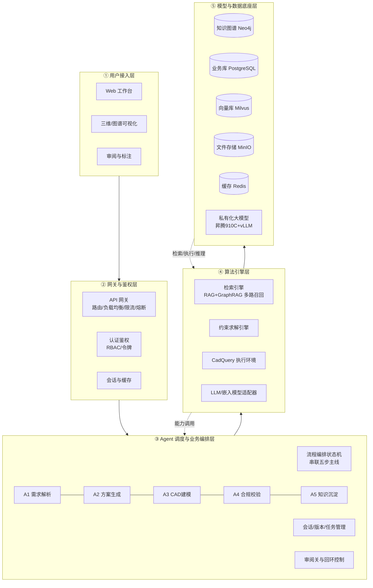
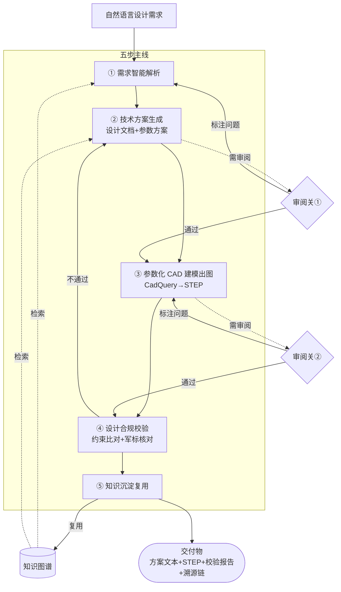
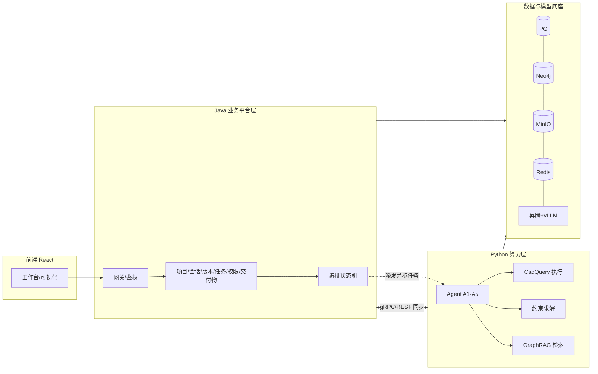
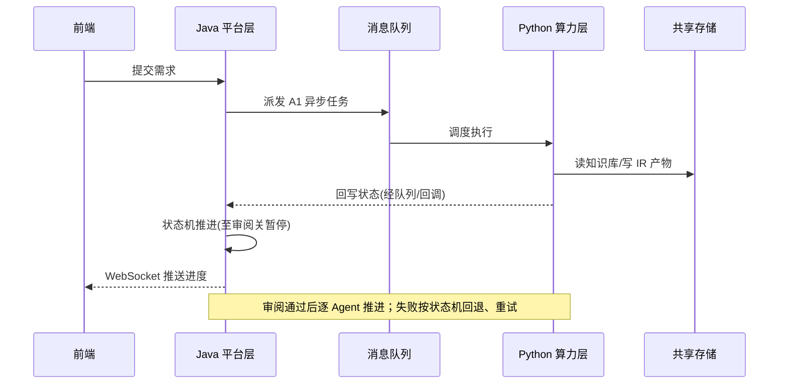
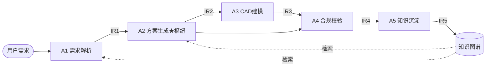

# 智能辅助声呐装备设计系统 · 总体设计方案

| 文档版本 | v1.0 |
|---|---|
| 文档类型 | 总体设计方案 |
| 编制日期 | 2026-07 |

---

## 目录

- [第 1 章 项目背景与系统定位](#第-1-章-项目背景与系统定位)
- [第 2 章 需求分析](#第-2-章-需求分析)
- [第 3 章 系统总体架构](#第-3-章-系统总体架构)
- [第 4 章 技术选型](#第-4-章-技术选型)
- [第 5 章 功能设计](#第-5-章-功能设计)
- [第 6 章 Agent 智能体与流程编排设计](#第-6-章-agent-智能体与流程编排设计)
- [第 7 章 数据与知识体系](#第-7-章-数据与知识体系)
- [第 8 章 接口与集成设计](#第-8-章-接口与集成设计)
- [第 9 章 安全与合规](#第-9-章-安全与合规)
- [第 10 章 部署与运维](#第-10-章-部署与运维)
- [第 11 章 项目实施计划](#第-11-章-项目实施计划)
- [附录](#附录)

---

# 第 1 章 项目背景与系统定位

## 1.1 项目背景

声呐装备设计是一项长链路工程：从战术使命与探测需求，到总体方案、结构参数、零部件三维建模，再到出图与合规核对。该链路长期存在三方面痛点：

| 痛点 | 表现 | 后果 |
|---|---|---|
| 链路冗长、人工传递损耗大 | 需求、方案、图纸在不同人员与工具之间手工传递 | 信息失真、返工频繁、周期延长 |
| 知识难以复用 | 成熟设计案例、公式、经验值分散于文档与个人经验 | 新型号从零起步，重复踩坑 |
| 合规难以落地 | 设计约束（几何、声学、军用标准）依赖人工核对 | 易漏检，问题往往滞后暴露 |

本系统旨在以**参数化 CAD 设计为核心**，深度集成知识图谱增强检索与大模型推理，将上述链路打通为一条"需求智能解析 → 技术方案生成 → 参数化 CAD 建模出图 → 设计合规校验 → 知识沉淀复用"的全流程闭环，同步输出符合军用标准的专业设计方案文本与标准化参数化 CAD 文件。

## 1.2 系统定位与能力边界

为避免产生歧义，首先界定系统的能力范围。

**本系统是**：一套面向声呐装备设计全流程的智能辅助系统，以参数化 CAD 设计为核心，通过知识图谱增强检索为设计提供可计算的依据，自动生成方案文本与标准化 CAD 文件，实施合规校验，并将设计经验沉淀回知识库。

**本系统不是**：

- 不是通用 CAD 软件（不替代 Catia/SolidWorks，而是产出可被其打开的 STEP 标准文件）；
- 不是纯文档检索系统（检索仅为手段，最终输出为可执行的 CAD 模型与可签发的设计方案）；
- 不是脱离人工决策的自动设计机（关键节点保留人工审阅把关）。

## 1.3 建设目标

**总体目标**：实现"需求智能解析 → 技术方案生成 → 参数化 CAD 建模出图 → 设计合规校验 → 知识沉淀复用"的全流程闭环，最终同步输出符合军用标准的专业声呐设计方案文本与标准化参数化 CAD 文件，支持设计参数双向联动与全链路溯源。

**分期目标**：

| 阶段 | 目标 |
|---|---|
| 一期（项目原型） | 打通五 Agent 状态机流转与"需求→方案→CAD→校验→沉淀"完整异步闭环 |
| 二期（闭环强化） | 参数双向联动、约束推理校验精度优化、压力测试通过 |
| 三期（生产上线） | 军标规模化录入与全量合规核对、生产部署上线 |

## 1.4 设计原则

| 原则 | 含义 |
|---|---|
| 技术先进性与工程可落地性统一 | 在确保前沿性的同时，强调实用性、稳定性与资料适配性 |
| 数据驱动、分阶段建设 | 优先围绕已掌握资料构建知识底座，能力随数据增量激活 |
| 人在回路、可问责 | 关键节点设审阅关，每个参数可溯源至知识与依据 |
| 模块化、可扩展 | 插拔式架构，标准/规则以配置而非硬编码接入 |
| 安全合规、信创优先 | 军用内网私有化部署，数据不出网，兼容国产软硬件 |
| 可解释、可追溯、可修订 | 生成结果标注证据来源，支持溯源、差异对比与人工修订 |

---

# 第 2 章 需求分析

## 2.1 业务需求

系统须覆盖声呐装备设计的全流程闭环，核心业务需求为：

1. 接收自然语言或文档形式的设计需求，智能解析为结构化设计目标；
2. 基于知识库检索，生成技术方案文本与带出处的参数方案；
3. 由参数方案生成参数化 CAD 脚本并产出 STEP 三维模型；
4. 对参数与特征进行合规与一致性校验，出具可操作的报告；
5. 将成功设计的决策与产物沉淀回知识库，供后续复用；
6. 全程支持人工审阅、参数双向联动与全链路溯源。

## 2.2 功能需求清单

| 类别 | 功能模块 |
|---|---|
| 核心设计流程 | 需求智能解析、技术方案与参数生成、参数化 CAD 建模出图、合规与一致性校验、知识沉淀与案例复用、参数双向联动与溯源 |
| 项目与协作管理 | 设计项目管理、会话与状态管理、版本管理、任务管理、用户与权限管理、交付物管理 |
| 知识与数据治理 | 知识库管理、公式/约束/军标库管理、多 CAD 格式解析接入、基础元数据管理、记忆系统 |
| 平台支撑 | 系统主页与工作台、系统管理与监控运维 |

各模块设计详见第 5 章。

## 2.3 非功能需求

| 维度 | 指标 |
|---|---|
| 并发 | 支持高设计并发 |
| 响应 | 单次完整设计闭环端到端 ≤ 15 分钟（优化目标）                 |
| 检索性能 | 知识检索阶段经优化后 ≤ 4 分钟 |
| 安全 | 设计数据全程内网，不出网；审计日志独立留存 |
| 可维护性 | 模块化、容器化部署，支持无停机扩缩容与配置热更新 |
| 兼容性 | 输出 STEP 等工业标准文件，可被主流 CAD 软件打开；支持多格式文档与 CAD 资料接入 |

## 2.4 用户角色与使用场景

| 角色 | 主要职责 | 关键权限 |
|---|---|---|
| 设计师 | 提交需求、审阅方案/CAD、迭代参数、下载交付物 | 项目/会话读写、参数编辑、审阅关裁决（本人项目） |
| 审阅人 | 对设计文档与 CAD 出图做合规把关 | 审阅关裁决、批注、回退 |
| 知识库管理员 | 资料入库、知识库与图谱维护、军标/公式/约束录入 | 知识库读写、知识审阅关确认、元数据管理 |
| 项目管理员 | 项目立项、成员与权限分配、进度跟踪 | 项目级管理、成员管理 |
| 系统管理员 | 用户/角色/模型/部署配置、监控运维 | 全系统管理权限 |

详细权限矩阵见附录 C。

## 2.5 约束与假设（诚实声明）

- **CAD 资料现状**：当前掌握的 CAD 资料有限，仅支撑"接入路径论证"，不支撑整机全自动 CAD 设计；当前原型基于一份拖曳线列阵声呐公开资料构建知识库。
- **知识库现状**：单案例来源，已索引约 307 实体 / 371 关系 / 82 社区报告；国家军用标准（GJB）条目尚为 0，待增量注入。
- **部署约束**：定位为军用声呐装备设计，设计数据不得出网，须私有化部署。
- **AI 辅助定位**：经验公式/经验规律以"风险提示/辅助分析"为主要应用方式，不直接替代工程定型判断；关键节点人工把关。

---

# 第 3 章 系统总体架构

## 3.1 架构设计原则与分层思路

系统采用分层解耦架构，核心思路是"职责集中、接口契约化、能力可替换"：

- **职责分离**：业务编排逻辑与计算密集逻辑分别归入不同层级，避免在一个模块内堆积过多职责；
- **契约化交互**：层与层之间通过明确的接口与数据契约（如 IR、消息、REST/gRPC 接口）通信，互不暴露内部实现；
- **可独立演进**：每一层可单独开发、测试、扩缩容与替换（例如更换底层 CAD 内核或大模型，不影响上层业务编排）。

基于上述思路，系统自上而下划分为用户接入、网关鉴权、调度编排、算法引擎、数据底座五层，整体架构见图 3-1。

## 3.2 五层架构总览



图 3-1 系统五层架构

该架构的关键在于"业务编排与计算分离"：编排与业务管理逻辑集中在上层，计算密集的 Agent / CAD / 求解集中在下层（具体技术分工见图 3-3）。图中实线表示自上而下的正向调用与数据流，虚线表示下层向上回供的检索、执行与推理能力。

## 3.3 各层职责详述

**① 用户接入层**：系统统一门户。基于 React 19 + Ant Design 构建响应式工作台，提供需求输入、任务中心、方案审阅、CAD 预览、校验报告、知识库浏览、系统管理等入口；集成三维预览（Three.js / React Three Fiber）、图谱可视化（D3.js）、图表（ECharts）与代码/文档编辑（Monaco）。

**② 网关与鉴权层**：基于 Nginx + Spring Cloud Gateway 构建高性能 API 网关，提供反向代理、负载均衡、路由转发、协议转换（HTTP/HTTPS/WebSocket）、熔断降级与限流控制；认证鉴权基于 Spring Security + RBAC；会话与热数据缓存于 Redis，支持多会话并发与断点恢复。

**③ Agent 调度与业务编排层**：系统业务中枢。以有向无环图（DAG）引擎 + 状态机实现任务编排、状态流转与过程跟踪；承载五个主线 Agent（A1–A5）、横切服务（参数联动、溯源、人在回路），以及会话/版本/任务/项目/权限等业务管理职能。Agent 运行于隔离沙箱，经事件总线协同。

**④ 算法引擎层**：检索与推理中枢。包含检索引擎（标准检索增强生成 RAG 的稀疏/稠密混合检索 + 交叉编码器重排序；GraphRAG 知识图谱增强检索的局部多跳 + 全局社区发现）、约束求解引擎、CadQuery 执行环境、统一大语言模型（LLM）/嵌入模型适配器（屏蔽异构模型差异，管控并发与限流）。

**⑤ 模型与数据底座层**：持久化与算力支撑。知识图谱（Neo4j）、业务库（PostgreSQL）、向量库（Milvus）、文件存储（MinIO）、多层缓存（Redis）、私有化大模型（昇腾 910C + vLLM + 开源模型 Qwen / DeepSeek 系列）等，数据不出网。

## 3.4 核心业务流



图 3-2 端到端核心业务流：五步主线 + 两道审阅关 + 知识闭环

如图 3-2 所示，一条设计需求从自然语言输入开始，依次经过需求解析、方案生成、CAD 建模出图、合规校验、知识沉淀五个阶段，最终产出方案文本、STEP 模型、校验报告与溯源链等交付物。其中在**方案生成后**与**CAD 出图后**各设一道人工审阅关，未通过即局部回退重做（虚线箭头），避免错误向下游传递。同时，每个阶段的检索都依赖知识图谱，沉淀阶段又将新的设计经验回写知识图谱，从而形成"检索—设计—沉淀"的闭环，使系统能力随使用持续累积。

## 3.5 技术栈总体划分

系统采用 **Java + Python 双后端**：Java 承担业务与平台层（网关、权限、项目-会话-版本、交付物、编排状态机、对外 API），Python 承担 Agent 与算力层（Agent 实现、LLM 调用、GraphRAG 检索、CadQuery 执行、约束求解）。两层通过消息队列（异步任务）+ REST/gRPC（同步调用）+ 共享存储解耦协作。详细选型见第 4 章。



图 3-3 双后端技术栈总体划分

图 3-3 给出双后端的技术分工：前端统一由 React 构建；Java 平台层集中处理网关鉴权，以及项目、会话、版本、任务、权限、交付物等业务管理与流程编排；Python 算力层承担 Agent 执行、CadQuery 建模、约束求解、GraphRAG 检索等计算密集任务；两者共同读写同一套数据与模型底座。Java 与 Python 之间，同步调用走 gRPC/REST，异步算力任务则由编排层派发到消息队列、交由 Python worker 消费，从而实现"业务编排"与"计算实现"的彻底解耦——任一侧的升级或替换都不会牵连另一侧。

---

# 第 4 章 技术选型

## 4.1 选型原则

成熟稳定主流技术优先；适配军用内网私有化与信创要求；AI/CAD/求解生态优先（Python 原生）；长期可维护、可扩展、可替换。基于此，系统采用 Java + Python 双后端。

## 4.2 业务与平台层（Java）

| 技术 | 用途 |
|---|---|
| Java 17 + Spring Boot 3 | 业务平台主框架 |
| Spring Cloud Gateway | API 网关（路由/负载均衡/限流/熔断） |
| Spring Security + JWT | 认证鉴权（RBAC） |
| MyBatis-Plus | 持久化 |
| Spring StateMachine / Camunda | 流程编排状态机（审阅关、回环、断点续跑） |
| Redisson | 分布式锁（用于参数联动防环形震荡、任务调度） |

理由：企业级成熟度、事务一致性、并发能力、信创/国产化生态兼容、长期可维护，适合承担项目/会话/版本/权限/交付物/编排等平台职能。

## 4.3 AI 与算力层（Python）

| 技术 | 用途 |
|---|---|
| Python 3.12 + FastAPI | 算力服务框架 |
| Celery + Redis/RabbitMQ | 异步任务调度（Agent/CAD/求解任务） |
| LangChain / LlamaIndex | LLM 编排 |
| Microsoft GraphRAG | 知识图谱增强检索 |
| CadQuery（OCP/OpenCascade 内核） | 参数化 CAD 建模与 STEP 导出 |
| Z3 / casadi | 约束求解与数值计算 |
| MinerU / PP-Structure | 多格式文档解析与 OCR |

理由：CadQuery 仅 Python 可用；GraphRAG、LLM 工具链、约束求解库生态原生在 Python，Agent 用 Python 实现更便利。

## 4.4 前端

| 技术 | 用途 |
|---|---|
| React 19 + Ant Design | UI 框架与组件库 |
| React Router / Zustand | 路由与状态管理 |
| React Three Fiber（基于 Three.js） | STEP 三维预览 |
| ECharts | 数据可视化 |
| D3.js | 知识图谱可视化 |
| Monaco Editor | 设计文档/CadQuery 脚本编辑查看 |
| TanStack Query | 服务端状态获取与缓存（任务进度、参数联动轮询） |
| Vite + TypeScript | 构建工具与类型系统 |
| WebSocket 客户端 | 实时任务进度与参数变更推送 |

## 4.5 数据与存储

| 组件 | 选型 | 可替代项 |
|---|---|---|
| 知识图谱 | Neo4j 5 | — |
| 业务库 | PostgreSQL 17 | 达梦/OpenGauss（信创） |
| 向量库 | Milvus | Qdrant（最小部署若关闭 basic 降级层可省） |
| 文件存储 | MinIO | AWS S3 兼容对象存储 |
| 缓存/消息 | Redis 7.2 | Valkey（开源分支） |

## 4.6 中间件与集成

- **消息队列**：Redis（Celery broker）/ RabbitMQ，用于 Java 派发异步算力任务、Python worker 间协同。
- **API 网关**：Nginx + Spring Cloud Gateway。
- **实时通信**：WebSocket（任务进度、参数联动通知、Agent 执行日志）。
- **跨语言调用**：Java ↔ Python 同步调用走 REST/gRPC，异步走消息队列。

## 4.7 私有化大模型部署

定位为军用设计，**数据不出网**，采用私有化部署：华为昇腾 910C 服务器 + vLLM 推理框架 + 开源模型（Qwen / DeepSeek 系列）。LLM 调用前置脱敏代理，剥离项目代号、型号、关键性能指标。公网 API 仅作开发期 fallback。

## 4.8 Java 与 Python 双后端解耦与协作机制



图 4-1 双后端协作时序

**协作要点**：

- Java 编排层维护会话状态机与 IR 版本，**不感知**算力实现；
- Python worker 无状态执行 Agent/CAD/求解，结果统一写共享存储（PG/Neo4j/MinIO），不回调业务逻辑；
- 失败/超时由 Java 状态机按既定策略回退或重试，Python worker 失败任务进死信队列隔离。

---

# 第 5 章 功能设计

## A 组 · 核心设计流程

### 5.1 设计需求智能解析

| 项 | 内容 |
|---|---|
| 职责 | 将自然语言或上传文档形式的需求解析为结构化设计目标，并规划检索子查询 |
| 输入→输出 | 需求（自然语言 / PDF / Word / Excel / 图片）→ 结构化目标 + 子查询 + 检索证据集 |
| 关键交互 | 多格式文档上传与光学字符识别 OCR（MinerU/PP-Structure）；按声呐设计要素抽取目标并标记缺失项；解析进度实时反馈；解析后进入人工核对界面，分模块（基础信息/功能/性能/环境/接口）校验修订 |
| 必要性 | 全流程入口，需求理解质量决定下游成败 |

### 5.2 技术方案与参数生成

| 项 | 内容 |
|---|---|
| 职责 | 综合检索结果生成技术方案文档与带出处的参数方案 |
| 输入→输出 | 检索证据集 → 设计文档（Word/PDF）+ 参数方案表 |
| 关键交互 | ① 大纲生成（左侧层级树、中央正文、右侧助手面板，标题可溯源至原文）；② 内容生成（流式输出、参数与知识库智能匹配、超限/优于预警）；③ 引用映射（正文段落↔原文双向定位）；④ **方案文档自动排版与军标格式报表导出**（一键生成符合军用格式的 Word/PDF 设计说明书，含参数表、溯源依据、校验结论） |
| 必要性 | 方案文本是交付后的核心产物之一；排版导出直接影响可用性 |

### 5.3 参数化 CAD 建模与出图

| 项 | 内容 |
|---|---|
| 职责 | 将参数方案转化为 CadQuery 脚本，执行产出 STEP 三维模型 |
| 输入→输出 | 参数方案 + 设计文档 → CadQuery 脚本（.py）→ STEP（.step） |
| 关键交互 | 按声呐类型匹配参考范例；LLM 生成脚本；多层静态校验（语法/完整性/建模模式）+ 自动修复；执行出 STEP，失败修复重试（次数上限可配）；三维预览 |
| 必要性 | CAD 文件是交付甲方的另一核心产物，参数化建模是系统差异化能力 |

### 5.4 设计合规与一致性校验

| 项 | 内容 |
|---|---|
| 职责 | 校验参数与 CAD 特征是否满足约束、公式与军用标准，对方案正文做风险质检 |
| 输入→输出 | 参数方案 + CAD 特征 + 方案正文 → 校验报告 |
| 关键交互 | **三级风险分类**：高风险（事实错误/逻辑矛盾/数据失实，红色，必须修正）、中风险（引用缺失/表述不当/术语不规范，黄色，警告）、低风险（格式/标点/风格，蓝色，提示）；按参数来源类型分流校验（公式类等式校验、案例类区间校验、军标类符合性核对、估算类重点复核）；AI 修改建议 + 前后差异对比 + 一键优化；约束满足率 CSR 汇总 |
| 必要性 | 三级风险使问题可定位、可处置                                 |

### 5.5 知识沉淀与设计案例库复用

| 项 | 内容 |
|---|---|
| 职责 | 将成功设计的决策与产物回写知识库，沉淀为可复用案例 |
| 输入→输出 | 设计过程与产物 → 增量知识（新参数关系/新案例/新约束经验） |
| 关键交互 | 抽取稳定可复用部分；与现有知识去重比对；以 pending 候选形式产出，经**知识审阅关**人工确认后才写入图谱；下次同类需求可检索复用历史案例 |
| 必要性 | 使系统具备持续累积能力，避免每次从零起步 |

### 5.6 参数双向联动与全链路溯源

| 项 | 内容 |
|---|---|
| 参数双向联动（E1） | 设计文档参数 ↔ CAD 特征互为镜像，修改一侧另一侧自动同步；按依赖类型分流传播；引入变更发起方原子锁与最大传播深度，防环形震荡死循环 |
| 全链路溯源（E2） | 每个参数可追溯至来源知识条目、计算公式/案例依据、CAD 特征，并记录变更历史与影响范围 |
| 必要性 | 联动保证文档与图纸一致；溯源是军用设计"可验收"的硬要求 |

## B 组 · 项目与协作管理

### 5.7 设计项目管理

提供设计项目全生命周期管理：立项、基础配置、成员分配、进度跟踪、多维检索（按名称/时间/状态/负责人）、归档与删除。列表逐行呈现项目核心指标与风险标识，操作列提供详情/编辑/历史结果/归档入口。

### 5.8 会话与状态管理

| 项 | 内容 |
|---|---|
| 职责 | 管理一次设计任务的全过程状态 |
| 状态机 | `pending → running → paused（审阅关）→ completed / failed`，含校验回退分支 |
| 关键能力 | 会话级缓存（Redis 存状态/当前步骤）；**断点恢复**（中断后恢复工作状态）；WebSocket 实时推送当前阶段与进度；会话超时自动清理 |
| 必要性 | 长链路设计任务必然跨多次会话与中断，状态管理与断点恢复是工业级基本要求 |

### 5.9 版本管理

| 项 | 内容 |
|---|---|
| 三级模型 | 项目（Project）→ 设计会话（Session）→ IR 快照版本（Version） |
| 关键能力 | IR 不可变快照（每次变更追加新版本，支持溯源/回退）；当前可编辑工作副本与历史版本职责分离；版本对比、回滚至任意合规时点、归档、软删 |
| 必要性 | 局部回环（修改单参数无需重跑全流程）依赖 IR 版本管理；版本回退是容灾与防污染基础 |

### 5.10 任务管理

| 项 | 内容 |
|---|---|
| 职责 | 管理异步算力任务（Agent 执行、CAD 生成、约束求解） |
| 关键能力 | 任务列表与状态（运行中/已完成/失败）；进度追踪与预计剩余时间；失败重试（上限可配）；失败任务隔离至**死信队列**，不阻塞主队列；任务日志查看 |
| 必要性 | 异步系统必备；任务可观测与隔离是高可用前提 |

### 5.11 用户与权限管理

基于 RBAC 的角色权限管理（矩阵见附录 C）；权限粒度覆盖项目级、会话级、知识库读写级、审阅关裁决权；支持鉴权令牌、会话超时清理；单租户为主，预留多租户扩展。

### 5.12 交付物管理

统一管理一次设计的全部交付物：STEP 三维模型、设计文档（Word/PDF）、CadQuery 脚本、校验报告、溯源链（JSON）。支持登记、与项目-会话-版本绑定、多格式导出、签发与下载。视觉/图纸类资产（架构图/结构图/仿真图等）按需并入本模块登记。

## C 组 · 知识与数据治理

### 5.13 知识库管理

| 能力 | 说明 |
|---|---|
| 多格式入库 | 支持 PDF/Word/TXT/Markdown/Excel/图片，集成 OCR、分块、结构化抽取、向量化 |
| 库类型 | RAG 向量库 / GraphRAG 图谱库 / 混合库 |
| 本体 Schema | 围绕声呐类型、部件、参数、标准、接口、来源文档定义实体与关系类型 |
| 构建/更新 | 全量构建 + 增量更新（仅处理变动部分，提示实体冲突与冗余） |
| 图谱可视化 | 力导向全局视图 + 邻域局部视图；支持交互探索、高亮推理路径、**图谱手动编辑**（增删实体/关系、属性版本历史、合并去重） |
| 导出 | 支持 json/csv 等格式导出分段与原文对应关系 |

### 5.14 公式库 / 约束库 / 军标库管理

| 项 | 内容 |
|---|---|
| 职责 | 为约束推理引擎与合规校验提供可运营的规则来源管理界面 |
| 关键能力 | 公式条目录入（表达式、变量、输出量、求解方式）；约束条目维护（类型、表达式/区间、可信度分层、来源引用）；军标条目录入（条目编号、约束类型、适用对象、判定表达式、优先级）；可信度分层（公式层/案例阈值层/军标层）；规则启用/停用 |
| 必要性 | 军标与约束以"插拔式规则注入"接入，若无管理界面则规则无法录入与运营，框架形同虚设 |

### 5.15 多 CAD 格式解析与资产接入

| 格式 | 解析策略 | 输出 |
|---|---|---|
| DWG/DXF（AutoCAD） | 标题栏、标注、属性块抽取 | 结构化三元组 |
| SLDPRT/SLDASM（SolidWorks） | 装配关系、材料属性、参数化特征 | 图谱实体与关系 / JSON |
| PRT（UG/Creo）、CATPart（CATIA） | 装配树、参数、公差 | JSON/CSV |

经解析中间件转化为结构化文本/JSON/CSV 后，作为知识库的 CAD 数据接入路径（当前为接入路径论证阶段）。

### 5.16 基础元数据管理

| 子模块 | 内容 |
|---|---|
| 声呐类型 | 按安装形式（艇艏/舷侧/拖曳）与功能体制（侧扫/多波束/前视/SAS/被动）双维度枚举 |
| 频率段定义 | 低频/中频/高频/甚高频，频率范围、应用场景、参考军标 |
| 性能参数规范 | 探测距离/方位分辨率/距离分辨率/发射声压级等单位、取值范围、业务定义 |
| LLM 模型注册表 | 多模型接入（云端商用 + 本地私有化）、模型适配器、并发与资源管控、热切换、状态监控 |
| 提示词模板管理 | Agent/检索/校验各环节提示词模板的版本化管理与调优（LLM 系统必备，常被忽视） |

### 5.17 记忆系统

为应对多 Agent 协同与长链路设计中的上下文衰减，构建三层记忆：

| 层 | 内容 | 生命周期 |
|---|---|---|
| 全局共享黑板 | 全局约束、设计方案大纲、核心技术指标 | 会话级，各 Agent 实时读取 |
| 局部工作记忆 | 当前任务的上下文连贯性、对话历史 | 任务级 |
| 长期知识库 | 沉淀的案例、参数关系、约束经验 | 持久（知识图谱） |

记忆系统与知识库、溯源链共用持久化链路，避免进程重启丢失。

## D 组 · 平台支撑

### 5.18 系统主页与工作台

仪表盘展示系统运行状态与业务数据（项目统计、知识库状态、资料解析进度、方案生成状态、风险项数量）；实时追踪进行中的设计任务进度；**通知中心**推送审阅请求、任务完成、参数变更；AI 助手面板实时记录 Agent 集群执行日志（检索标准、匹配参数、生成草稿、执行校验等轨迹）。

### 5.19 系统管理与监控运维

监控指标（API 响应、Agent 执行时长、错误率、资源占用、业务指标、缓存命中率）；日志分流（应用日志 → ELK；审计日志 → 独立审计库；Agent 轨迹 → 溯源表；任务日志 → 独立文件）；告警规则（建模超时、CadQuery 失败率、检索延迟、缓存命中率、队列长度）；配置管理（超时层级、并发参数抽离至环境变量，支持动态调优）；**数据备份恢复与知识库导出**（GraphML 快照、业务库备份、任意时点回退）。

---

# 第 6 章 Agent 智能体与流程编排设计

## 6.1 多 Agent 协作总览

五个主线 Agent 按固定管线串联，由编排层调度；横切能力（参数联动、溯源、人在回路）以服务方式贯穿；底座（知识图谱、约束库、CAD 执行环境）经明确接口被调用。



图 6-1 Agent 拓扑（固定管线 + 横切服务 + 底座）

图 6-1 展示五个主线 Agent 的固定管线：A1 解析需求产出 IR1，交由枢纽 Agent A2 生成方案与参数（IR2），随后并行进入 A3 建模与 A4 校验，最终由 A5 沉淀为增量知识（IR5）回写知识图谱。横切能力（参数联动、溯源、人在回路）以服务方式贯穿全程，知识图谱则为各 Agent 提供检索依据（虚线）。Agent 之间不直接耦合，只通过 IR 与编排层协作，从而保证每个环节可独立替换、独立重算。

## 6.2 各 Agent 职责与边界（简表）

| Agent | 职责 | 输入 IR | 输出 IR | 边界 |
|---|---|---|---|---|
| A1 需求解析 | 需求 → 结构化目标 + 子查询 + 检索证据 | IR0 | IR1 | 不推导几何参数、不赋值 |
| A2 方案生成 | 检索结果 → 设计文档 + 参数方案 | IR1 | IR2（枢纽） | 不解复杂隐式方程、不写 CAD 代码 |
| A3 CAD 建模 | 参数方案 → CadQuery 脚本 + STEP | IR2 | IR3 | 严格继承参数，矛盾抛回 A2 |
| A4 合规校验 | 参数 + 特征 → 校验报告 | IR2+IR3 | IR4 | 仅出报告，不改参数 |
| A5 知识沉淀 | 设计过程产物 → 增量知识 | IR1–IR4 | IR5 | 回写须经知识审阅关确认 |

## 6.3 流程编排与状态机

编排由编排层统一负责，Agent 自身不感知流程顺序。编排层以 DAG + 状态机实现：① 按固定顺序调用 Agent、传递 IR；② 在审阅关处暂停、等待人工裁决、按裁决执行局部回环；③ 维护 IR 版本，支撑局部重算与溯源。

**局部回环**是关键设计：回退时仅重跑受影响的 Agent，下游已有产物按需失效重算，"修改单个参数"无需"重跑全流程"。

## 6.4 中间表示（IR）数据契约

Agent 之间通过 IR 传递数据，每个参数均标注取值来源（`source_type`：formula/case/standard/estimated），决定下游校验与可信度处理。IR 流转：IR0（原始需求）→ IR1（设计目标）→ **IR2（方案·枢纽）** → IR3（建模产物）→ IR4（校验报告）→ IR5（增量知识）。详细字段定义见附录 B。

## 6.5 人在回路

在关键节点设两道审阅关（而非逐产物打断）：

| 审阅关 | 位置 | 审阅对象 | 未通过 → |
|---|---|---|---|
| ① | 方案生成之后 | 设计文档 + 参数方案（IR2） | 局部回退至 A1/A2 |
| ② | CAD 出图之后 | STEP 模型（IR3） | 局部重新生成脚本 |

另设自动回路：A4 校验未通过 → 自动回退 A2 修正参数。关键节点把关在"可控"与"高效"间取得平衡。

---

# 第 7 章 数据与知识体系

## 7.1 知识库内容体系

知识库涵盖三大类：

| 类别 | 内容 | 作用 |
|---|---|---|
| 规范与标准（约束类） | GJB（如 GJB 23B-2018 声纳换能器通用规范）、GB、ISO/IEC | 定义必须满足的设计要求，生成合规规则 |
| 结构与设计知识（机理类） | 声呐分类体系、核心部件四大子系统（声学/电子/结构机械/辅助）、装配关系 | 定义"如何设计"，知识图谱实例层装配模板 |
| 历史方案与图纸（经验类） | 历史 CAD 资料、设计模式、参数化实例 | 沉淀工程经验，复用设计模式 |

## 7.2 知识图谱架构

**三层结构**：概念层（声呐类型/部件类别/性能指标）→ 实例层（具体型号/历史方案/标准条款）→ 关系层（组成/约束/映射）。

**本体 Schema**（实体类型 + 关系谓词）：

- 实体类型：SonarSystem / StructuralModule / TransducerArray / Transducer / Component / DesignParameter / PerformanceIndicator / Formula / StandardClause
- 关系谓词：`consists_of`（组成）/ `has_parameter`（含参数）/ `made_of`（材料）/ `fulfills`（满足标准）/ `COMPUTED_BY`（由公式计算）/ `CONSTRAINED_BY`（受约束于）/ `GOVERNED_BY`（受军标治理）

**公式节点**：承载可计算化，记录表达式、变量列表、输出量、单位类型（几何/声学/结构）、求解方式（解析/区间/迭代）。

## 7.3 知识图谱现状基线（诚实声明）

| 指标 | 现状 |
|---|---|
| 实体数 | 307 |
| 关系数 | 371 |
| 社区报告 | 82 |
| 来源 | 单一案例文本（拖曳线列阵声呐公开资料） |
| 军标条目 | 0（待增量注入） |

后续将扩充更多案例、公式与军标。

## 7.4 检索引擎

**三级降级**保证鲁棒：图谱检索（local）→ 语义向量检索（basic）→ 文本关键词。

**多路召回与融合**：

- 标准 RAG：查询意图重写 + 稀疏/稠密混合检索 + 交叉编码器重排序；
- GraphRAG：局部实体子图多跳推理 + 全局社区发现与分层语义摘要；
- 多源融合：动态权重 + 倒数秩融合（RRF）+ 相关度动态阈值截断，保证注入大模型的高信噪比上下文。

## 7.5 约束库与军标接入框架

约束按来源性质分层，决定可信度与校验方式：

| 约束层 | 含义 | 校验方式 | 可信度 |
|---|---|---|---|
| 公式层 | 有明确公式、可解析计算 | 等式校验 | 高 |
| 案例阈值层 | 工程案例经验取值范围 | 区间校验 | 中 |
| 军标层 | 军用标准强制要求 | 符合性核对 | 强制 |

**插拔式军标接入**：标准条目以结构化元数据（条目编号、约束类型、适用对象、判定表达式、优先级）配置化注入约束网络，而非硬编码。当前以"框架调度—规则解析—冲突诊断"机制闭环为研发重点；标准库数据增量注入后自动激活全量核对，"数据录入"与"系统能力"解耦。

## 7.6 声呐设计参数体系

系统内置四类参数体系（节选）：

| 类别 | 代表参数 | 约束关系示例 |
|---|---|---|
| 结构参数 | 阵列长度 L、阵元直径 d、阵元间距 Δd、耐压舱直径、系统总重、重心 | 装配包络匹配 |
| 声学性能参数（核心） | 工作频率 f、带宽 B、声源级 SL、发射功率、接收灵敏度、指向性指数 DI、探测距离 R、分辨率、信噪比 | DI=10lg(N)；δR=c/(2B)；R∝D·√f |
| 环境适应性参数 | 工作水深、温度范围、盐雾等级、抗冲击、抗振动、水密等级 | GJB 系列 |
| 可靠性指标 | 平均故障间隔时间（MTBF）、平均修复时间（MTTR）、故障保护 | GJB 系列 |

## 7.7 数据存储设计

| 存储 | 用途 | 关键内容 |
|---|---|---|
| PostgreSQL | 业务数据 | projects / design_sessions / ir_snapshots（不可变版本）/ parameter_schemes（可编辑工作副本）/ review_records / artifacts / traceability_chain / users / roles 等 |
| Neo4j | 知识图谱 | 实体、关系、公式节点、约束/军标条目 |
| Milvus | 向量检索 | GraphRAG basic 降级层依赖 |
| MinIO | 文件存储 | step-models / cad-scripts / design-docs / validation-reports / knowledge-dumps |
| Redis | 多层缓存 | LLM 调用、查询、参数计算、代码生成缓存；会话热数据；任务状态；WebSocket 频道 |

## 7.8 知识沉淀回写路径

```
本次设计过程（参数怎么取、依据什么）
      ↓ 经知识审阅关人工确认
筛选稳定可复用部分 → 去重比对
      ↓
增量写入知识图谱（新参数关系/新案例/新约束经验）
      ↓
下次同类需求可直接检索复用
```

回写须经人工确认，避免一次性错误决策污染知识库。

---

# 第 8 章 接口与集成设计

## 8.1 API 总体规范

对外接口遵循统一的工程规范：

- **通信协议**：核心业务接口采用 RESTful 风格（基于 HTTP/JSON）；任务进度、参数变更等实时场景采用 WebSocket 长连接由服务端主动推送；
- **认证鉴权**：所有接口经网关统一鉴权，基于 JWT 令牌 + RBAC 角色控制访问（角色与权限见附录 C）；
- **契约先行**：以 OpenAPI 规范文档作为前后端唯一契约来源，支持自动生成 Mock、客户端类型与联调桩，降低跨团队协作成本；
- **版本与兼容**：接口路径携带版本号（`/api/v1/...`），保证后续演进向后兼容。

## 8.2 核心 API 端点（示例）

| 方法 | 路径 | 作用 |
|---|---|---|
| POST | `/api/v1/workflow/sessions` | 创建设计会话（异步任务） |
| GET | `/api/v1/tasks/{task_id}` | 查询任务状态 |
| GET | `/api/v1/workflow/sessions/{sid}/irs/{type}` | 获取中间产物（IR） |
| POST | `/api/v1/workflow/sessions/{sid}/reviews/gate1` | 提交审阅关①决定 |
| POST | `/api/v1/parameters/{pid}/update` | 更新参数（触发双向联动） |
| GET | `/api/v1/parameters/{pid}/trace` | 获取参数溯源链 |
| WS | `/api/v1/ws/tasks/{tid}` | 实时推送任务进度与参数变更 |

## 8.3 Java–Python 跨语言集成契约

- **异步任务**：Java 编排层将 Agent/CAD/求解任务序列化为消息（含 session_id、IR 版本号、入参引用），投入消息队列；Python worker 消费执行，结果写共享存储，状态经回调/队列回传。
- **同步调用**：少量需即时返回的算力请求（如公式即时计算、单次检索试探）走 REST/gRPC。
- **数据共享**：双方仅通过共享存储（PG/Neo4j/MinIO）交换 IR 与产物，不直接传递大对象。

## 8.4 与企业现有系统集成

提供标准 API 接口，支持与企业产品数据管理/产品生命周期管理（PDM/PLM）系统、CAD 工具链、统一身份认证对接；输出 STEP 等标准文件可被主流 CAD 软件直接打开。

---

# 第 9 章 安全与合规

声呐装备设计数据涉及型号、关键性能指标与战术用途，属于敏感/涉密信息。本章作为系统安全与合规的**集中说明**，定义贯穿全生命周期的安全红线与合规要求；与之相关的具体实现均以本章为口径、不再各自复述。

## 9.1 安全合规总体要求

面向军用场景，系统须满足以下总体要求：

| 要求 | 说明 |
|---|---|
| 数据不出网 | 设计数据全程驻留内网，禁止任何形式的外网回传，是首要红线 |
| 涉密信息管控 | 涉及密级的信息按密级管理规定存储、流转与销毁，最小知悉范围 |
| 私有化部署 | 大模型、知识库、存储均在内网本地化，不依赖外部云服务 |
| 信创优先 | 关键软硬件优先国产化、自主可控 |
| 全程可审计可追溯 | 所有关键操作留痕、可还原、可追责，支撑合规验收 |

## 9.2 数据安全与生命周期

**数据不出网**：知识图谱、设计文档、STEP 模型、校验报告全程存储于内网，Neo4j / MinIO 等存储组件不暴露公网端口；前后端、算力服务、数据层均部署于同一可信内网域。

**数据生命周期保护**：针对设计数据从产生到销毁的全过程，逐环节施加保护：

| 阶段 | 保护措施 |
|---|---|
| 采集 | 外部资料入库前经格式校验与来源标注；涉密资料按密级隔离存储 |
| 存储 | 业务库/图谱/文件分库分桶隔离；敏感字段加密存储；MinIO 桶按项目/密级划分访问边界 |
| 处理 | 算力任务在隔离容器沙箱执行；进程间不交叉读取无关项目数据 |
| 传输 | 内网通信启用 SSL/HTTPS；服务间调用与 WebSocket 均经鉴权 |
| 归档 | 项目归档后转为只读；GraphML 快照与业务库备份支持任意时点回退 |
| 销毁 | 过期/废弃数据按密级管理要求销毁，删除操作记入审计 |

## 9.3 涉密信息与大模型脱敏

即便采用私有化大模型，系统仍以**纵深防御**对待模型输入，前置脱敏代理对送入大模型的文本进行清洗：

- **剥离字段**：项目代号、型号、战术使命、关键性能指标（如工作频率、探测距离、声源级）、人员与单位名称等；
- **占位与回填**：剥离处以中性占位符替换，大模型返回结果后再按映射回填，保证生成文本可用而不泄露敏感信息；
- **最小化原则**：仅向模型提供完成当前子任务所必需的最少上下文，不整包投喂设计文档；
- **公网 fallback 受控**：公网 API 仅作开发期 fallback，生产环境强制禁用。

## 9.4 权限、审计与合规可追溯

**权限控制**：基于 RBAC 角色权限模型，权限粒度覆盖项目级、会话级、知识库读写级与审阅关裁决权。

**审计留痕**：审计日志独立留存（不混入应用日志），记录所有 Agent 调用、参数变更、人工审阅决定、知识回写与导出操作，对接溯源体系（E2），任何设计结论均可还原"由谁、在何时、依据什么作出"。

**合规核对可追溯**：合规校验的每一条结论均关联至具体军标条款或约束条目，校验报告与溯源链一并归档为交付物，满足军用设计"可验收、可追责"的硬要求。

## 9.5 信创适配

关键软硬件优先国产化、自主可控，满足信创要求：

- **算力**：华为昇腾 910C 推理芯片/服务器；
- **数据库**：兼容达梦、OpenGauss 等国产关系型数据库；
- **中间件**：兼容 Valkey 等 Redis 开源分支；
- **大模型**：采用 Qwen / DeepSeek 等开源模型系列，避免绑定单一外部供应商。

## 9.6 私有化部署与运行安全

大模型与算力服务采用昇腾 910C + vLLM + 开源模型的私有化部署，与外部网络物理/逻辑隔离，数据不出网；生产环境禁用公网 API fallback。运行期安全（健康探针、限流熔断、失败隔离、灾备回退）与监控告警、日志分流在第 10 章统一说明。

---

# 第 10 章 部署与运维

## 10.1 部署架构

采用 Docker / Kubernetes 容器化部署，分层架构：浏览器 → CDN/Nginx（SSL）→ 应用层（Java 平台集群 + Python 算力 worker 集群 + WebSocket 服务）→ 任务队列层（Celery worker + Beat + Redis broker）→ 数据层（PG 主从 / Neo4j / Milvus / MinIO / Redis）→ 执行层（CadQuery 执行容器池 + 约束求解容器池）。

## 10.2 容器化与服务编排（Docker Compose）

| 服务 | 说明 |
|---|---|
| frontend | React 前端（Nginx 托管静态资源） |
| platform（Java） | Spring Boot 平台层，网关/鉴权/编排/业务管理，多实例 |
| agent-worker（Python） | FastAPI + Celery worker，Agent/CAD/求解，挂载 CadQuery 执行目录 |
| pg / redis / neo4j / minio / milvus | 数据与存储 |
| nginx | 反向代理 + SSL |

连接信息经环境变量注入（`DATABASE_URL`、`REDIS_URL`、`NEO4J_URI`、`MINIO_ENDPOINT`、`LLM_API_KEY`），数据卷独立挂载持久化。

## 10.3 性能优化

基于原型性能数据（端到端约 15 分钟，其中知识检索阶段约 6.5 分钟为最大瓶颈），采用四层优化：

| 层级 | 措施 |
|---|---|
| L1 缓存 | LLM/查询/参数计算/代码生成缓存 |
| L2 队列 | Celery 异步队列（8–16 workers） |
| L3 并行 | Agent 内部并行查询、Agent 间流水线 |
| L4 查询 | 查询合并、图谱分区、增量索引 |

## 10.4 高可用与容灾

| 等级 | 场景 | 应对 |
|---|---|---|
| P0 阻断 | 核心服务宕机 | 双活部署 + 健康探针切换；PG 流复制热备；Neo4j GraphML 快照回滚 |
| P1 降级 | 算力过载 | 网关令牌桶限流 + 熔断，超载返回 429 结构化降级；前端指数退避重试 |
| P2 容错 | 单任务失败 | 修复循环（重试上限可配）；失败任务进死信队列隔离 |
| 数据安全 | 知识误写/污染 | 知识审阅关 + IR 版本任意时点回退 |

任一 Agent 输出异常，编排层依据 IR 版本快照回退至最近合规状态，局部重算，无需重跑全流程。

## 10.5 监控告警与日志

监控指标（API 响应、Agent 执行时长、错误率、资源占用、业务指标、缓存命中率）；日志分流（应用 → ELK；审计 → 独立审计库；Agent 轨迹 → 溯源表；任务 → 独立文件）；告警规则（Agent 执行超时、CadQuery 失败率 > 10%、检索延迟 > 30s、缓存命中率 < 60%、队列长度 > 100）。

## 10.6 环境配置矩阵

关键工程参数（建模超时、任务软/硬超时、并发 worker 数）抽离至环境变量，支持不重启动态调优。超时层级由内到外逐级放大：内层 CadQuery 建模超时（120–600s 弹性）→ 中层任务软超时（基线 15 分钟）→ 外层硬超时强杀兜底（基线 20 分钟）。

---

# 第 11 章 项目实施计划

## 11.1 分阶段实施路线

| 阶段 | 定位 | 核心目标 |
|---|---|---|
| Phase 1 · Base Line | 原型系统 | 五 Agent 状态机流转打通、需求→方案→CAD→校验→沉淀最小闭环、前后端框架与基础设施、任务队列、横切能力串联 |
| Phase 2 · Advanced | 闭环强化 | 参数双向联动（变更抑制）、约束推理校验精度优化、多层缓存与查询调优、压力测试 |
| Phase 3 · Extensible | 生产上线 | 军标规模化录入与全量合规核对、生产部署与监控告警完善、用户培训与正式上线 |

## 11.2 里程碑与验收标准

| 里程碑 | 交付物 | 验收标准 |
|---|---|---|
| M1 基础架构 | 前后端框架、数据库、缓存 | 能创建项目、查询知识图谱 |
| M2 核心流程 | A1–A2、IR 契约、任务队列 | 跑通"需求→方案"异步任务 |
| M3 完整闭环 | A3–A5、横切能力 | 跑通完整五步流程 |
| M4 生产就绪 | 性能优化、监控告警 | 通过 50 并发压测、CSR 达标、无环形震荡 |
| M5 正式上线 | 生产部署、培训 | 系统稳定运行、用户可用 |

## 11.3 关键风险与应对

| 风险 | 应对 |
|---|---|
| 异步任务超时 | 超时分级控制 + 失败重试 + 死信隔离 |
| 知识检索性能瓶颈 | 多层缓存 + 查询优化 + 图谱分区 |
| LLM 推理成本/延迟 | 提示词优化 + 结果缓存 + 私有化部署 |
| 前后端联调复杂 | OpenAPI 文档先行 + Mock + 类型检查 |
| 并发不足 | worker 动态扩展 + Redis Cluster + 负载均衡 |
| CAD 资料不足 | 接入路径先行，分阶段补充资料 |

## 11.4 交付物清单

- 智能辅助声呐装备设计系统软件一套；
- 一次完整设计的交付物：方案文本（Word/PDF）、STEP 三维模型、CadQuery 脚本、校验报告、溯源链；
- 项目设计说明书、使用说明书、大模型部署与接口资料；
- 私有化部署环境（昇腾 910C 服务器）。

---

# 附录

## 附录 A 术语表

**A. 业务与领域概念**

| 术语 | 含义 |
|---|---|
| 声呐（Sonar） | 利用声波进行水下探测、测距与成像的装备，本系统的设计对象 |
| GJB | 国家军用标准（"国军标"），声呐装备设计须强制遵循的规范体系，如 GJB 23B-2018 声纳换能器通用规范 |
| GB | 国家标准（"国标"） |
| ISO / IEC | 国际标准化组织 / 国际电工委员会制定的国际标准 |
| SAS | 合成孔径声呐（Synthetic Aperture Sonar），一类高分辨率水下成像声呐 |
| MTBF | 平均故障间隔时间（Mean Time Between Failures），可靠性指标，越大越可靠 |
| MTTR | 平均修复时间（Mean Time To Repair），可维护性指标，越小越好 |
| PDM / PLM | 产品数据管理 / 产品生命周期管理系统，企业用来管理图纸、BOM、设计变更的工业软件 |
| 信创 | 信息技术应用创新，要求关键软硬件国产化、自主可控 |
| 昇腾 910C | 华为自研的 AI 推理加速芯片/服务器，用于军用内网私有化部署大模型 |

**B. AI、检索与大模型**

| 术语 | 含义 |
|---|---|
| AI | 人工智能 |
| LLM | 大语言模型（Large Language Model），如 Qwen、DeepSeek，本系统用它理解需求、生成方案与代码 |
| RAG | 检索增强生成（Retrieval-Augmented Generation）：先从知识库检索相关资料，再交给大模型作答，使结果"有出处、可溯源" |
| GraphRAG | 知识图谱增强检索：在 RAG 基础上结合知识图谱的关系结构，提升复杂问题的回答质量 |
| 嵌入模型（Embedding） | 把文字转化为向量（一串数字）的模型，用于衡量语义相似度 |
| 向量检索 | 按语义相似度从库中找最相关内容（区别于按关键词字面匹配） |
| 稀疏检索 / 稠密检索 | 关键词匹配 / 语义匹配两种检索方式，本系统混合使用以提高召回率 |
| 交叉编码器重排序 | 对初步检索结果用更精细的模型重新打分排序，提升精度 |
| RRF | 倒数秩融合（Reciprocal Rank Fusion），把多路检索结果合并排序的方法 |
| OCR | 光学字符识别（Optical Character Recognition），把图片/PDF 中的文字提取为可编辑文本 |
| 提示词（Prompt） | 输入给大模型、引导其按预期作答的指令文本 |
| Agent（智能体） | 能自主完成一类任务的 AI 程序单元，本系统设五个主线 Agent（A1–A5） |
| Token | 大模型处理文本的最小单位（约等于半个汉字到一个词），是计费与长度计量单位 |

**C. 系统架构与工程**

| 术语 | 含义 |
|---|---|
| IR（中间表示） | Agent 之间传递的结构化数据契约（IR0–IR5），是各环节对接的"统一表格" |
| source_type | 参数取值来源类型：formula（公式）/ case（案例）/ standard（标准）/ estimated（估算） |
| confidence | 参数可信度：high / medium / low |
| CSR | 约束满足率（Constraint Satisfaction Rate），合规校验的量化指标（满足的约束占比） |
| DAG | 有向无环图（Directed Acyclic Graph），一种任务依赖关系图，本系统用它编排流程 |
| 状态机 | 描述任务在"待办/运行/暂停/完成/失败"等状态间流转的模型 |
| 死信队列 | 存放反复失败、无法正常处理任务的隔离队列，避免拖垮主流程 |
| 限流 / 熔断 | 过载时主动拒绝部分请求 / 暂停调用下游，保护系统不雪崩 |
| 令牌桶 | 一种限流算法，按固定速率发放"令牌"控制请求频率 |
| RBAC | 基于角色的访问控制（Role-Based Access Control），按角色授予权限 |
| JWT | JSON Web Token，一种登录令牌，用于身份认证 |
| API | 应用程序接口，软件之间对接的标准入口 |
| REST / RESTful | 一种主流的、基于 HTTP 的 API 设计风格 |
| gRPC | 一种高性能跨语言远程调用协议 |
| WebSocket | 支持服务器主动向浏览器推送消息的通信协议（用于实时进度推送） |
| OpenAPI | 描述 API 接口的规范文档，便于前后端协同开发 |
| Mock | 接口的模拟实现，便于在真实后端就绪前联调 |
| CDN | 内容分发网络，加速前端资源加载 |
| SSL / HTTPS | 加密通信协议 / 其上的安全网页协议 |
| ELK | Elasticsearch + Logstash + Kibana，主流的日志收集与检索分析平台 |

**D. 技术产品与组件**

| 术语 | 含义 |
|---|---|
| React / Ant Design | 前端界面开发框架 / 配套的成熟组件库（按钮、表格、表单等） |
| Spring Boot / Spring Cloud / Spring Security | Java 主流企业级后端框架套件（含网关、安全鉴权等） |
| MyBatis-Plus | Java 持久化框架，负责读写数据库 |
| FastAPI / Celery | Python 的高性能 Web 框架 / 异步任务调度框架 |
| CadQuery | 基于 Python 的参数化 CAD 建模库，本系统用它生成 STEP 三维模型 |
| OCP / OpenCascade | CadQuery 底层使用的开源 CAD 几何内核 |
| Z3 / casadi | 约束求解器 / 数值计算库，用于公式求值与约束校验 |
| LangChain / LlamaIndex | 大模型应用编排框架 |
| MinerU / PP-Structure | 多格式文档解析与版面识别工具（PDF/图片转结构化文本） |
| PostgreSQL（PG） | 主流开源关系型数据库，存业务数据 |
| Neo4j | 主流图数据库，存知识图谱 |
| Milvus / Qdrant | 向量数据库，存语义向量用于检索 |
| MinIO | 兼容 S3 的对象存储，存文件（STEP、文档、图纸） |
| Redis / Valkey | 内存缓存与消息中间件，加速访问与排队 |
| RabbitMQ | 消息队列，服务间异步通信 |
| vLLM | 开源大模型推理加速框架 |
| Qwen / DeepSeek | 阿里通义千问 / DeepSeek 开源大模型系列 |
| Docker / Kubernetes（K8s） | 容器化部署 / 容器集群编排技术 |
| Nginx | 高性能反向代理与 Web 服务器 |
| STEP | 工业标准三维模型交换格式（.step），可被 Catia/SolidWorks 等主流 CAD 打开 |

## 附录 B IR 数据契约字段定义（示例）

**IR2 参数方案表**（全系统枢纽）字段：

| 字段 | 含义 | 示例 |
|---|---|---|
| id | 参数唯一标识 | P-014 |
| name | 参数名 | 声阵段外径 |
| value + unit | 取值与单位 | 27 mm |
| source_type | 来源类型 | formula / case / standard / estimated |
| source_ref | 来源引用 | 公式编号 / 知识条目 ID / GJB 条目 |
| derivation | 取值依据 | 公式计算过程 / 案例引用说明 |
| confidence | 可信度 | high / medium / low |
| trace_id | 溯源链 ID | T-0042 |
| dependencies / dependents | 依赖与被依赖参数 | [P-007, P-009] / [P-021] |

## 附录 C 用户角色权限矩阵

| 功能 / 角色 | 设计师 | 审阅人 | 知识库管理员 | 项目管理员 | 系统管理员 |
|---|:---:|:---:|:---:|:---:|:---:|
| 提交需求/迭代参数 | ✓（本人项目） | — | — | ✓ | ✓ |
| 审阅关裁决 | ✓（本人） | ✓ | — | — | ✓ |
| 知识库读写/知识审阅 | — | — | ✓ | — | ✓ |
| 军标/公式/约束录入 | — | — | ✓ | — | ✓ |
| 项目立项/成员管理 | — | — | — | ✓ | ✓ |
| 用户/角色/模型/部署配置 | — | — | — | — | ✓ |
| 监控运维/数据备份 | — | — | — | — | ✓ |

## 附录 D 基础元数据字典（示例）

**声呐类型（双维度）**：

- 按安装形式：艇艏阵、舷侧阵、拖曳阵
- 按功能体制：侧扫、多波束、前视、合成孔径（SAS）、被动

**频率段**：低频段 / 中频段 / 高频段 / 甚高频段（各含频率范围、应用场景、参考军标）。

**性能参数规范**：探测距离、方位分辨率、距离分辨率、发射声压级（各单位、取值范围、业务定义）。

## 附录 E 实施现状增补（2026-09-30）

> **增补声明**：本附录为纯增量增补，正文（第 1 章至附录 D）内容一字未改，设计口径仍以正文为准；本附录仅同步截至增补日的**实施现状**，供阅读时对照。实施细节与后续优化路线见仓库 `docs/设计实现对照与优化路线.md`，进度事实源为仓库 `docs/roadmap.md`。

### E.1 实施现状总览

截至 2026-09-30，系统已按本方案完成**一期（Base Line）全部目标**并发布 v0.1.0（2026-09-20）：

| 本方案里程碑 | 验收标准 | 增补日状态 |
|---|---|---|
| M1 基础架构 | 能创建项目、查询知识图谱 | 已达成 |
| M2 核心流程 | 跑通"需求→方案"异步任务 | 已达成 |
| M3 完整闭环 | 跑通完整五步流程 | 已达成（v0.1.0 已打 tag） |
| M4 生产就绪 | 50 并发压测、CSR 达标、无环形震荡 | 未开始（对应二期目标） |
| M5 正式上线 | 生产部署、培训 | 未开始（对应三期目标） |

代码库内部按阶段推进至 PHASE-008（阶段 0～8 全部收官，多数"待人工验收"）。测试资产：py-engine 约 252 个单测 + 5 条 e2e（含 mock LLM server），Java 侧约 41 个测试。

### E.2 超出本方案设计范围的新增能力（实施期增补）

以下两项能力为本方案编制时未包含、实施期新增的能力线（均有 ADR 决策记录）：

1. **CAD 交互微调（FreeCAD 集成，PHASE-008，ADR-004）**：FreeCAD 薄插件（`clients/freecad-plugin/SonarCADLink`，零凭据、平台账号换 JWT）+ py-engine 后端大脑（`cad_agent` 模块，ReAct 文本协议）。流程：A3 完成后的设计会话 → 插件拉 STEP 导入 → 点选+自然语言微调 → 每轮收敛上传真实 STEP → 几何实测 → IR3 追加新版本 → 审阅关②审定稿（裁决记录冻结微调版本）。一期微调机制为增量编辑脚本；参数化特征树编辑列二期。
2. **知识库多库与会话选库（PHASE-006）**：文档↔知识库多对多归属、检索按库三层过滤（Milvus/Neo4j）、Agent 自动库路由、会话建会话时手选库（不选=Agent 自主圈定）、A5 回写批准时手选目标库。

### E.3 关键实现口径与正文的差异对照

以下为实施落地后与正文表述存在口径差异的条目（正文不改，以本表为准阅读）：

| 正文位置 | 正文口径（编制时） | 实施现状（增补日） |
|---|---|---|
| §3.4 / §6.5 人在回路 | 两道审阅关（方案后 / CAD 后） | 实为**三道**：gate1（IR2 后）/ gate2（IR3+IR4 后）/ knowledge 知识关（IR5 沉淀确认后），与 §5.5"知识审阅关"呼应 |
| §7.3 知识库现状基线 | 307 实体 / 371 关系 / 82 社区（单案例） | 已演进为多库体系，该数字为设计时单案例口径；当前规模以 `/api/v1/kb/status` 实时为准（参考：e2e 单库实测 518 实体；语料 4 文档 / 439 chunks / 2939 条抽取） |
| §7.4 检索引擎 | 标准 RAG 稀疏/稠密混合 + 交叉编码器重排序 | 实际为三级降级链：自建 Neo4j 实体层 → Milvus 向量 → 文本关键词；GraphRAG SDK（local/basic）为可选层、未安装时自动跳过；交叉编码器重排序为规划项未实现 |
| §5.6 E1 参数双向联动 | 文档↔CAD 双向同步 | 文档→CAD 方向已实现（审阅关①驳回回环 + IR3 特征↔IR2 参数自动联动）；CAD→文档反向回写列二期（当前以 FreeCAD 微调 IR3 版本化过渡，微调版本 features 解除参数联动、人工偏差交 gate2 裁决） |
| §5.4 / 附录 A CSR | 约束满足率 CSR 汇总 | 尚未实现；IR4 现以 overall 结论 + error/warning/info 三级计数呈现 |
| §7.5 军标接入 | 军标条目待增量注入 | 框架已落地（kb_standards 表 + 分流校验逻辑），条目仍为 0，check 为空时如实提示"待补" |
| §10.2 部署 | frontend / platform / agent-worker 容器化 | 过渡态：数据底座（PG/Neo4j/Milvus/MinIO/Redis/RabbitMQ/Nginx 等十容器）compose 一键起、实机 9/9 healthy；Java 五服务 + py-engine + 前端为宿主机进程（`scripts/start-all` 一键启动）；应用全容器化列 v0.2 待办 |
| §5.16 基础元数据管理 | 声呐类型/频率段/性能参数规范/提示词模板管理 | 大部分未落地为管理界面；LLM 模型注册表（llm_providers）已落地并有前端供应商管理页 |
| §8.2 API 端点 | 示例端点（含 `POST /parameters/{pid}/update`） | 实际分组为 `/api/v1/workflow|kb|cad-agent|trace/**` 经网关路由；独立参数更新入口未按原样实现（联动经审阅驳回回环完成） |
| §2.3 响应指标 | 端到端 ≤15 分钟、检索 ≤4 分钟 | 为设计目标；旧 demo 实测数据（三阶段 597s）对新架构无参考性，待重新基线化 |
| §10.5 监控告警 | ELK、审计库、告警规则 | 监控告警零实现（AdminPage 服务探测 + 会话日志落库回看已有）；审计语义由不可变 IR 快照/审阅记录/溯源链承担 |

### E.4 未竟事项索引

二期（Advanced）闭环强化承诺已全部闭环（**v0.5（2026-10-06）收官**：E1 参数双向联动补全——正向参数更新入口+变更抑制（Origin Lock 窗口/传播深度=3/反向确认制）；IR1 人工核对界面；方案正文风险质检；LLM 重试退避；前端 bundle 分割；GraphRAG SDK（3.2.0）SDK 级自动优先实测；缓存命中率告警；用户指南）。**v0.6（2026-10-07）已清账**（安全合规与可启动项）：独立审计库（audit_logs 表 + 登录/用户/项目/会话/裁决/KB 写/导出留痕 + 审计查询界面——§9.4 审计留痕落地）、日志分流（Loki+promtail+Grafana 数据源——§10.5「ELK」以 Loki 承担开发环境语义、ELK 留生产替换，差异如实）、涉密语义脱敏占位回填（§9.3 机制层：身份类占位+回填默认开；数值型指标默认不脱敏并如实标注——数值剥离待「占位化+确定性 solver 代入」改造）、成员级数据权限（project_members + 项目/会话可见性过滤 + 成员管理界面——§9.4「项目级」粒度与附录 C「本人项目」落地）、PDF 导出（gotenberg 容器 docx→PDF，§5.2 Word/PDF 交付齐备；正式军标模板仍待授权）、交叉编码器重排序（§7.4：配置驱动 /rerank 客户端 + vector 扩量重排截断，未配置直通跳过如实降级）、基础元数据管理（§5.16 四子项落地为管理界面 + LLM 注册表既有——五子项全覆盖）。遗留主要欠账（外部依赖）：真实 vLLM 部署（硬件）、真实 GJB 全量录入（授权）、双活实施（生产环境）、ELK 生产替换、正式军标模板。三期（Extensible）生产上线项待生产环境。**v0.4（2026-10-01）已清账**：E1 CAD→文档反向回写（diff 提案+确认回写+gate2 复审闭环）、军标批量录入能力（batch/xlsx-csv 导入，真实 GJB 待授权）、军标格式 Word 导出、细粒度 RBAC（用户管理+三条硬规则）、通知持久化、vLLM 切换就绪（出站脱敏+失败转移，真实服务待硬件）、容灾备份（备份/恢复+演练，双活方案见 ADR-005）。**v0.3（2026-09-30）已清账**：50 并发压测（错误率 0.015%）、CSR 落地（IR4.csr+军标核对）、首批军标 demo 条目、限流/熔断/429 结构化降级、监控告警（Prometheus/Grafana + 4 条告警）、应用容器化（三镜像 + compose profile）、端到端性能重基线（真 LLM 中位 554.5s ≤15min）。完整清单（含优先级、建议方案、验收标准）见 `docs/设计实现对照与优化路线.md`。

