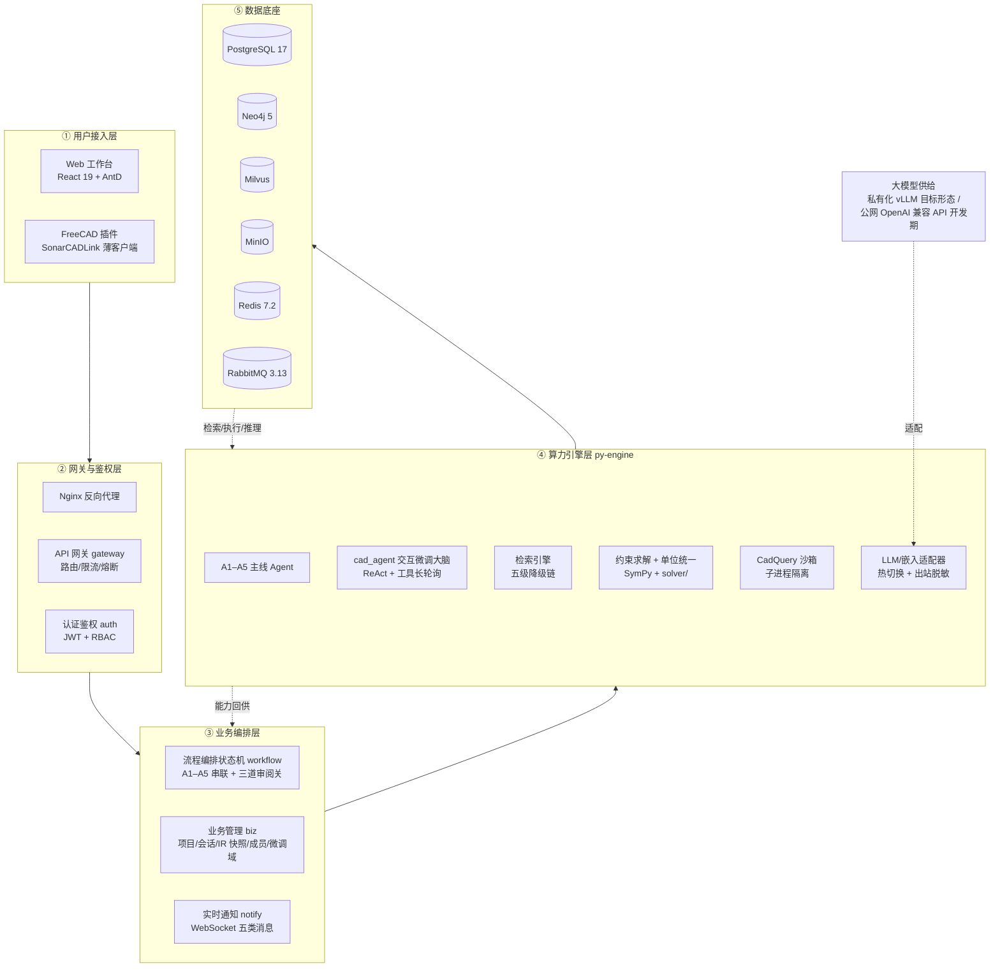
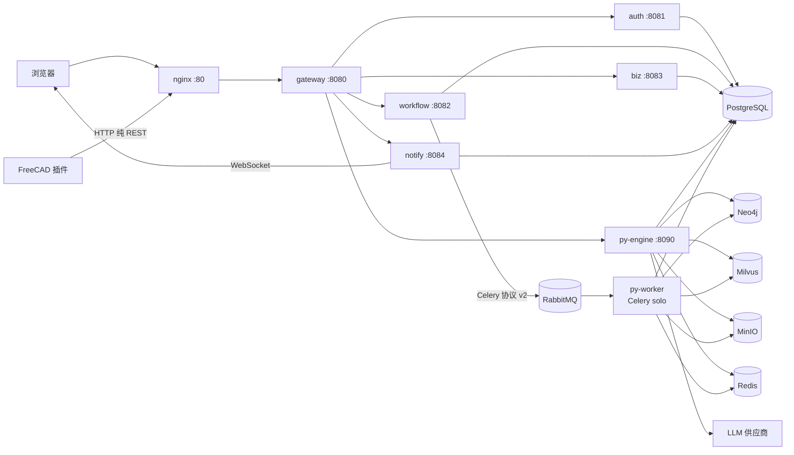
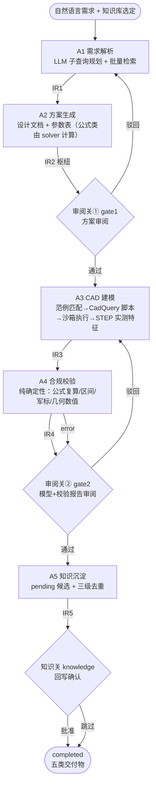
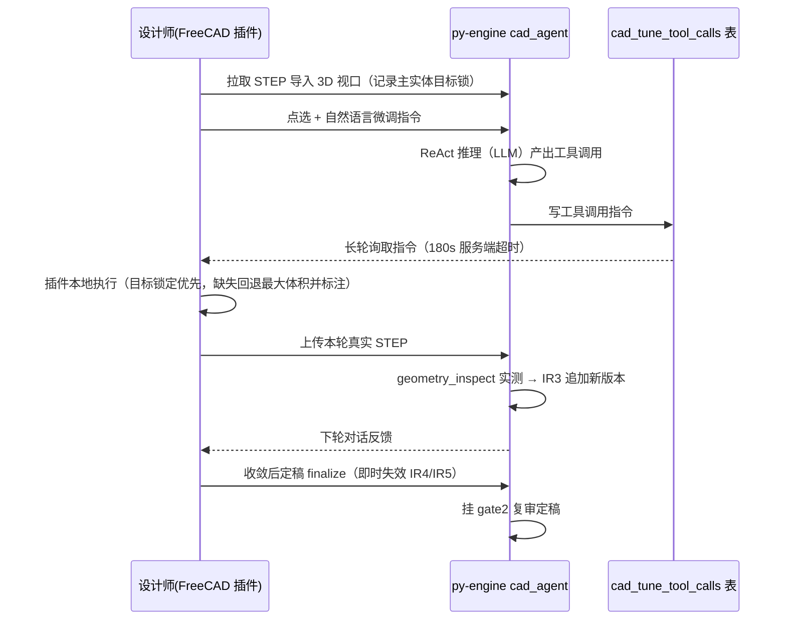
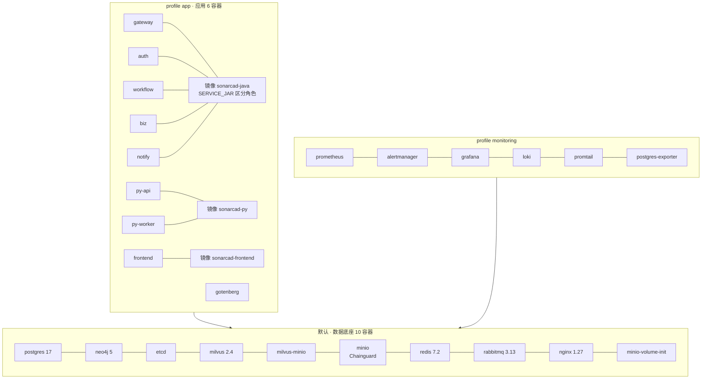

# 系统总体架构定稿

| 文档编号 | ARCH-001 |
|---|---|
| 文档版本 | v1.0（2026-10-08 定型，ADR-006） |
| 口径基准 | **v0.7.0**（tag `v0.7.0`，2026-10-08） |
| 文档类型 | 系统总体架构定稿 |
| 编写口径 | **以实际实现为准**；《智能辅助声呐装备设计系统_总体设计方案》（同目录）为叙事底本，口径差异处逐条注明；设计 ↔ 实现逐项对照见 `docs/设计实现对照与优化路线.md`（GAP-001） |
| 用途 | 项目申报、毕业论文「系统架构设计」章底稿——每节事实附出处（代码路径 / 文档章节），可验证、可答辩 |

---

## 0. 文档定位

本稿回答一个问题：**系统建成了什么、怎么组织的**。它不是设计承诺的转述，而是落地形态的定型快照；与设计底本的差异在 §2.3 集中说明，未提及处即与底本一致。出处标注约定：反引号内为代码路径或文档章节（如 `py-engine/agents/a3_cad/agent.py`、`GAP-001 §1.2`）。

---

## 1. 系统定位与能力边界

### 1.1 一句话定位

面向声呐装备设计全流程的**智能辅助设计系统**：以参数化 CAD 设计为核心、知识图谱增强检索为可计算依据，打通"需求解析 → 方案生成 → CAD 出图 → 合规校验 → 知识沉淀"五步主线闭环；三道人工审阅关把关，参数级全链溯源，输出设计方案文本（Word/PDF）、STEP 三维模型、CadQuery 脚本、校验报告与溯源链五类交付物。（叙事底本：总体设计方案 §1.1–§1.3）

项目演进中形成的定型叙事可概括为**三道关**：

| 关 | 含义 | 系统机制 |
|---|---|---|
| 能算 | 全链路自动生成：需求进、方案文档 + 参数表 + 三维模型出 | 五 Agent 固定管线（A1–A5，§4） |
| 算准 | LLM 不直接产生数值：公式类参数由代码计算，校验由确定性引擎复算 | LLM 介入白名单 + SymPy 精确复算（宪法 A-07、§4 技术方案定稿 ③） |
| 算完查 | 结论可检验、可追溯、可问责：应检未检不显示通过 | 三道审阅关 + 校验状态学（三态结论/四级风险/覆盖率）+ 全链溯源 + 独立审计 |

### 1.2 系统是什么 / 不是什么

- **是**：一套面向声呐装备设计全流程的智能辅助系统，产出可被主流 CAD（Catia/SolidWorks）直接打开的 STEP 标准文件与可签发的设计方案；
- **不是**：通用 CAD 软件（不替代 Catia/SolidWorks）；纯文档检索系统（检索是手段，输出是 CAD 模型与方案）；脱离人工决策的自动设计机（关键节点保留人工审阅）。（总体设计方案 §1.2）

### 1.3 用户角色

| 角色 | 主要职责 |
|---|---|
| 设计师 | 提交需求、审阅方案/CAD、迭代参数（E1 正向更新 + 依赖重算）、CAD 交互微调、下载交付物 |
| 审阅人 | 审阅关裁决、批注、驳回回退 |
| 知识库管理员 | 资料入库、抽取确认、知识库/图谱/元数据维护、军标/公式/约束录入、知识关确认 |
| 项目管理员 | 项目立项、成员与权限分配（v0.6 成员级数据权限） |
| 系统管理员 | 用户/角色/模型/部署配置、审计中心、监控运维 |

（底本 §2.4；v0.4 RBAC 用户管理、v0.6 成员管理落实现状见 `docs/roadmap.md` 阶段 11/13）

### 1.4 能力边界与诚实声明（A-16）

- **CAD 资料现状**：知识库基于拖曳线列阵声呐等公开资料构建（4 文档 / 439 chunks / 2939 条确认抽取，`HANDOFF.md` KB 语料行），多声呐类型规模化泛化为远期目标；
- **军标现状**：军标接入**框架完整**（条目表 + 批量导入 + SymPy 安全求值核对），但真实 GJB 条目为 0（仅 6 条 DEMO 演示条目），**待授权录入**——库空时校验如实标"待补"，不造假；
- **部署定位**：面向军用内网私有化部署（数据不出网）；开发期以公网 OpenAI 兼容 API（SiliconFlow / DeepSeek-V3.2）作 LLM fallback，接口与配置按私有化 vLLM + 昇腾预留（切换手册 `docs/ops/vLLM切换手册.md`）；
- **AI 辅助定位**：经验公式/规律以"风险提示/辅助分析"为应用方式，不替代工程定型判断。

---

## 2. 总体架构

### 2.1 五层架构

图 2-1 系统五层架构（底本 §3.2 图 3-1 的落地形态）

### 2.2 分层职责

| 层 | 职责 | 实现载体 |
|---|---|---|
| ① 用户接入层 | Web 工作台（需求输入、审阅、三维/图谱可视化、报告、知识库、管理）；CAD 交互微调入口 | `frontend/`（11 页面）、`clients/freecad-plugin/SonarCADLink` |
| ② 网关与鉴权层 | 反向代理、路由、限流熔断、JWT 鉴权、RBAC | `java-platform/gateway`、`auth`、`deploy/` nginx |
| ③ 业务编排层 | 会话状态机与任务编排、审阅关裁决与局部回环、IR 版本管理、项目/成员/交付物/通知 | `java-platform/workflow`、`biz`、`notify` |
| ④ 算力引擎层 | 五主线 Agent、交互微调大脑、检索、约束求解、CAD 执行、LLM 适配 | `py-engine/`（FastAPI + Celery） |
| ⑤ 数据底座 | 业务库、知识图谱、向量、对象存储、缓存/限流、消息队列 | 六件套（§6） |

分层设计原则（底本 §3.1）：职责分离（业务编排与计算密集分层）、契约化交互（IR / WS 消息 / REST 契约）、可独立演进（换 LLM 供应商或 CAD 内核不动上层）。

### 2.3 与设计底本的口径差异（定型形态）

| 主题 | 设计底本口径 | 定型（实现）口径 |
|---|---|---|
| 审阅关 | 两道（方案后 / CAD 后） | **三道**：gate1（IR2 后）/ gate2（IR3+IR4 后）/ knowledge 知识关（IR5 沉淀确认后） |
| 检索引擎 | 标准 RAG 混合检索 + GraphRAG | **五级降级链**：GraphRAG SDK local → basic（可选，未装自动跳过）→ 自建 Neo4j 实体层 → Milvus 向量 → 文本关键词；交叉编码器重排序为配置驱动可选项（v0.6） |
| E1 双向联动 | 文档 ↔ CAD 双向同步 | **双向齐备**（v0.4 反向 diff 提案 + v0.5 正向参数更新 + 依赖重算/变更抑制） |
| 校验结论 | 三级风险 + CSR | 三级风险升格为**四**级 severity（error/warning/info/unverified），overall 三态（pass/fail/incomplete），CSR 与 coverage 并列（v0.7 校验状态学） |
| 部署 | platform 单 Java 服务 + agent-worker | **Java 五服务**（gateway/auth/workflow/biz/notify 同镜像分角色）+ py-api/py-worker 分容器 + 前端容器；全栈容器化（v0.2 起） |

（完整差异对照：总体设计方案附录 E.3、`GAP-001 §2`）

---

## 3. 服务拓扑与职责

### 3.1 运行拓扑

图 3-1 服务运行拓扑（`deploy/docker-compose.yml`、`java-platform/gateway/src/main/resources/application.yml`）

### 3.2 服务清单

| 服务 | 端口 | 技术栈 | 职责 |
|---|---|---|---|
| gateway | 8080 | Spring Cloud Gateway + Redis 令牌桶 + Resilience4j | 统一入口：路由 / 限流 / 熔断 / JWT 校验传递 |
| auth | 8081 | Spring Security + JWT + MyBatis-Plus | 登录签发、用户/角色管理（RBAC）、审计查询 |
| workflow | 8082 | Spring StateMachine + AMQP | 会话状态机编排、三道审阅关、IR 快照查询、溯源查询、任务派发（Celery 协议 v2）、SNAPSHOT_STALE 乐观版本校验 |
| biz | 8083 | MyBatis-Plus + **Flyway**（V1–V19 启动自动迁移） | 项目、成员、会话、IR 快照、通知持久化、CAD 微调域、交付物 |
| notify | 8084 | Spring WebSocket | 五类 WS 消息推送、通知中心、告警桥接（Alertmanager → WS） |
| py-api | 8090 | FastAPI + Pydantic 2 | 内部算力 API：`/api/v1/kb|cad|cad-agent|logs|metadata`，健康探针 `/healthz`，LLM 供应商管理，`/metrics` |
| py-worker | — | Celery（solo 池） | 异步任务消费：`sonarcad.a1`–`a5`、`kb_extract`、`kb_build`；RabbitMQ broker / Redis backend |
| frontend | 3000→80 | React 19 + TS + Vite + AntD（容器内 nginx 托管） | 工作台 SPA |
| gotenberg | 3010 | gotenberg 8.15 | docx → PDF 转换（校验报告/方案文档导出） |

（出处：`java-platform/pom.xml`、各服务 `application.yml`、`py-engine/api/main.py`、`deploy/docker-compose.yml`）

### 3.3 网关路由与防护

| 路由前缀 | 目标 | 防护 |
|---|---|---|
| `/api/v1/auth`、`/api/v1/audit` | auth:8081 | JWT |
| `/api/v1/workflow`、`/api/v1/trace` | workflow:8082 | JWT；限流（校准值 WF 150/s 突发 450） |
| `/api/v1/kb|cad|cad-agent|logs|metadata` | py-engine:8090 | JWT；熔断 + TimeLimiter 120s（算力长任务），失败 → `/fallback/py-engine` 结构化 429 |
| `/api/v1/notifications` | notify:8084 | JWT |
| `/api/v1/**` 兜底 | biz:8083 | JWT |

（`java-platform/gateway/src/main/resources/application.yml`；限流校准见 `docs/reviews/压测报告_v0.3.md`）

### 3.4 py-engine 模块划分

| 模块 | 职责 |
|---|---|
| `api/` | FastAPI 路由（kb/cad/cad-agent/logs/metadata） |
| `agents/a1_requirement` … `a5_knowledge` | 五主线 Agent（各含 agent.py / prompts.py / cli.py） |
| `cad_agent/` | CAD 交互微调后端大脑：AgentLoop（ReAct 文本协议）、提案（param_proposals.py）、工具长轮询 |
| `solver/` | 可计算校验底座：formulas（公式注册表）、intervals（区间传播）、standards（军标核对）、units（单位统一，v0.7）、deps（依赖图，v0.7）、recompute |
| `knowledge/` + `kb/` | 检索服务层（五级链、多库路由）与入库管线（parsers/OCR/chunker/extractor/三库构建/重排序） |
| `cad_engine/` | CadQuery 沙箱（子进程 300s 硬超时）、静态校验器、范例库、几何实测（geometry_inspect） |
| `storage/` | 16 个 store：ir_store / neo4j_store / object_store / trace_store / audit_store / proposal_store / cache 等 |
| `llm/` | 统一 OpenAI 兼容适配器：供应商注册与热切换、失败转移、出站脱敏挂点 |
| `docgen/`、`worker/`、`observability/` | 文档渲染导出、Celery 装配与任务、指标与日志 |

### 3.5 前端与插件

- **前端**（`frontend/`）：React 19 + TypeScript + Vite + Ant Design；状态 Zustand + TanStack Query；三维 React Three Fiber、图谱 D3、图表 ECharts、编辑 Monaco。路由：登录 / 仪表盘 / 项目 / 会话（Overview-Model-Review-Report 四页签）/ 知识库（文档-图谱-元数据-供应商-公式注册表多页签）/ 系统管理。WS 指数退避重连（1s→30s）+ HTTP 对账轮询兜底（`frontend/src/ws/wsClient.ts`）。
- **FreeCAD 插件**（`clients/freecad-plugin/SonarCADLink`）：**零凭据薄客户端**（登录换 JWT，不存任何 LLM key）；纯 HTTP 标准库实现零 pip 依赖；承担 3D 视口与工具执行，"大脑"全在 py-engine `cad_agent`——工具调用经 `cad_tune_tool_calls` 表长轮询下发，服务端 180s 超时兜底（ADR-004）。

---

## 4. 核心业务流与审阅关

### 4.1 主管线

图 4-1 五步主线与三道审阅关（`HANDOFF.md` 管线现状行；`java-platform/workflow/.../statemachine/`）

管线纪律（宪法 A-01~A-05）：顺序由编排层写死，LLM 无权决定"下一步调用谁"；Agent 间不互调，只经 IR + 编排层传递；编排层只做"按序调用、审阅关控制、IR 版本维护"三件事。

### 4.2 会话状态机

`pending → running → paused（审阅关）→ completed / failed`；支持 RETRY（failed → running 按 current_stage 重派）；推进用乐观并发（`WHERE status=当前值`，冲突 409）；断点恢复按 DB 状态重建。（`java-platform/workflow/.../session/SessionService.java`、GAP-001 §1.2）

### 4.3 三道审阅关

| 审阅关 | 位置 | 审阅对象 | 通过后 | 未通过 |
|---|---|---|---|---|
| gate1 审阅关① | A2 之后 | 设计文档 + 参数方案（IR2） | 进入 A3 建模 | 局部回算 A1/A2，下游 IR 批量失效 |
| gate2 审阅关② | A3+A4 之后 | STEP 模型（IR3）+ 校验报告（IR4）；裁决记录冻结 `ir_snapshot_id` | 进入 A5 | 局部回算 A3（或经微调回路修订） |
| knowledge 知识关 | A5 之后 | 知识沉淀候选（IR5） | 回写 Neo4j（可手选目标库） | 跳过回写，会话照常收官 |

审阅提交带 **expectedSnapshotVersion 乐观版本条件**：审阅的 IR 版本已不是最新时返回 409 SNAPSHOT_STALE，前端提示刷新复核——旧页面不能批准新模型（v0.7，T14.6）。

### 4.4 驳回局部回算与下游失效

每次 Agent 产出追加**不可变 IR 快照**（版本单调递增）；驳回只重跑受影响 Agent，下游快照按需软失效（`ir_snapshots.invalidated_at`）——"改一个参数"不重跑全流程（宪法 A-11/A-12）。微调定稿等产物固化动作即时失效 IR4/IR5，强制复核后才能交付（v0.7，T14.5）。

### 4.5 CAD 交互微调回路

图 4-2 交互微调回路（ADR-004 §2.4；v0.7 目标锁定与产物版本化 T14.1/T14.5）

### 4.6 E1 参数双向联动

| 方向 | 机制 | 留痕与防护 |
|---|---|---|
| 文档 → CAD（正向） | 会话内参数更新入口 → `solver/deps.py` 依赖图定位下游公式参数 → 受控级联重算（直接更新 + 「依赖重算」修订留痕；无法定位生成待确认提案） | Origin Lock 变更抑制（发起方原子锁，传播深度上限 3，超深 409） |
| CAD → 文档（反向） | 微调轮几何 diff 提案（param_proposals）→ 人工确认 → 合并应用（同参多轮取最新，落败标 superseded）→ IR2 新版本 + 下游失效 → 自动重挂 gate2 复审 | 提案按符号精确同步推导记录（sync_derivation），候选绑定 ir2/ir4 版本 |

（v0.4/v0.5/v0.7 演进，`py-engine/cad_agent/param_proposals.py`、`py-engine/solver/deps.py`；roadmap 阶段 11/12/14）

---

## 5. IR0–IR5 中间表示契约体系

### 5.1 契约一览

| IR | 名称 | 生产者 → 消费者 | 核心内容 |
|---|---|---|---|
| IR0 | 原始需求 | 用户输入 → A1 | 自然语言需求原文 + 附件引用 + 知识库选定（kb_ids） |
| IR1 | 设计目标 | A1 → A2 | 结构化设计目标、检索子查询（4–8 条）、知识引用、缺失项清单、库路由留痕 |
| IR2 | 技术方案（**枢纽**） | A2 → A3/A4/前端 | 设计方案文档（Markdown）+ 参数表；每参数强制四件套（§5.3） |
| IR3 | 建模产物 | A3/微调 → A4/三维预览 | CadQuery 脚本（基线+微调段拼接溯源）、STEP 对象引用（版本化键 + sha256）、**features 实测几何特征**（由 STEP 提取，非 LLM 自述） |
| IR4 | 校验报告 | A4 → gate2/报告页 | overall 三态（pass/fail/incomplete）、风险四级（error/warning/info/unverified）、CSR 约束满足率、coverage 验证覆盖率 {checked/applicable/ratio}、结构化问题清单（CHK-* 编号 + 修复建议） |
| IR5 | 增量知识 | A5 → 知识关 → Neo4j | pending 候选（新参数关系/案例/约束经验），三级去重，数值回核对 IR2，绑定源版本 |

### 5.2 契约治理

- **单一事实源**：`contracts/ir/ir0.schema.json` … `ir5.schema.json` + `contracts/ws/ws-message.schema.json`（宪法 A-04）；改契约 = 改一处 + 全链路回归；
- **运行时校验**：py-engine 产出侧以 jsonschema 加载校验（`py-engine/ir_contract.py`）；
- **消费侧对齐**：前端 TS 类型与 Java 消息类**手工对齐** schema（无代码生成）——工程上如实标注为漂移风险点，靠契约测试与评审缓解；
- **向后兼容**：schema 演进只加不缩（如 IR4 三态/coverage 为加法演进，旧快照两态值天然兼容，读取端兼容处理——v0.7 实证：旧会话 IR4 v1 可正常读取展示）。

### 5.3 IR2 参数四件套（A-06，全系统可信度根基）

每参数强制携带：`source_type ∈ {formula, case, standard, estimated}` + `source_ref`（来源引用）+ `derivation`（取值依据，符号级可同步）+ `trace_id`（溯源链）；缺来源的参数不允许进入 IR2。**公式类参数取值必须由代码计算（SymPy），LLM 不得给出数值**（宪法 A-07）。v0.7 起参数值带机器可读单位（`solver/units.py`：长度/频率/电平/速度/无量纲五族，未知单位显式"未验证"）。

### 5.4 IR4 校验状态学（v0.7 定型）

| 概念 | 口径 |
|---|---|
| overall 三态 | `pass` 全部应检项通过 / `fail` 存在 error / `incomplete` 存在 unverified（应检未检）且无 error |
| severity 四级 | error（必须修正）/ warning / info（提示）/ **unverified**（应检未检：公式无法定位、复算输入不全、军标条目待补、几何未联动等——诚实暴露校验盲区） |
| CSR | 约束满足率（满足约束数 / 有效约束数，口径注释固化于 schema） |
| coverage | 验证覆盖率 = checked / applicable（必检项 = 公式复算 + 适用军标条目 + 已联动几何期望）；无必检项时如实为 null |

**设计动机**：杜绝"没查 ≠ 通过"——未执行的检查以 unverified 显式呈现并压低 overall 为 incomplete，前端报告页分色展示（`frontend/src/pages/session/ReportTab.tsx`）。

### 5.5 快照版本化与失效语义

- 三级模型：项目 Project → 设计会话 Session → IR 快照 Version（不可变追加，版本号 per (session, ir_type) 单调递增）；
- 失效：驳回回环按依赖批量软失效（`invalidateDownstream`）；微调 finalize_version / 忽略全部提案 / 零提案路径即时 `mark_invalidated(["IR4","IR5"])`；
- 交付物版本化：STEP 按代独立对象键 `{sid}/a3/{token}/sonar_model.step` + sha256 指纹，旧版本对象不删不覆盖（A-12 不可变），下载端点可指定版本。

---

## 6. 数据底座

### 6.1 职责矩阵

| 组件 | 版本/形态 | 承载数据 | 要点 |
|---|---|---|---|
| PostgreSQL | 17 | 业务库（唯一起迁移权威） | Flyway V1–V19 由 biz 启动自动迁移；核心表：projects / project_members / design_sessions / ir_snapshots / review_records / audit_logs / kb_bases·kb_base_documents / cad_tune_sessions·_rounds·_tool_calls / notifications / 元数据四表 |
| Neo4j | 5 community | 知识图谱 + 检索实体层 | 本体：SonarSystem/TransducerArray/DesignParameter/Formula/StandardClause 等实体与 consists_of/has_parameter/COMPUTED_BY/CONSTRAINED_BY/GOVERNED_BY 谓词；A5 知识关批准后回写 |
| Milvus | 2.4 standalone（etcd + 内部 MinIO） | kb_chunks 向量 | 检索 basic 级与重排序扩量；多库按 doc 集合过滤 |
| MinIO | Chainguard digest 固定镜像（0 CVE，ADR-002） | 五桶：step-models / cad-scripts / kb-docs / cad-tunes / knowledge-dumps | STEP/cad-tunes 按版本键落桶 + sha256；v0.4 起 presigned URL 公开端点独立签名 |
| Redis | 7.2 | Celery result backend、L1 三层缓存（llm/kb/codegen，键含供应商标识与范围语义）、网关限流计数 | |
| RabbitMQ | 3.13-management | Celery broker | topic 交换机 `sonarcad.task`；7 队列按阶段隔离（a1–a5/kb），全配死信交换机 DLQ（`py-engine/worker/celery_app.py`） |

### 6.2 多语言存储分工原则

结构化业务事实与版本权威在 PG；图谱关系与检索实体在 Neo4j；语义向量在 Milvus；不可变文件产物在 MinIO（版本键 + 指纹）；热状态与缓存在 Redis；跨语言异步任务在 RabbitMQ。IR 快照以 PG 为版本权威、MinIO 为产物实体，两者以对象键 + sha256 关联。

### 6.3 宿主机端口覆盖（开发环境事实）

Neo4j 17474/17687、业务 MinIO 19000 为覆盖端口（宿主机既有 openspg 容器占用默认端口），生产部署恢复默认即可（`HANDOFF.md` 环境注意、`.env`）。

---

## 7. 部署架构

### 7.1 Compose 三 profile 拓扑

图 7-1 部署拓扑（`deploy/docker-compose.yml`；loadtest profile 另有 mock-llm:8091）

### 7.2 要点

- **三自建镜像**：`sonarcad-java`（一镜像五服务，`SERVICE_JAR` 环境变量区分启动角色）、`sonarcad-py`（uvicorn + celery 分容器）、`sonarcad-frontend`（node:20 构建 → nginx:1.27 托管）；镜像版本随 tag 演进（当前 0.3.0 系列）；
- **双轨启动**：开发脚本 `scripts/start-all.cmd|.sh`（宿主进程 + 复用在跑底座）与容器化 `docker compose --profile app up -d`；切换规程见 `HANDOFF.md` 入口 6；
- **超时层级**（环境变量化，可动态调优）：内层 CadQuery 沙箱 300s 硬超时 → 微调工具 180s → 网关 TimeLimiter 120s → 任务软超时（基线 15 分钟）→ 硬超时强杀兜底（基线 20 分钟）；
- **可观测栈**：Prometheus（15s 抓取，py 双通道 API /metrics + worker :9101，Java actuator，RabbitMQ 原生插件）+ Alertmanager（4+1 条告警 → notify 桥接 WS）+ Grafana（面板 + Loki Explore）+ Loki/promtail（容器 stdout 分流：应用日志 / 审计语义独立留存）。

---

## 8. 横切能力

### 8.1 认证与权限

JWT 登录（auth 签发，网关校验传递）；RBAC：users/roles/permissions 表 + 三条硬规则（越权防护，含 authz 空角色越权漏洞修复记录）+ 成员级数据权限（`project_members` 项目/会话可见性过滤，v0.6）。开发默认账号 admin/admin123（上线必改，A-16 披露）。

### 8.2 审计留痕（§9.4 落地）

独立 `audit_logs` 表（V17）+ 四侧插桩（auth/workflow/biz/py-engine）：登录、用户变更、项目/成员变更、会话操作、审阅裁决、知识库写入/回写/跳过、导出、LLM 供应商变更；detail 不含敏感明文；AdminPage 审计中心查询。Agent 执行过程性留痕由溯源体系承担（不重复插桩）。

### 8.3 全链路溯源（E2）

trace_id 全程贯通（A2 derive / A3 transform / A4 validate / A5 assign / 审阅 confirm）；`GET /api/v1/trace/{id}` 反查含 IR0/IR1/IR2 上下文视图；`py-engine/storage/trace_steps.py` + `TraceController.java`。

### 8.4 可用性

网关令牌桶限流 + Resilience4j 熔断 + 429 结构化降级（前端幂等 GET 指数退避）；Celery 死信队列隔离失败任务；会话断点恢复；失败会话 RETRY；前端 WS 断线指数退避重连 + HTTP 对账兜底；健康探针（py `/healthz` 事件循环心跳 503 语义）。

### 8.5 安全与合规（红线）

数据不出网（组件不暴露公网端口）；LLM 出站脱敏默认开（身份类占位 + 结果回填；数值型指标默认不脱敏的边界如实记录，待"占位化 + 确定性 solver 代入"改造）；供应商热切换 + 失败转移（禁止硬编码单一供应商，D-12）；生产强制禁用公网 API fallback；供应链固定（MinIO Chainguard digest，ADR-002）；信创路径预留（达梦/OpenGauss 兼容口径、昇腾 + vLLM 目标形态，总体设计方案 §9.5）。

### 8.6 容灾备份

`backup.sh` / `restore.sh --drill`（业务库 + GraphML 快照 + MinIO 数据）；2026-10-01 恢复演练通过（GraphML 快照 1473 节点，`docs/reviews/2026-10-01-容灾恢复演练-T117.md`）；双活方案论证留生产触发（ADR-005）。

---

## 9. 关键设计决策索引

### 9.1 技术决策 D-01~D-15（宪法 §2，均已落地）

| 决策 | 采用 | 决策 | 采用 |
|---|---|---|---|
| D-01 后端形态 | Java 17 平台层 + Python 3.12 算力层双后端 | D-09 向量库 | Milvus |
| D-02 前端 | React 19 + TS + Vite + AntD 全家桶 | D-10 文件存储 | MinIO 五桶 |
| D-03 网关 | Nginx + Spring Cloud Gateway | D-11 缓存 | Redis 7.2 |
| D-04 认证 | Spring Security + JWT + RBAC | D-12 LLM 接入 | 统一适配器热切换，禁止硬编码供应商 |
| D-05 编排 | Java 状态机 + Python 无状态 worker | D-13 CAD | CadQuery 子进程隔离沙箱 |
| D-06 消息 | RabbitMQ + 死信队列 | D-14 解析 | 多格式解析 + OCR（PaddleOCR-VL） |
| D-07 业务库 | PostgreSQL 17 + Flyway | D-15 求解 | SymPy 精确代入 + 区间传播 |
| D-08 图谱 | Neo4j 5 + GraphRAG 增强 | | |

### 9.2 架构硬约束 A-01~A-16（宪法 §3，分组摘引）

| 组 | 约束 |
|---|---|
| 管线纪律 | A-01 固定管线禁自由协商；A-02 一能力一 Agent；A-03 Agent 不互调；A-05 编排层只做三件事 |
| 契约与版本 | A-04 IR Schema 单一事实源；A-12 局部重算依赖 IR 不可变快照 |
| LLM 边界 | A-06 参数来源四分类强制；A-07 LLM 介入白名单（公式类参数代码计算）；A-08 A3 不改参数；A-09 A4 只出报告 |
| 人在回路 | A-10 知识回写需人工确认；A-11 两道审阅关（实落三道，见 §2.3）+ 局部回算禁整链重跑 |
| 工程兜底 | A-13 有界终止（重试上限可配）；A-14 检索多级降级不中断；A-15 计算密集逻辑在底座；A-16 诚实交代原则（无数据不造假） |

### 9.3 架构决策记录（ADR）

| ADR | 主题 |
|---|---|
| ADR-001 | 取消 demo 裁剪，按五层架构全量实现；旧仓库资产三级复用 |
| ADR-002 | MinIO 镜像切 Chainguard digest 固定（供应链 0 CVE） |
| ADR-003 | 几何自校验路线：IR3 features 由 STEP 实测提取 + A4 数值复核（否决 vision-LLM 闭环与 GPLv2 CAD 内核引入） |
| ADR-004 | CAD 交互微调：FreeCAD 薄插件 + py-engine 后端大脑（否决插件自治 / Web 3D 主战场） |
| ADR-005 | 容灾：备份/恢复落地，双活留生产触发 |
| ADR-006 | reference 设计文档定型整理与权威体系更新（本定稿的设立依据） |

---

## 附录 A · 术语速览

| 术语 | 含义 |
|---|---|
| A1–A5 | 五个主线 Agent：需求解析 / 方案生成 / CAD 建模 / 合规校验 / 知识沉淀（对应一代文档 C1–C5 能力编号） |
| IR0–IR5 | 六级中间表示契约：原始需求 / 设计目标 / 技术方案（枢纽）/ 建模产物 / 校验报告 / 增量知识 |
| gate1 / gate2 / knowledge | 三道人工审阅关：方案后 / 出图+校验后 / 知识沉淀确认 |
| E1 / E2 / E3 | 横切能力：参数双向联动 / 全链路溯源 / 人在回路 |
| source_type 四分类 | formula（公式，代码计算）/ case（案例，区间核对）/ standard（军标，符合性核对）/ estimated（估算，重点复核） |
| 四件套 | 参数强制携带 source_type + source_ref + derivation + trace_id |
| CSR / coverage | 约束满足率 / 验证覆盖率（必检项口径见 §5.4） |
| unverified | 校验状态学第四级风险：应检未检（对应 overall=incomplete） |
| SNAPSHOT_STALE | 审阅乐观版本冲突 409：所审 IR 版本已非最新 |
| Origin Lock / Max Depth | E1 正向联动的变更抑制：发起方原子锁 + 传播深度上限 3 |
| DLQ | 死信队列：反复失败任务的隔离队列 |
| 微调（cad_tune） | A3 之后的 FreeCAD 交互式增量编辑回路，每轮产出真实 STEP 并追加 IR3 版本 |
| trace_id | 全链路溯源标识，贯通取值/变换/校验/沉淀/裁决五类步骤 |

---

> **修订记录**
>
> | 版本 | 日期 | 说明 |
> |---|---|---|
> | v1.0 | 2026-10-08 | 定型初版：口径基准 v0.7.0（ADR-006） |
